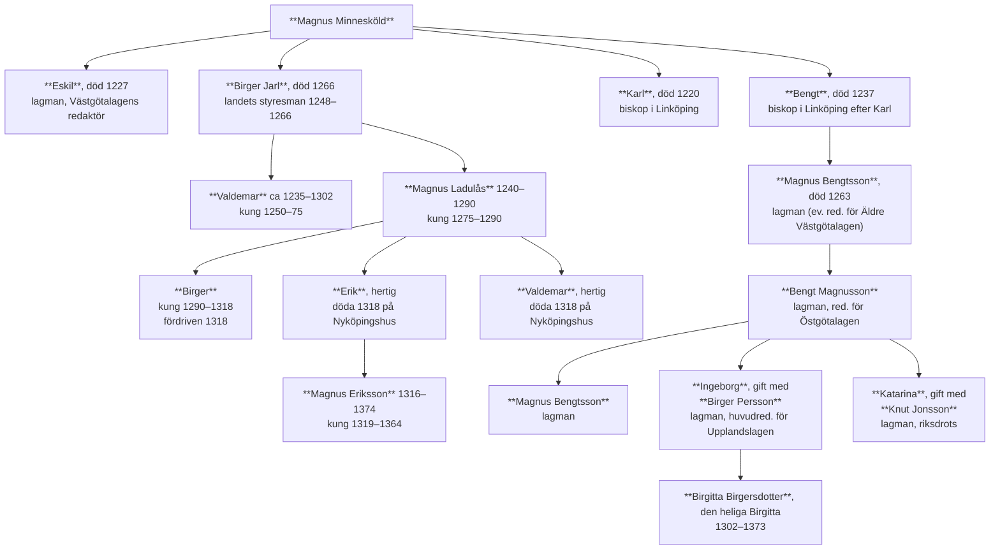

# Svenska språket under sjuhundra år
## En historia om svenskan och dess utforskande

*Gertrud Pettersson*  
(Studentlitteratur)

---

# Del 1. De äldre perioderna

## Kapitel 3. De gamla texterna, deras ursprungliga och sentida utformning

<!-- Sida 51 -->

Ljudupptagningar har ju inte varit möjliga förrän en bra bit in på 1800-talet, och därför utgörs det mesta av det material som språkhistoriker arbetar med av skrivna texter. Under en lång period av det svenska språkets historia är flertalet av de autentiska texterna svårtillgängliga i flera av detta ords bemärkelser: För det första är många av de gamla texterna skrivna med en skrift som inte är särskilt lätt att läsa för oss moderna människor; de allra äldsta är skrivna med runor, och långt in i nyare tid skrivs många texter för hand. Också tryckta texter kan ha en typografi som i flera avseenden avviker från det vi är vana vid och därigenom bli svårlästa för en modern publik. För det andra är originaltexterna svåra att få tillgång till; de förvaras kanske i något av landets forskningsbibliotek eller i något arkiv och får inte tas därifrån. För det tredje behandlar ofta texterna förhållanden som är okända för oss och därmed svåra att rätt förstå.

Inom dessa områden har det därför genom tiderna utvecklats språkvetenskapliga specialiteter: runologi, paleografi och filologi. Runologen sysslar med att tolka och beskriva runinskrifter och att sätta in dem i ett språkhistoriskt och kulturellt sammanhang. Paleografen är specialist på äldre tiders skriftformer och deras historia och har som huvuduppgift att åldersbestämma och tolka handskrifter samt att identifiera olika handstilar. Filologen sysslar med textutgivning, dvs. att göra äldre handskrivna texter tillgängliga för en modern publik genom att ge ut dem i tryckt form, samt med tolkning av äldre texter och beskrivning av deras språkliga form.

Även om man i en kort kurs i svensk språkhistoria inte har tid att fördjupa sig i något av dessa områden går det inte att helt lämna dem därhän. Runinskrifterna utgör våra allra äldsta språkliga minnesmärken, minnesmärken som dessutom fortfarande utgör ett viktigt inslag i land-

<!-- Sida 52 -->

skapet och som därigenom är av intresse för moderna människor. Både runor och andra, senare skriftformer är dessutom kulturhistoriskt intressanta. Textutgivning slutligen behöver man som språkhistoriestudent känna till en del om för att rätt kunna tolka och förstå de texter man konfronteras med. Det här kapitlet ska därför ge en introduktion till alla dessa tre områden.

### 3.1 Runor och runinskrifter

Frågan om runornas uppkomst och härstamning har varit föremål för mycket diskussion. Vad vi med säkerhet vet i dag är att runorna började användas senast ett eller ett par århundraden efter Kristi födelse och att de har inspirerats av något eller några av de klassiska alfabetena, det grekiska, latinska eller möjligen det etruskiska. Man har också anledning anta att de ursprungligen utformades för inristningar i trä. Något som tyder på det är att det inte finns några vågräta linjer – de skulle i så fall ha sammanfallit med träets fibrer och gjort tecknen otydliga. I stället består runorna av lodräta stavar med rundade eller snett uppåt- eller nedåtriktade bistavar.

Den äldsta runraden skapades alltså mycket tidigt och är en samgermansk företeelse. Den består av sammanlagt 24 tecken, varav en del företer tydliga likheter med tecken i de klassiska alfabetena. Ordningsföljden avviker emellertid radikalt från alfabetets. Runraden delades in i tre s.k. ätter, varav de inledande tecknen i den första har fått ge namn åt företeelsen: futhark. Den ser ut så här:

| 1:a ätten | | | | | | | | 2:a ätten | | | | | | | | 3:e ätten | | | | | | | |
| :---: | :---: | :---: | :---: | :---: | :---: | :---: | :---: | :---: | :---: | :---: | :---: | :---: | :---: | :---: | :---: | :---: | :---: | :---: | :---: | :---: | :---: | :---: | :---: |
| ᚠ | ᚢ | ᚦ | ᚨ | ᚱ | ᚲ | ᚷ | ᚹ | ᚺ | ᚾ | ᛁ | ᛃ | ᛈ | ė[^1] | ᛉ | ᛋ | ᛏ | ᛒ | ᛖ | ᛗ | ᛚ | ᛜ | ᛞ | ᛟ |
| **f** | **u** | **þ** | **a** | **r** | **k** | **g** | **w** | **h** | **n** | **i** | **j** | **p** | **ė** | **R** | **s** | **t** | **b** | **e** | **m** | **l** | **ŋ** | **d** | **o** |

Varje runa hade ett namn som började med det ljud som runan stod för (med undantag för ᛉ och ᛜ som aldrig förekom i uddljudsställning). F-runan hette sålunda \**fehu*[^2] 'boskap', a-runan \**ansuR* 'ås', 'gud' och j-runan \**jara* 'år'.

[^1]: Man vet inte säkert vilket ljudvärde denna runa har haft – möjligen något mellan [i] och [e]. För att skilja den från e-runan brukar man vid translittereringen skriva *ė*.
[^2]: När ett ord – som i detta och flera följande exempel – är försett med en stjärna, innebär det att något skriftligt belägg för just den formen inte finns, utan att formen är rekonstruerad (se avsnitt 2.1.3).

<!-- Sida 53 -->

Det finns över 300 bevarade inskrifter med den äldre runraden. De allra äldsta utgörs av ristningar på mindre föremål, t.ex. vapen eller smycken. Många av dem är korta och ännu inte tydda med säkerhet, men man tror att de innehåller namnet på föremålets ägare eller tillverkare eller beteckning för föremålet självt. Ett exempel är inskriften på det ena av de berömda s.k. Gallehushornen från ca 400 e.Kr.:

> **Ek HlewagastiR HoltijaR horna tawido**  
> *Jag Lägäst från Holt (eller Holtes son) gjorde hornet*

Runinskrifter på resta stenar finns bara i de nordiska länderna. De allra äldsta stenarna med den 24-typiga futharken är från 300–400-talen och finns i Norge och Sverige. Stenarnas inskrifter har inte alltid kunnat tolkas till fullo.

När vi kommer in i det som brukar kallas vikingatid, dvs. ca 800, har de nordiska språken genomgått en rad stora förändringar. Bl.a. har de fått flera nya ljud som gjorde det svårt att använda den gamla runraden. I inskrifterna från denna tid möter vi också en ny runrad. Märkligt nog har man där, i stället för att utvidga det gamla teckensystemet med nya tecken för dessa nya ljud, gått i rakt motsatt riktning och skapat en radikalt förenklad runrad: en futhark bestående av bara 16 tecken, den s.k. yngre runraden. Det finns påfallande få runinskrifter bevarade från övergångstiden, och hur och varför den nya futharken har kommit till och hur övergången mellan den och den gamla har gått till är fortfarande föremål för livlig diskussion runforskare emellan.

Den nya runraden förekommer i två varianter, normalrunor och kortkvistrunor:

| Typ | 1:a ätten | | | | | | 2:a ätten | | | | | 3:e ätten | | | | |
| :--- | :---: | :---: | :---: | :---: | :---: | :---: | :---: | :---: | :---: | :---: | :---: | :---: | :---: | :---: | :---: |
| **Normalrunor:** | ᚠ | ᚢ | ᚦ | ᚬ | ᚱ | ᚴ | ᚼ | ᚾ | ᛁ | ᛅ | ᛋ | ᛏ | ᛒ | ᛘ | ᛚ | ᛦ |
| **Kortkvistrunor:** | ᚠ | ᚢ | ᚦ | ᚭ | ᚱ | ᚴ | ᚽ | ᚿ | ᛁ | ᛆ | ᛌ | ᛐ | ᛓ | ᛙ | ᛚ | ᛧ |
| **Translitterering:** | **f** | **u** | **þ** | **ą** | **r** | **k** | **h** | **n** | **i** | **a** | **s** | **t** | **b** | **m** | **l** | **R** |

Till följd av ljudförändringar fick en del av runorna förändrat ljudvärde. Den gamla runradens a-runa och j-runa hade som vi sett namnen \**ansuR* respektive \**jara*. Dessa ord hade nu uttalat *as* (med nasalerat a) respektive *ar*. Detta fick till följd att den gamla j-runan kom att stå för ett a-ljud och att den nya runraden, trots sin sparsamhet med tecken, hade två a-tecken. I de flesta inskrifterna finns det dock en skillnad mellan dessa två a-runor. Den gamla a-runan betecknar oftast ett nasalerat a, medan den nya betecknar ett vanligt a-ljud.

<!-- Sida 54 -->

Det är normalrunorna som vi möter på de flesta runstenarna, och man kan anta att de företrädesvis användes för mer varaktiga minnesmärken. Till vardags däremot, då man ristade enklare meddelanden i trä, var det troligen kortkvistrunorna som kom till användning.

Den 16-typiga runraden var enklare att använda för ristaren: han behövde inte göra en så noggrann analys av ljuden i talräckan, utan ett och samma tecken kunde stå för flera olika ljud. Runan ᛏ fick således stå för både *t* och *d*, och runan ᛁ för både *i*, *e* och *ä*. Den nya runraden var däremot svårare att läsa. Trots detta är de flesta av de inskrifter vi har med denna nyare runrad betydligt lättare att tolka än de gamla inskrifterna. Det beror i första hand på att de har en bestämd funktion: de är oftast stenar som rests till minne av en avliden person. En annan orsak är att ristaren i allmänhet sätter ut tydliga skiljetecken mellan orden.

De allra flesta runstenarna är alltså ristade med denna nyare runrad. Totalt finns det i Sverige nära 3 000 inskrifter, de flesta från tiden ca 950–1100. Från början av vikingatiden har vi däremot bara ett fåtal stenar, dock en av de allra intressantaste. Det är en sten som nu står utanför Röks kyrka i Östergötland, den s.k. Rökstenen med världens längsta runinskrift, över 700 tecken (kortkvistrunor och en sorts lönnskrift, s.k. lönnrunor). Runorna är lättlästa och den text som finns där är tolkad, åtminstone på det språkliga planet. Det problematiska med Rökstenen är i stället hur dess innehåll ska tolkas. Inskriften är delvis utformad på vers, den fornnordiska versmåttet fornyrdislag, och den innehåller en rad anspelningar på längesedan försvunna hjältesagor och sånger.

För en allmän översikt av runor och runinskrifter se Jansson 1984, Moltke 1976 och 1985 samt Erikson & Strid 1991. Mer ingående presentation av enskilda ristningar ges i *Sveriges runinskrifter* 1900- och i Jacobsen & Moltke 1941–42 (inskrifter från det danska området, inkluderande de gamla danska provinserna Skåne, Halland och Blekinge).

Efter 1100-talet upphörde i stort sett seden att resa minnesstenar med runinskrifter. Under större delen av medeltiden användes dock runor i det vardagliga livet i Norden. I de flesta fall ristades de dock i trä, och det finns därför inte särskilt många sådana ristningar bevarade. En del fynd från Bergen visar att runorna bör ha varit ganska allmänt kända och brukade (se närmare Benneth m.fl. 1994).

<!-- Sida 55 -->

### 3.2 Handskriftsformer och tryckstilar

Det latinska alfabetet kom till Sverige med kristendomen – de äldsta bevarade dokumenten på svensk botten är några urkunder från 1160-talet skrivna på latin. Det är detta alfabet som alltsedan dess använts i landet, såväl i handskrifter som i tryck. Det innebär dock inte att de enskilda bokstäverna sett likadana ut genom tiderna. I den svenska skriftens historia kan man urskilja en rad olika stilar och därmed också bokstavsvarianter. Här är inte platsen för en mer ingående redovisning av dessa. I stället ska här ges en mer allmän beskrivning av den svenska skriftens historia. När det gäller de enskilda bokstäverna ska framställningen koncentreras till sådana drag i de medeltida handskrifterna som kom att få betydelse också i boktrycket.

Runorna ristades såsom redan framgått med någon form av verktyg i trä eller höggs in i sten. Med den latinska skriften kom inte bara ett nytt alfabet utan också nya redskap och nytt material. De allra flesta medeltida dokumenten är skrivna på pergament, dvs. specialberedda skinn av kalv, get eller får. Skinnen skars jämna i kanterna och linjerades med en pryl eller en penna. Man markerade också marginalerna. Därefter veks de och lades ihop till lägg för att utgöra en bok, en s.k. codex. Man skrev med fjäderpenna, vanligen av gås, och med bläck, oftast svart. Enligt en mycket gammal tradition skrevs överskrifter och varierande partier av textens inledning i stället med rött bläck. Därav kommer ordet *rubrik* (av latinets *ruber* 'röd'). Ofta lämnade skrivaren ett tomrum i texten för initialbokstaven för att den skulle utformas av en speciell rubrikskrivare. I en hel del handskrifter har dock denna initial aldrig blivit ifylld. För att hålla ordningen mellan bladen skrev man längst ner vid högermarginalen på varje sida en s.k. kustod, dvs. det första ordet eller den första stavelsen på följande sida. På 1300-talet började man också med någon form av sidnumrering. När codexen var färdigskriven bands den oftast in i ett träband, ibland överdraget med skinn.

Mot slutet av 1300-talet introducerades papperet i Sverige, vilket innebar något av en revolution i den svenska skrivkonstens historia. Visserligen dröjde det in på 1500-talet innan det startade en inhemsk papperstillverkning, men papper importerades snart flitigt från i första hand Tyskland. Tillgången på material att skriva på blev alltså radikalt förbättrad och kostnaderna för att anskaffa det minskade. Från och med 1400-talet skrevs många texter på papper i stället för på pergament.

<!-- Sida 56 -->


*Exempel på präntad skrift. Parti ur handskrift B 59, Äldre Västgötalagen.*  
*Källa: Corpus Codicum Suecicorum Medii Aevi, volym XII.*

> ### Transkription
> Far *maþær* af landi sætær brytiæ firi bo. sighir at han skal. gangæ til roms. þa skal bryti bo varþa til iamlangæ. sidan skal arvi varþæ. ok iki bryti længer num arvi uili. Far *maþær* af. landi. sytær huspreæ i bo. havir i knæ ok annat i kviþi. far cristindom vændir han hæl ok nakkæ at hemkynnum ok stighær fotum af fostær landi. þær skulu arvær væræ. er skyldasti. uaru hanum þa han heman for en han kombær eig æftær til hemkynnæ. Ingsins manss arv takær hæn mæn i girklandi sitær.  
> *(Bokstäver i kursiv är skrivna med någon form av förkortningstecken i handskriften.)*

> ### Översättning till modern svenska
> *(ur Holmbäck & Wessén 1946 s. 78)*  
> Far en man ur landet, sätter bryte för sitt bo, säger, att han ska gå till Rom, då ska bryten svara för boet under ett år. Sedan ska arvingen svara för det och icke bryten längre, om icke arvingen vill. Far en man ur landet, sitter hustrun i boet, har [ett barn] i knä och ett annat i kved, får det kristning, vänder han häl och nacke åt hembygden och stiger med fötterna från fosterlandet, då skola de vara hans arvingar, som voro honom mest närskylda, då han for hemifrån, om han icke kommer åter till hembygden. Ingen mans arv tager han, medan han sitter i Grekland.

<!-- Sida 57 -->

(För statistik se Åström 1993 s. 233.) Antalet nyproducerade texter kunde därmed öka kraftigt.

Papperet är intressant för språkforskare därför att det normalt försågs med s.k. vattenmärken, en tecknad figur, bokstäver eller ibland t.o.m. årtal som syns tydligt när papperet hålls upp emot ljuset. Vattenmärkena kan genom sin utformning hjälpa till att datera en handskrift, något som textfilologen har stor glädje av i sitt arbete.

De allra flesta svenska medeltida handskrifterna är skrivna med någon variant av den s.k. gotiska skriften. Den såväl som alla andra skriftformer förekom i två huvudvarianter: som präntad skrift, dvs. en skrift där de enskilda bokstäverna skrevs var för sig, och kursiv skrift, en skrift där bokstäverna bands ihop med varandra. Präntad skrift användes i första hand som bokskrift. Ett exempel på en sådan återfinns på föregående sida: ett parti ur Äldre Västgötalagen. Kursiven däremot användes både i böcker och i kortare mer tillfälliga texter, t.ex. brev. De allra flesta fornsvenska handskrifterna är tillkomna i klostret i Vadstena, och där utbildades under senare delen av 1300-talet den s.k. Vadstenakursiven, som egentligen är ett mellanting mellan pränt och kursiv, eftersom bara en del av bokstäverna bands samman. Se exempel på sidan 58.

Den gotiska stilen kännetecknas av smala, höga och kantiga, rentav brutna former, och skriften ger därför ett sammanträngt intryck. Det är utifrån den som de första boktryckarna modellerar sina bokstavstyper för trycket, och den gotiska handskriften får på det sättet sin fortsättning i tryck i den s.k. frakturstilen.

Som en reaktion mot den gotiska stilen uppstod under 1400-talet i Italien en ny skriftform, den s.k. humaniststilen som utmärktes av enklare, renare och mer rundade former. Upphovsmännen ansåg sig därmed ha återupplivat en gammal antik skrivform, och den nya stilen fick också benämningen antikva. Också den förekom som präntad och kursiv stil. Utmärkande för den kursiva stilen var, förutom att den hade sammanbundna bokstäver, att den lutade. Det är därifrån vi har fått den moderna betydelsen av ordet kursivstil. (Den engelska beteckningen *italics* vittnar om det italienska ursprunget.) Humanistantikvan utgör ursprunget till antikvastilen i boktrycket.

Både uppsättningen bokstäver och utformningen av dem i de medeltida handskrifterna avvek något från vad vi är vana vid. Dessutom var det vanligt att handskrifterna använde sig av förkortningar. En del av detta kommer till synes också i tryckta utgåvor av medeltida handskrif-

<!-- Sida 58 -->


*Exempel på Vadstenakursiv. Parti ur handskriften Codex Oxenstiernianus från 1380-talet.*  
*Källa: Svenska skriftprov från Erik den heliges tid till Gustaf III:s. Första häftet.*

---

<!-- Sida 59 -->

> ### Transkription till parti av Codex Oxenstiernianus
> han stodh a mot at søkia sina systor  
> Johannes abbas hafthe gudhlica systor. Hon lærthe han først at forlata vær-  
> linna fafængo oc giwas i klostir Han giorthe som hon rædh. ooc blef ii  
> clostreno fyra aar oc tiwghu. swa at han alrigh wt gik af thy. Oc søkte ey  
> sina systor ¶ Hon astundathe vmstthe mykit. at se han. Oc skreff hanom  
> ofta bref bidhiande han koma til sik at hon matte glædhias af hans nærværu  
> i guz kærlek Han nekathe oc vilde ey koma Hon skreff til hans anmantidh  
> sighiande. Um thu vilt ey koma til mic. tha scal iac ændelica koma til thiin  
> Johannes hørdhe thætta oc drøfthis mykit sighiande mz sik. Vm iac latir  
> hona koma til miin Tha koma oc flere mine frændir oc søkia mic Oc thy  
> vilde han hællir fara til hænna oc tok medhit sik twa brødhir af klostreno  
> Oc kom til sinna systors klostirs hws dør Oc badh høra pelagrima Hans  
> systir kom til thera mz andre gudz thienisto qwinno. oc kænde ey sin  
> brodhir. tho kænde han hona Oc talathe ey ordh at hon sculde ey vanlika  
> kænna han af røstinne Munkane som mz hanom waro badho gifwa sik vatn  
> at drikka Hon gaf them vatn oc the drukko Oc thakkatho gudhi oc hænne  
> Oc gingo atir til sit klostir Æfte nakra dagha skref hon atir til hans Oc badh  
> han koma til sik  
> *(Bokstäver i kursiv är skrivna med någon form av förkortningstecken i handskriften.)*

ter och i det tidiga boktrycket. Följande kan underlätta läsningen av sådana texter:

• Tecknet &lt;þ&gt; förekommer i texter fram till ca 1400. Det står för tonande eller tonlös dental frikativa (ljudet i engelskans *the* och *thing*). Därefter ersätts det av &lt;th&gt; eller &lt;dh&gt;.  
• Det finns två s-tecken: långt &lt;ſ&gt; och vanligt runt &lt;s&gt;. Det senare används normalt i slutet av ord. Det långa s-et är många gånger svårt att skilja från ett &lt;f&gt;.  
• Som tecken för dubbelt s förekommer ibland tecknet &lt;ß&gt; såsom i nutida tyska. Ursprungligen är det en sammanskrivning av tecknen för *s* och *z*.  
• Från början fanns i det latinska alfabetet inget &lt;u&gt; och inget &lt;j&gt;. I stället användes &lt;v&gt; och &lt;i&gt;. När så småningom *u*- och *j*-varianterna uppkom fick de inte någon egen klart avgränsad funktion, utan &lt;v&gt; och &lt;u&gt; respektive &lt;i&gt; och &lt;j&gt; kunde växla ganska oregelmässigt och stå för både vokalljud och konsonantljud.

<!-- Sida 60 -->

• Som beteckning för långt *i*-ljud används &lt;ij&gt;.  
• I frakturstilen har bokstaven *k* en utformning som skiljer sig mycket från vårt moderna &lt;k&gt;, främst därför att den saknar den nedre av det moderna *k*-ets bistavar: 𝔨  
• I de flesta tryckta utgåvor av handskrifter har utgivaren upplöst förkortningarna, dvs. skrivit ut hela orden. Detta markeras i utgåvan normalt med kursiv.  
• I tidigt tryck och i vissa handskriftsutgåvor finns en del förkortningar kvar. I Nya testamentet från 1526 har man t.ex. behållit det s.k. nasalstrecket, dvs. en nasal ersätts av ett streck över en föregående bokstav. Se utdraget ur NT nedan. Ett annat vanligt förkortningstecken som ofta finns kvar i utgåvorna är &lt;z&gt; som står för &lt;edh&gt; eller &lt;eth&gt;. I Pippings utgåva av Erikskrönikan skrivs således orden *med* och *thet* konsekvent *mz* och *thz*.

När man började trycka böcker i Sverige på 1500-talet fick man ta hjälp av boktryckare från Tyskland, i första hand från Lybeck. Detta fick till följd att det svenska boktrycket använde sig av frakturstilen (se utdraget ur NT 1526 nedan). Denna stil var dominerande i Sverige ända in på 1700-talet. Antikvan, dvs. den tryckstil som ligger till grund för de moderna typsnitten, användes inte i en hel bok på svenska förrän i en utgåva av den medeltida stadslagen år 1628. Därefter dröjde det in på 1700-talet innan den kom i mera allmänt bruk. Föregångare här var den år 1739 instiftade Kungliga Vetenskapsakademien som lät trycka sina handlingar med den betydligt mer lättlästa antikvan. Detta gick helt i linje med akademiens mål att sprida nya vetenskapliga rön till en bredare allmänhet för att befordra välstånd och utveckling. Mest konservativ var som i flera andra avseenden det religiösa trycket och lagtrycket. I dessa genrer förekom frakturstil in på 1900-talet.


*Exempel på tidigt boktryck. Parti ur Nya Testamentet 1526.*

> **Diplomatarisk text ur faksimilet:**  
> Swaradhe Jeſus och ſadhe / En man färdadhes nedh aff Jheruſalẽ  
> til Jerico / och kom j röffuara hender / och the dådde aff honõ och ſar-  
> ghadhe honõ / och gingo tädhan latãdis honõ liggia halff dödhan / Så  
> hende thet ſigh ath en preſt foor nedher ååt ſamma wäyen / och thå han  
> fick ſee honom gick han fram om honõ / Sammalunda och en ✶ Leuit  
> thå han kom til thet ſamma rwmet gick han fram och ſågh på honom /  
> och gick ſedhan fram om honom /

<!-- Sida 61 -->

### 3.3 Texter och textutgivning

År 1993 var det 200 år sedan Carl Jonas Love Almqvist föddes, och därför passade man i serien ”En bok för alla” på att ge ut en ny upplaga av några av hans mer kända skrifter, bl.a. berättelsen ”Det går an”. Så här inleds den texten:

> En skön torsdagsmorgon i juli månad strömmade mycket folk förbi Riddarholmskyrkan i Stockholm, och skyndade utför backen emellan Kammarrätten och Statskontoret, för att i rättan tid hinna ned till Mälarstranden, där ångbåtarna låg. Alla hastade till Yngve Frey, löpte in över landgången med snabbhet, ty tiden till avresan var redan slagen, och ångkaptenen kommenderade ”främmande från bord!”  
> De främmande tog därför ett kortvulet avsked av sina bortresande vänner och återgick på stranden. (s. 102)

Berättelsen ger uttryck för en syn på förhållandet mellan könen och på äktenskapet som är mycket före sin tid. För mer oskuldsfulla moderna läsare kan det ligga nära till hands att tro att Almqvist också språkligt var en banbrytare. Trots att texten har mer än 150 år på nacken är det som vi kan se ovan inte mycket som skiljer den från en text skriven i dag. Men det är en synvilla, för i själva verket såg den ursprungliga texten, den som trycktes år 1850, ganska annorlunda ut:

> En skön thorsdagsmorgon i julii månad strömmade mycket folk förbi Riddarholmskyrkan i Stockholm, och skyndade utför backen emellan Kammarrätten och Statskontoret, för att i rättan tid hinna ned till Mälarstranden, der ångbåtarne lågo. Alla hastade till Yngve Frey, lupo in öfver landgången med snabbhet, ty tiden till afresan var redan slagen, och ångkaptenen kommenderade ”fremmande från bord!”  
> De fremmande togo derföre ett kortvulet afsked af sina bortresande vänner och återgingo på stranden. (s. 150).

Vad utgivarna år 1993 har gjort är alltså att de har ändrat den ursprungliga textens stavning och böjning för att göra den mer lättillgänglig för den moderne läsaren. För den som i första hand läser texten för innehållets skull är denna modernisering säkert en fördel. Men för den som vill studera Almqvist ur ett språkhistoriskt perspektiv är den moderna texten vilseledande och därmed inte användbar som studieobjekt.

Texter kan alltså ha ändrats ganska avsevärt på sin väg från författare till läsare, och ju äldre texten är, desto fler varianter av den har tro-

<!-- Sida 62 -->

ligen producerats under tidernas lopp. Det är en sak som man måste vara mycket uppmärksam på när man studerar texter i ett historiskt perspektiv.

Alla texter fram till början av 1500-talet skrevs ju för hand, och det är fallet också med många intressanta texter från senare tider, t.ex. brev och dagböcker. För en modern läsare är sådana handskrifter ganska svåra att tyda. Det tillhör inte heller vanligheten att man som student möter en handskrift varken som original eller som kopia. Det stora flertalet av dessa texter är i stället utgivna i tryckt form i vad som brukar kallas en **vetenskaplig** eller **textkritisk utgåva**. Målet för en sådan är att göra den ursprungliga versionen rättvisa, dvs. att återge den så exakt som det rimligtvis går. Av en rad olika skäl är arbetet med att ge ut en gammal handskriven text med ett sådant mål ett ganska komplicerat företag, och textutgivning har därför blivit en språkvetenskaplig specialitet. Vad är det då som ligger bakom en vetenskaplig utgåva av en text? Vilka problem möter utgivaren och hur kan de lösas?

I alla tider har det naturligtvis funnits ett behov av att sprida texter till flera läsare. Före boktryckets tid var den enda möjligheten att åstadkomma detta att skriva av texten ord för ord. Vad som blir resultatet i en sådan situation är inte – såsom när det gäller tryckta texter – en exakt kopia. Den som skriver av för hand åstadkommer ofta, utan att själv vara medveten om det, en del avvikelser från förlagan: stavar annorlunda (speciellt eftersom det i äldre tider inte fanns någon fastlagd ortografisk norm), byter ut ord och fraser eller hoppar över ett mindre textparti, t.ex. genom att läsa fel vid radskiften. Att sådana fel lätt smyger sig in kan vi själva konstatera när vi ska skriva av något. Dessutom ändrar kanske avskrivaren ursprungstexten fullt medvetet genom att göra tillägg eller uteslutningar. En text kan alltså finnas bevarad i många olika handskrifter som skiljer sig ganska mycket från varandra.

I äldre tider var man inte heller särskilt angelägen om att bevara originalhandskrifter. Efter en tids flitig användning kunde förstås en handskrift bli ganska illa medfaren. Man såg då till att göra en avskrift och kunde därefter kasta bort det gamla slitna originalet. I de allra flesta fall har vi alltså helt enkelt inte kvar den allra första versionen av den gamla texten.

För att nå målet – att presentera den troliga ursprungsversionen av texten – måste utgivaren för det första försöka hitta alla de handskrifter som finns av texten i fråga och för det andra skapa sig en bild av deras

<!-- Sida 63 -->

status i förhållande till originalet. Viktigt att försöka utröna är t.ex. handskrifternas ålder, förhållande till varandra och deras allmänna pålitlighet. Ett sådant arbete ställer stora krav på noggrannhet och logisk slutledningsförmåga och resulterar i ett s.k. stemma, dvs. ett stamträd över hur handskrifterna förhåller sig till varandra. Ett exempel på ett sådant stamträd ges på s. 64.

Med hjälp av detta stemma kan utgivaren sedan komma fram till hur den ursprungliga texten bör ha sett ut. Det är sedan den som presenteras i den tryckta utgåvan. Det är dock ytterst sällan som fullständig säkerhet kan uppnås om den ursprungliga textens utformning. Därför förses utgåvan med en s.k. **textkritisk apparat**, dvs. upplysningar om vilka varianter som finns i de olika handskrifterna. Dessa upplysningar ges i fotnoter på varje sida och kan ta stort utrymme i anspråk (se exemplet s. 65). De ska i första hand ses som en redovisning till andra fackmän inom området om hur utgivaren gått till väga, t.ex. vilka ev. ändringar han har gjort för att ge texten mening och sammanhang och vilken grad av osäkerhet det finns i det förslag till text som han bestämt sig för. För nybörjaren inom det språkvetenskapliga området är notapparaten därför inte av något egentligt intresse.

Den som vill studera språket i texter som ursprungligen skrevs och kopierades för hand måste alltså vända sig till en textkritisk utgåva som är gjord med omsorg och noggrannhet. När det gäller fornsvenska texter är vi ganska väl försedda med sådana. De fornsvenska lagarna, alltifrån Äldre Västgötalagen (från ca 1280) till Kung Kristoffers landslag (från 1442) är utgivna i serien *Samling af Sweriges Gamla Lagar* (band 1–13) av juridikprofessorn Carl Johan Schlyter. Han arbetade under större delen av sitt liv med denna utgivning (det första bandet utkom 1827 och det sista 1877) och han får anses som en föregångare på området. Trots att det nu har gått över 100 år sedan serien avslutades betraktas hans utgåvor som utomordentligt pålitliga. Vetenskapliga utgåvor av fornsvenska texter i andra genrer återfinner man i *Samlingar utgivna av Svenska Fornskriftsällskapet*.

Även efter den fornsvenska tiden skrevs förstås texter för hand. Många sådana har senare kommit ut i textkritiska utgåvor. Några exempel ur detta mycket stora material kan anföras: Gustav Vasas registratur, dvs. de brev som skrevs (och kopierades för arkivering) i det kungliga kansliet under Gustav Vasas regeringstid, Agneta Horns *Beskrifning över min vandringstid* från ca 1660 (utgiven 1959 av Gösta Holm), dikten *Bröllops beswärs Ihugkommelse*, också den från

<!-- Sida 64 -->

1660-talet (utgiven 1970 av Bernt Olsson) och *Årstadagboken*, skriven under tiden 1793–1835 (utgiven 1946 av Sigurd Erixon, Arvid Stålhane och Sigurd Wallin).

När det gäller texter som redan från början publicerades i tryckt form är det i allmänhet den första utgåvan som man från vetenskapligt håll intresserar sig främst för. Många gånger är det dock svårt att få tillgång till en sådan, speciellt förstås när det är fråga om texter från 1500- och 1600-talen. Också i sådana fall finns **specialutgåvor** med vetenskaplig bakgrund att tillgå. En viktig serie att uppmärksamma är *Svenska författare utgivna av Svenska Vitterhetssamfundet* (SFSV). Såsom namnet antyder är den speciellt inriktad på utgivning av skönlitterära författares verk.

I utgåvor av de slag som nu nämnts finns normalt en rad intressanta upplysningar om texten vid sidan om den rent textkritiska apparaten. Utgivaren har oftast skrivit en utförlig inledning där bl.a. speciella drag i författarens språk och stil redovisas och kommenteras. Dessutom finns ofta en ordlista med förklaringar och kommentarer till enskilda textställen. För den som ska arbeta med att tolka en gammal text är förstås sådan information av stort värde.

En annan möjlighet att ge en modern publik tillgång till en gammal text i originalversionen är att framställa en **faksimilutgåva**, dvs. att göra en exakt fotokopia av originalet. Sådana utgåvor har gjorts, t.ex. av *Gustav Vasas Bibel* och av Linnés *Skånska resa*.


*Exempel på stemma. Ur Olsson 1970, s. LII.*

<!-- Sida 65 -->


*Exempel på textkritisk utgåva med text och notapparat. Ur Olsson 1970, s. 27.*

> ### Texturval ur *Bröllops beswärs Ihugkommelse*
> Gånger i Ruuß och Duuß bland fuchtige Bröder och Syſtrar[,]  
> Pungen åhr öde och tom, Crediten i Staden är ute[:]  
> 350 Måſte då fader och Mor i rad Richzdalerne töma[,]  
> Skieppa ſå fort dher uth, fylt pung, fläſk, Kläder och Oſtar[.]  
> Hwad will wara der af? Kan hända det Kan intet hielpa  
> Mer än Mannen med häſtar och Ook då plöijer i Sanden,  
> Sohnen är ey ſå from, han wjll föräldrarna tacka  
> 355 Och dem gifwa Beröm, för koſtnadt och ijdkelig omſorg.  
> Sådant och annat mehr finß det långt wore beſkrifwa,  
> Här utj Echta ſtånd, ſom Mannen och Huſtrune plågar  
> Och giör ſuckande[,] puſt, utpreßar de heteſte Tårar;  
> Ty blifwer och det Stånd, när man den möda betrachtar[,]  
> 360 Korß ſkohla[,] ſagt och tålemodz pröfning, ſom Gullet i Teſter,  
> Och faſt mehr än Guld, ty Gullet pröfwaß man en gång[,]  
>
> ---
>
> ### Textkritisk apparat (notapparat)
> **348** *Gånger* Gångar N, Gången H, Går han L G, *Ruuß* sus G. *Duuß* i duus L D. *fuchtige* fuchtiga L H, hurtige E. *Bröder* brödrar G.  
> **350** *Måste* Maste R. *då* saknas i D. *fader* Faar B A N L D G H C. *i* med G. *rad* Råd B. *Richzdalerne* Rexdalerne F, Rixdalerna B A E L D G C. *töma* domma B A, damma N K, dämma E L F D G H C.  
> **351** *Skieppa* Skicka A N, Stoppa G. *så fort dher uth, fylt* i uttömd G. — *dher uth, fylt* en upfyld L. — *uth* uti H C. *fylt* fyld B A N K E F D H C. *fläsk* fäsk F, inpacka fläsk G. *Kläder* kläde D. *Ostar* annat B A N.  
> **352** *wara* warda L, blifwa N₂; saknas i A N. *Kan hända* Törhända G. *intet* icke E.  
> **353** *än* än tå G. *Mannen* man A N L. *med hästar och Ook då plöijer* wille plöja med ök och hästar L. — *och* saknas i F. *Ook* öök B E D G H C. *då* tu K, will E, han G. *plöijer* plöija E, plågar K, plyer F.  
> **354** *wjll* weet B A N H C. *föräldrarna* föräldrarne A H, föräldrana K F.  
> **355** *dem* then B. *kostnadt* kåstnad A N L D G H C. *ijdkelig* idelig B.  
> **356** *finß det långt wore beskrifwa* som man ey hinner upräkna L. — *finß* saknas i G. *det* det nu F D G H C N₂, som K E. *långt wore* wore R, wore långt K F D C, woro långt E G H. *beskrifwa* att beskrifwa E F D G H C.  
> **357** *Här är* D, Fins L G, Går R. *stånd* sengh F D H C. *Mannen och* mennerne F, männerna D, tå männerna G. *Hustrune* hustruna L, hustrurna F D G, hustrun R E C. *plågar* plägar B, plåga D G H, pläga C.  
> **358** *utprebar* utpreber H, utpräba G, upprustar D. *de* saknas i D G H C. *heteste* hetaste E L F D G H C.  
> **359** *Stånd* standh F. *den* de L. *möda* mödo N, moda F. *betrachtar* betäncker D.  
> **360** *Korßskohla* Kors Schole C, Korsets schola L. *sagt* sampt B A N K E L F D G H C. *och* saknas i K E L F D G H C. *tålemodz* tålamodz B A N F L D G H C. *pröfning* bepröfning G. *Gullet* gulldet B K E. *Tester* Elden B A N K E L F D G H C.  
> **361** *mehr* mera F G. *Guld* gull L F. *Gullet* guldet A N K E. *pröfwaß* pröfwat B, pröfwes A L, bepröfwas F, pröfwar D G H C.

<!-- Sida 66 är tom versosida i originaltrycket -->

---

# 4 Före fornsvensk tid

<!-- Sida 67 -->

De allra flesta av de språk som talas i Europa i dag tillhör den indoeuropeiska språkfamiljen. Såsom framgått av kapitlet om vetenskapshistoria har denna grupp av språk stått i centrum för intresset hos språkhistoriker under lång tid, och det finns därför stora kunskaper samlade om språkgruppens historia och inbördes relationer. Vi har också sett att en grundtanke i mycket av den forskning som bedrivits är att de olika indoeuropeiska språken går tillbaka på ett gemensamt urspråk som en gång för flera tusen år sedan talades i ett relativt begränsat geografiskt område och att dess invånare sedan successivt spritt sig över Europa och delar av den asiatiska kontinenten. Det är ingen överdrift att påstå att så gott som all forskning som rör tidiga skeden av de indoeuropeiska språkens historia utgår från föreställningen att det har funnits ett urspråk, att detta efter hand har splittrats i olika dialekter och språkvarianter och att dessa så småningom gett upphov till de moderna nationalspråken. (Beträffande diskussionen om ett urspråk och den följande dialektsplittringen se närmare avsnitt 2.2.1)

Denna tanke innebär också att de olika indoeuropeiska språken är mer eller mindre nära besläktade med varandra. Med utgångspunkt från nedärvda likheter och förvärvade olikheter brukar man dela in den indoeuropeiska språkgruppen i följande olika grenar (jfr trädet s. 39):

* **indoiranska språk** (t.ex. persiska, kurdiska, hindi, urdu, romani)
* **keltiska språk** (t.ex. gaeliska, iriska, bretonska)
* **latinska språk** (främst latin, franska, italienska, spanska, portugisiska, rumänska)
* **baltiska språk** (litauiska, lettiska)
* **slaviska språk** (t.ex. polska, ryska, tjeckiska)
* **germanska språk** (t.ex. engelska, tyska, svenska)
* **grekiska**
* **albanska**
* **armeniska**

<!-- Sida 68 -->

Svenska språket tillhör som synes den germanska språkgruppen. I ett språkhistoriskt perspektiv brukar man dela in denna i tre olika undergrupper: östgermanska, västgermanska och nordgermanska (nordiska) språk.

Den **östgermanska gruppen** består av gotiska. Det var språk som talades av folkgruppen goterna som under de första århundradena av vår tideräkning hade sin hemvist i närheten av Svarta havet. Under medeltiden assimilerades goterna av andra folk och deras språk försvann. En variant har dock bevarats till eftervärlden genom den översättning av de fyra evangelierna som på 300-talet gjordes av en gotisk biskop vid namn Wulfila. Ett exemplar av den översättningen, den s.k. *Silverbibeln* som är en handskrift från 500-talet, finns i universitetsbiblioteket i Uppsala. Detta är det äldsta längre dokument som finns bevarat på något germanskt språk och ger förstås därför ett viktigt vittnesbörd om de germanska språkens tidiga historia.

De **västgermanska språken** utgörs av engelska, tyska, holländska, flamländska, frisiska samt afrikaans (den holländska som talas av boerna i Sydafrika) och jiddisch (de östeuropeiska judarnas språk). De **nordiska språken** är förutom svenska: danska, norska, isländska och färöiska. I den traditionella språkhistorien brukar de indelas i två undergrupper: de östnordiska språken svenska och danska och de västnordiska: norska, isländska och färöiska.

Denna indelning av de germanska språken baserar sig på historiska förhållanden och på sådana likheter och olikheter mellan de olika språken som man tror sig kunna finna genom systematiska jämförelser mellan tidiga varianter av dem. Också här har språkhistoriker länge utgått ifrån att det funnits ett gemensamt urspråk, i det här fallet en **urgermanska**, som under utvecklingens gång splittrats i olika varianter. En av dessa varianter skulle då utgöras av **urnordiskan**, som sedan i sin tur splittrades upp, först i en östnordisk och en västnordisk variant och därefter i dialekter som så småningom utgjorde grunden för de olika nationalspråken. Under senare tid har dock denna utvecklingsgång ifrågasatts (se närmare avsnitt 2.2.1). Det mesta som skrivits om dessa tidiga skeden utgår dock från att det verkligen funnits en urgermanska och en urnordiska, och därför är det mest praktiskt att även här använda den terminologin. Det här kapitlet ska alltså behandla några förändringar som inträffat under de germanska respektive nordiska språkens tidiga historia. (En fylligare och mer heltäckande beskrivning av utvecklingen under denna tid ges av Gun Widmark i *Det språk som blev vårt* (2001) kapitel 1 och 2.)

<!-- Sida 69 -->

## 4.1 Urgermanska

Vi ska här fokusera på fyra egenskaper som de germanska språken har gemensamt och som skiljer dem från övriga indoeuropeiska språk.

Redan de språkhistoriska pionjärerna upptäckte vissa systematiska skillnader mellan konsonanter i de germanska språken och övriga indoeuropeiska språk. De förändringar som givit upphov till dessa skillnader brukar i den svenska traditionen sammanfattas under beteckningen **den germanska ljudskridningen**. I anglosaxisk litteratur ger man i stället företeelsen namn efter en av pionjärerna och kallar den för *Grimms lag*.

Resultatet av den germanska ljudskridningen brukar beskrivas så här:

1. **Aspirerade klusiler tappar sin aspiration:**  
   *bh*, *dh*, *gh* > *b*, *d*, *g*
2. **Tonande klusiler blir tonlösa:**  
   *b*, *d*, *g* > *p*, *t*, *k*
3. **Tonlösa klusiler blir tonlösa frikativor:**  
   *p*, *t*, *k* > *f*, *þ*, *h*

Genom ljudskridningen uppstod det en rad systematiska olikheter mellan t.ex. de latinska språken och de germanska. En del av dessa olikheter kan vi urskilja än i dag. I de latinska språken har de ursprungliga klusilerna *b*, *d*, *g* och *p*, *t*, *k* behållits intakta. Det innebär att ord med gemensamt ursprung har *b*, *d*, *g* i t.ex. latin och franska men *p*, *t*, *k* (eller vidareutvecklingar av dem) i t.ex. engelska, tyska och svenska. Orden med ursprungligt *b* var mycket sällsynta i det gamla språket, så därför kan inga exempel ges på sådana, men när det gäller de övriga konsonanterna finns det rikligt med exempel:

* *duo*, *deux* motsvaras av *two*, *zwei*, *två*
* *decem*, *dix* motsvaras av *ten*, *Zehn*, *tio*
* *dens*, *dent* motsvaras av *tooth*, *Zahn*, *tand*

* *genu*, *genou* motsvaras av *knee*, *Knie*, *knä*
* *gena*, *joue* motsvaras av *chin*,[^4] *Kinn*, *kind*

* *pater*, *père* motsvaras av *father*, *Vater*, *fader*
* *piscis*, *poisson* motsvaras av *fish*, *Fisch*, *fisk*
* *pes*, *pied* motsvaras av *foot*, *Fuss*, *fot*

[^4]: Här har betydelsen av ordet ändrats – i dag betyder det som bekant 'haka'.

<!-- Sida 70 -->

* *tres*, *trois* motsvaras av *three*, *drei*, fsv. *þrīr*, nusv. *tre*
* *centum* (med k-uttal i latinet!), *cent* motsvaras av *hundred*, *Hundert*, *hundra*
* *cornu*, *corne* motsvaras av *horn*, *Horn*, *horn*
* *cor*, *coeur* motsvaras av *heart*, *Herz*, *hjärta*

När det gäller förändringen *bh*, *dh*, *gh* > *b*, *d*, *g* är skillnaden fortfarande systematisk men skyms till viss del av senare förändringar i de latinska språken. Där har *bh*, *dh* övergått till *f* och *gh* till *h*. Det innebär att ett latinskt *f* kan motsvaras av ett germanskt *b* eller *d* och att ett latinskt *h* motsvaras av germanskt *g*. Exempel på sådana paralleller finns det gott om:

* *fero* motsvaras av *bear*, (ge)*bären*, *bära*
* *frater*, *frère* motsvaras av *brother*, *Bruder*, *broder*
* *fores* motsvaras av *door*, *Tür*, *dörr*
* *hortus*, *jardin* motsvaras av *garden*, *Garten*, *gård*
* *hostis*, *hôte* motsvaras av *guest*, *Gast*, *gäst*

En annan förändring i de germanska språken gällde **accenten**. Språkforskarna brukar anse att huvudtrycket i indoeuropeiska ord kunde ligga på vilken stavelse som helst och att det också fanns en tonaccent. Det senare innebar att flerstaviga ord kunde skiljas åt enbart genom att de hade olika tonhöjdsförlopp (som t.ex. *and-en* och *ande-n* i den moderna svenskan). I de germanska språken är den gamla tonaccenten borta och det har utvecklats en **tryckaccent som läggs på ordets första stavelse** (utom i de fall då ordet har prefix).

Huvudtryck på en annan stavelse än den första är även i den moderna svenskan ett kännetecken på att ett ord är av icke-germanskt ursprung: *accent*, *musikalisk*, *konsonant*.

De specialutvecklingar i de germanska språken som vi hittills behandlat gäller ljudsystem och uttal. Men också inom böjningssystemet uppstod det germanska novationer. De germanska språken utvecklade sålunda en förenklad böjning av adjektiv, en s.k. **svag adjektivböjning**.

De två sätten att böja adjektiv har vi kvar i modern svenska: vi har stark böjning i obestämda nominalfraser (*en grön skjorta*, *ett grönt hus*, *två gröna cyklar*) och då adjektivet står predikativt (*skjortan är grön*, *huset är grönt*, *cyklarna är gröna*), och svag böjning i bestämda nominalfraser (*den/det/de gröna skjortan/huset/cyklarna*).

<!-- Sida 71 -->

Den fjärde och sista germanska novationen som ska behandlas här är den **svaga verbböjningen**.[^5] De germanska språken utvecklade nämligen ett förenklat sätt att böja verb i preteritum: man tillfogade ett suffix med en dental konsonant. Vid sidan om denna behölls dock gamla böjningssystem, t.ex. med avljud, som innebar en växling av stamvokalen. Sedan denna tid har vi alltså en svag verbböjning med ändelser (*kalla*, *kallade*, *kallat*; *köra*, *körde*, *kört*) och en stark med vokalväxling (*bita*, *bet*, *bitit*; *fara*, *for*, *farit*).

[^5]: Beteckningarna stark och svag böjning härstammar från Jacob Grimm, en av den historiska språkforskningens pionjärer. Termerna får nog uppfattas som värderande och ett uttryck för den tidens sätt att se på språket. Avljudsverben uppfattades som starka därför att de inom själva stammen kunde åstadkomma böjning. När termerna används om adjektiv- och substantivböjning står stark närmast för en böjning med många ändelser i kontrast till svag, som innebär att böjningen är förenklad.

## 4.2 Urnordiska

Under tiden från ca 500–ca 800 genomgick de germanska språken stora förändringar. En del av dessa är gemensamma, men resultatet blev ändå att språken i Norden alltmer avlägsnade sig från de andra germanska språken. Man brukar därför anse att det under den här tiden etablerade sig en språkvariant som kan kallas **urnordiska**.

En följd av placeringen av tryckaccenten på första stavelsen blev att obetonade vokaler föll bort. Sådant vokalbortfall kallas **synkope** eller, om det är sista ljudet i ordet som faller, **apokope**. Detta fick stora konsekvenser för orden i och med att antalet stavelser reducerades.

Bland annat innebar det att de vokaler som substantivstammarna slutade på och som ursprungligen hade utgjort deklinationskännetecken försvann. Några exempel:

* *fiskaR*[^6] > *fiskr*
* *rættiR* > *rættr*
* *galtuR* > *galtr*
* *horna* > *horn*

[^6]: Tecknet *R* står för s.k. palatalt r. Detta ljud förekommer bl.a. i nom.sg. mask. och är utvecklat ur ett indoeuropeiskt *-s*. Jfr latinets *hostis* som motsvarar urn. *gastiR*. (Se vidare s. 77).

I grammatiska beskrivningar av de nordiska språkens äldre skeden har man ändå alltid använt dessa försvunna slutljud som indelningsgrund för substantiven. När det i klassiker som Iversens *Norrøn grammatikk*

<!-- Sida 72 -->

(1955) och Wesséns *Svensk språkhistoria I* (nytryck 1992) förekommer beteckningar som *a*-stammar för ord av typen *fiskr* och *horn*, *i*-stammar för ord av typen *rættr* och *u*-stammar för ord av typen *galtr* är det dessa ursprungsvokaler som åsyftas. Men de försvann alltså före den fornsvenska tiden, och i beskrivningen av den fornsvenska grammatiken i den här boken används inte den terminologin.

De svagtoniga stavelserna reduceras också på ett annat sätt: slutljudande *-n* försvinner. I och med det uppstår en skillnad gentemot tyskan. Jfr tyskt *helfen* – svenskt *hjälpa*.

Under loppet av den urnordiska tiden sker också ett bortfall av initialt *j* och av *w* (framför rundad vokal). Därigenom uppstår systematiska olikheter mellan de nordiska språken och både tyskan och engelskan. Jfr tyskt *Jahr*, *Wort* och engelskt *year*, *word* – svenskt *år*, *ord*.

En annan genomgripande förändring är det s.k. **omljudet**. Omljud innebär att en trycksvag vokal (t.ex. *i*, *u*) eller halvvokal (t.ex. *j*, *w*) påverkar en föregående tryckstark vokal. Resultatet blir att de två ljuden får ett mer likartat uttal. Omljud förekommer i alla de germanska språken, fast i olika utsträckning och i olika former.

I de nordiska språken brukar man räkna med en rad olika typer av omljud. De som haft störst betydelse för svenskans del är **i- och j-omljudet**. Det verkar på både långa och korta vokaler på följande sätt:

| Omljud | Rekonstruerad urnordisk form | Fornsvensk form |
| :--- | :--- | :--- |
| **a > ä** | urn. \**lasian*[^7] | > fsv. *læsa* |
| **o > ö** | urn. \**domian* | > fsv. *døma* |
| **u > y** | urn. \**knutian* | > fsv. *knyta* |
| **iu > y** | urn. \**liusian* | > fsv. *lysa* |
| | urn. \**fastian* | > fsv. *fæsta* |
| | urn. \**fullian* | > fsv. *fylla* |

[^7]: När ett ord – som i detta och flera följande exempel – är försett med en stjärna innebär det att något skriftligt belägg för ordet i just den formen inte har kunnat återfinnas, utan att formen är rekonstruerad (se avsnitt 2.1.3).

Genom omljudet skapades nya vokalfonem: /ɛ/, /ø/ och /y/. Omljudet verkade samtidigt med synkopen och många av ändelsevokalerna försvann efter att ha åstadkommit omljud (så har som synes skett i alla exemplen ovan). I den moderna svenskan ser vi en rad av omljudets verkningar, både i ordböjningen:

* *hand* – *händer*
* *bok* – *böcker*
* *son* – *söner*
* *stor* – *större* – *störst*

<!-- Sida 73 -->

och i ordbildningen:

* *arv* – *ärva*
* *mot* – *möte*
* *van* – *vänja*
* *sur* – *syra*
* *tung* – *tyngd*
* *karl* – *käring* (ursprungligen *kærling*)

Omljudet innebar alltså att en tryckstark vokal fick ett ändrat uttal. Under den urnordiska tiden var det också en annan förändring som kunde drabba tryckstarka vokaler, nämligen den s.k. **brytningen**. Brytning i de nordiska språken innebär att ett kort tryckstarkt *e* bryts i två ljud:

* ***ia* (som senare oftast övergår till *iæ*[^8]) under påverkan av ett följande trycksvagt *a*:**  
  *eka* > *iak* > *jag*  
  \**herta* > *hiarta* > *hjärta*  
  \**geldan* > *gialda* > *gälla*

* ***io* under påverkan av ett följande trycksvagt *u*:**  
  \**erþu* > *iorþ* > *jord*  
  \**ferþu* > *fiorþ* > *fjord*  
  \**bernuR* > *biorn* > *björn*

[^8]: Om denna vokalförändring se s. 77.

Brytningen är en i huvudsak nordisk företeelse, och genom den uppstår tydliga skillnader, framför allt gentemot tyskan:

| Svenska | Tyska | Svenska | Tyska |
| :--- | :--- | :--- | :--- |
| *helfen* | *hjälpa* | *Herz* | *hjärta* |
| *eben* | *jämn* | *ich* | *jag* |
| *Erde* | *jord* | *stehlen* | *stjäla* |

Som vi sett på föregående sida försvinner i de nordiska språken de gamla initiala *j*-ljuden, men genom brytningen uppstår alltså ett initialt *j*-ljud i andra ord. Ett initialt *j*-ljud i ett ord i den moderna svenskan kan alltså inte vara inhemskt och nedärvt från urgermanskan. Däremot kan det vara ett resultat av brytning. I de flesta fall är det dock fråga om senare inlån (som i *jaga*, *jungfru* från tyskan, *jeans*, *jobb* från engelskan eller *juridik*, *januari* från latinet).

Efter synkopeperiodens slut utvecklas åtminstone i vissa av de nordiska språken åter en **tonaccent**: enstavighetsaccent (akut) och flerstavighetsaccent (grav). Det innebär att alla ord som utgick ur urnordiskan som enstaviga fick akut accent och alla övriga grav accent. Det mönstret har vi kvar än i dag i svenskan, även om det ibland skyms av senare förändringar. (Se t.ex. not s. 96).

<!-- Sida 74 -->

Alla de förändringar som hittills behandlats rör ljudsystemet. Men också på det morfologiska området uppstår nordiska novationer som skapar olikheter gentemot de andra germanska språken. Det rör sig om två fall av grammatikalisering, dvs. den process som innebär att ett självständigt ord övergår till att bli ett grammatiskt element. För det första utvecklar de nordiska språken en **efterställd bestämd artikel**. Denna var ursprungligen ett demonstrativt pronomen (*inn*) som placerades efter substantivet och så småningom smälte samman med detta (s.k. enklis). Långt fram under fornsvensk tid böjs också substantivet och slutartikeln var för sig: *fisks-ins* (se närmare om denna böjning i avsnitt 5.4).

För det andra skapas i de nordiska språken en **särskild s-form av verben**. Den uppstod genom att det reflexiva pronomenet *sik* eller dess dativform *sæR* tillfogades verbet enklitiskt och alltså gav verbet en reflexiv innebörd. Senare fick denna ändelse en passiv betydelse. I de västnordiska språken blir ändelsen *-sk* eller *-st*, i de östnordiska *-s*.

## 4.3 Från urnordiska till fornsvenska

### 4.3.1 Östnordiska och västnordiska

De förändringar av ljudsystemet som ägde rum under urnordisk tid genomfördes inte enhetligt över hela det nordiska språkområdet. Omljudet genomfördes i större utsträckning i väst, medan brytningen var vanligare i de östliga delarna av det nordiska språkområdet. Även en del andra förändringar tillkom, vilket medförde att man kan urskilja två huvuddialekter: östnordiska (Sverige och Danmark) och västnordiska (Island, Färöarna och Norge).

En ytterligare olikhet mellan de västnordiska språken och de östnordiska uppstod under senare delen av vikingatiden och gäller förekomsten av diftonger. I urnordiskan fanns diftongerna *au*, *ai*. Spår av dessa kan vi se ännu i en del av 1000-talets runinskrifter. I de östnordiska språken (svenska och danska) sker successivt en **monoftongering**, medan diftongerna kvarstår i Västnorden. Svenskans *öga*, *öra*, *sten* motsvaras således i t.ex. isländskan av *auga*, *eyra*[^9], *steinn*.

[^9]: *ey* här är ett resultat av i-omljud på *au*.

<!-- Sida 75 -->

Också **konsonantförbindelserna *nk*, *nt* och *mp*** behandlas olika i öst och väst. De assimileras i västnordiskan ganska konsekvent till långt *k*, *t* och *p*. Viss sådan assimilation sker också i Östnorden, särskilt av *nk* (jfr eng. och ty. *thank*, *Danke* – sv. *tack*), men i de flesta fall är nasalerna bevarade.

Naturligtvis följde inte dessa förändringar de nationsgränser som vi har i dag. Det är i stället fråga om tendenser som gör sig mer eller mindre starkt gällande i olika geografiska områden, och där man ofta kan urskilja skillnader mellan östliga områden och västliga. De olika nationalspråken börjar inte etablera sig förrän långt in på medeltiden, då en skriftspråksnorm så sakta börjar ta form.

Att det är fråga om dialektala olikheter visar sig tydligt än i dag. I vissa svenska dialekter finns de ursprungliga diftongerna kvar: på Gotland, i Österbotten, Åboland och Nyland, i övre Norrland och i de delar av Jämtland och Härjedalen som gränsar mot Norge. De diftonger som i dag finns t.ex. i delar av Sydsverige är däremot senare utvecklade, s.k. sekundära diftonger. (Se mera därom i dialektkapitlet.)

I västliga svenska dialekter förekommer assimilerade former där riksspråket har bevarade nasaler: *klätt* – *klint*, *bratt* – *brant*, *kröppling* – *krympling* med något differentierat betydelseinnehåll: *svamp* – *sopp*, *klimp* – *kläpp*, *kamp* – *kapp*.

### 4.3.2 Danska och svenska

Enligt den traditionella modell för de nordiska språkens framväxt som vi här följer har vi alltså under loppet av vikingatiden fått markanta språkliga skillnader mellan språken i de östliga delarna av Norden – Danmark och Sverige – och de övriga nordiska språken. Under början av medeltiden sker en rad novationer inom det danska området som gör att danskan alltmer skiljer sig både från svenskan och från övriga nordiska språk. De viktigaste är följande tre:

Ursprungligen fanns det i de nordiska språken tre olika **ändelsevokaler**: *i*, *u* och *a*. Svenskan bibehåller denna tredelning, i varje fall i de dialekter som kom att ligga till grund för riksspråket (även om *i* och *u* där sedermera övergår till *e* och *o* – se närmare avsnitt 6.3.2, slutet). I danskan däremot får alla ändelser ett försvagat uttal: [ə], i skriften tecknat som <e>. Skillnaden mellan danska och svenska kan illustreras av följande moderna skriftspråksformer:

<!-- Sida 76 -->

da. *tanke*, *skåren* — sv. *tanke*, *skuren*  
da. *hjerner*, *gaver* — sv. *hjärnor*, *gåvor*  
da. *hjerne*, *gave*, *orke*, *otte* — sv. *hjärna*, *gåva*, *orka*, *åtta*

En annan förändring rör **uttalet av *p*, *t*, *k* efter lång betonad vokal** (som i nusvenskt *gripa*, *bita*, *leka*). I danskan får dessa konsonanter först ett tonande uttal och därefter övergår de till frikativor. I ortografin är det dock bara den första förändringen som manifesteras: *gribe*, *bide*, *lege*. (Se dock dialektkapitlet om en liknande utveckling i Sydsverige.)

Vi såg ovan att (åtminstone vissa av) de nordiska språken tidigt utvecklade en tonaccent, dvs. en skillnad i uttalet mellan akut och grav accent (som i nusvenskans *and-en* och *ande-n*). I danskan utvecklades i stället (eller möjligen i ett senare skede ur tonaccenten) den specifikt danska företeelse som går under beteckningen **stöt** (**stød**). Denna beskrivs så här ur ett fonetiskt perspektiv av Claes Christian Elert (1995 s. 80):

> I danskan förekommer ett laryngalt ljud inuti vissa ord [...]. Det bildas genom att stämläpparna närmas ofullständigt till varandra, vilket medför en oregelbundenhet i stämbandsvibrationerna. Endast sällan blir det en fullständig laryngal klusil.

Något förenklat kan man säga att enstaviga ord, som ju i svenskan fick akut accent, i stället fick stöt i danskan. Orden *mand*, *hus*, *sten* har alltså stöt, medan orden *kone*, *have*, *stene* inte har det.

Precis som när det gäller tidigare utvecklingar är det viktigt att ha klart för sig att de språkliga novationerna inte följde några moderna nationsgränser. Detta faktum sammanfattas på ett bra sätt av Pamp (1971, s. 63):

> Det östnordiska området innehåller, liksom f ö det svensk-norska, ett system av dialekter som på olika sätt övergår i varandra. Ingenstans kan man på grundval av dialekterna dra en bestämd gräns mellan två huvudområden, ett svenskt och ett danskt. Målen på ömse sidor om den riksgräns som gällde fram till 1658 har väsentliga drag gemensamma, liksom skånska mål delar många viktiga dialektutvecklingar med de danska ömålen. Att vi har fått två östnordiska riksspråk beror på politiska faktorer: det fanns två riken i Östnorden, och de politiska centra i dessa låg så långt från varandra att de normgivande målen i dessa centra uppvisade inte oväsentliga skillnader.

<!-- Sida 77 -->

### 4.3.3 Runsvenska

Trots att några mer markanta skillnader mellan danska och svenska inte börjar uppträda förrän ganska sent i historien (se föregående avsnitt) brukar man använda begreppet ”svenska” om det språk som användes i delar av det nuvarande Sverige redan ca 800. Från de första århundradena efter 800, från den s.k. runsvenska perioden, har vi emellertid ytterst lite material att tillgå. Det rör sig om runinskrifter – visserligen många men med lite text och ett ganska stereotypt innehåll. De flesta runstenarna från denna tid är ju minnesinskrifter.

Några av de viktigare förändringar som äger rum i språket under den runsvenska tiden har nyss behandlats, och här ska endast göras ett par kompletteringar.

Den första gäller det ljud som hade utvecklats ur ett gammalt tonande *s* och som brukar skrivas *R*. Det kallas för ”palatalt r” (även om ingen med riktig säkerhet kan uttala sig om det verkliga ljudvärdet), och det förekom i en rad olika böjningsändelser, både hos substantiv, adjektiv och verb. Under loppet av den runsvenska tiden försvinner detta palatala r. I vissa former övergår det till vanligt r-ljud, i andra former försvinner det. I utvecklingen av det palatala r-et uppstår det också dialektala olikheter (se s. 217). Det skiftande uttalet gör att *r* i ändelser ofta sätts inom parentes i böjningsparadigm (se nästa kapitel, t.ex. s. 100–107).

Den andra förändringen gäller det *ia* som uppkommit genom brytning (se s. 73). Det övergår till *iæ* – det är det konsonantiska i-ljudet som åstadkommer en form av omljud på den följande vokalen, och företeelsen brukar därför kallas ”progressivt j-omljud”[^10]:

* *hiarta* > *hiærta*
* *gialda* > *giælda*
* *iamn* > *iæmn*
* *stiala* > *stiæla*

[^10]: Senare – under den fornsvenska tiden – uppstår liknande omljud också i en del ord där det konsonantiska i-et följs av långt *a* och kort och långt *o*:  
*sial* > *siæl*  
*biorn* > *biørn*  
*miolk* – *miølk*  
*sior* > *siø*

<!-- Sida 78 är tom versosida i originaltrycket -->

---

# 5 Den klassiska fornsvenskan

<!-- Sida 79 -->

Den kronologiskt hållna beskrivning av det svenska språkets historia som ska ges i detta och nästa kapitel startar med en period som sträcker sig från ca 1225 och fram till ca 1375. Den brukar kallas klassisk fornsvenska. Benämningen *klassisk* motiveras av att språket då var förhållandevis stabilt och att det fornärvda ljud- och formsystemet fortfarande kan anses vara tämligen intakt.

I ärlighetens namn måste man dock erkänna att vår direkta kunskap om språket under större delen av 1200-talet är bristfällig. I stort sett är de enda texter vi har kvar från detta århundrade ett par handskrifter av en av landskapslagarna, Västgötalagen. Den första är bara ett fragment – två blad – och brukar dateras till någon gång mellan 1225 och 1250. Den andra är en så gott som fullständig version av lagen och är tillkommen på 1280-talet.

Under första halvan av 1300-talet blir dock materialet rikare (se mera därom i nästa avsnitt). Den som utger sig för att beskriva den klassiska fornsvenskan stöder sig alltså i första hand på texter som är tillkomna från ca 1300 till ca 1375. Det här kapitlet ska behandla tillståndet under denna period och ge en synkronisk beskrivning av det språk som återfinns i handskrifterna. När det i fortsättningen av detta kapitel talas om fornsvenska är det alltså denna tid som det handlar om. (Om språk och litteratur under denna period se även Widmark (2001), kapitel 3.)

Det kan inte förnekas att det uppstår en del svårigheter för den som i dag vill ta del av innehållet i en fornsvensk text. Dessa svårigheter kan hänföras till alla nivåer i språket. Det som först ställer till problem för den moderne läsaren är troligen att den fornsvenska texten har en så annorlunda stavning än den moderna. Den kan till och med använda bokstäver som vi inte är bekanta med från den moderna svenskan. Det är också ofta så att ett och samma ord kan stavas på lite olika sätt i samma text. Allt detta gör att många av orden i texten blir svåra att känna igen även om de skulle återfinnas i dagens svenska och således

<!-- Sida 80 -->

vara bekanta för den moderne läsaren. En annan orsak till svårigheter kan förstås vara att den fornsvenska texten innehåller ord som inte längre används eller ord som hade en annan betydelse när texten skrevs än vad de har i dag.

En tredje orsak är att den fornsvenska grammatiken i flera avseenden avviker från den nusvenska. Fornsvenskan har ett rikt böjningssystem och liknar på det sättet den moderna tyskan. I den klassiska fornsvenskan är substantivets artiklar ännu inte fullt utbildade. Sålunda saknas både obestämd och bestämd fristående artikel. Ordföljden avviker också på flera punkter från den moderna. Genom att systemet av konjunktioner och subjunktioner ännu är ganska outvecklat kan det vara svårt för en modern läsare att få grepp om hur meningar hänger ihop i den fornsvenska texten.

Det är en genomgående strävan att försöka visa vilka likheter och olikheter det finns mellan klassisk fornsvenska och modern svenska, och därför utgår ofta beskrivningen från det som är känt för läsaren, dvs. den moderna svenskan.

Beskrivningen av språket kommer att koncentreras på sådana förhållanden som har med det fornsvenska språkliga systemet att göra: fonologiska, ortografiska, morfologiska och syntaktiska. De lexikaliska olikheterna mellan fornsvenska och modern svenska går det förstås inte att ge en översikt av. När man möter ord som man inte förstår i en fornsvensk text måste man gå till en ordbok (vilka de är och hur de är upplagda beskrivs i det sista kapitlet i denna bok). Däremot är det möjligt att ge en översiktlig bild av hur det fornsvenska ordförrådet var sammansatt och vilka tekniker som användes för att skapa nya ord. En sådan inleder beskrivningen av det fornsvenska språket. Allra först ska vi dock se lite mera i detalj på källor och kommunikationsförhållanden under början av 1300-talet.

## 5.1 Källor och kommunikationsförhållanden

Såsom framgått ovan är 1300-talet det första århundrade som kan erbjuda den sentida forskningen ett mer rikhaltigt svenskt material att studera från språkliga utgångspunkter. Sett i ett modernt perspektiv är förstås textproduktionen utomordentligt blygsam. Patrik Åström har i en uppsats 1993 redovisat statistik över det bevarade fornsvenska bok-

<!-- Sida 81 -->

beståndet.[^11] Antalet böcker är under hela 1300-talet inte fler än 70 stycken. Hela 45 av dessa är dessutom tillkomna under tiden 1370–1400 och hör alltså egentligen inte hemma i den period som här ska behandlas.

[^11]: Begreppet 'bok' definierar Åström så här: ”Med bok avses här varje bok eller bokfragment som har ett eget signum i den samling som den eller det tillhör” (s. 230).

I detta material är dock flera olika genrer företrädda. Den mest välrepresenterade är lagtexter. Från första halvan av 1300-talet finns handskrifter av alla landskapslagarna: Östgötalagen, en del av Smålandslagen, Södermannalagen, Västmannalagen, Upplandslagen, Hälsingelagen och Dalalagen samt Gutalagen (som gällde på Gotland). Också Skånelagen är från denna tid. Eftersom Skåne vid denna tid tillhörde det danska riket brukar den dock aldrig beaktas i beskrivningen av det fornsvenska språket. Vid sidan om landskapslagarna finns det också en del handskrifter av lagregler för städer, i första hand den s.k. Bjärköarätten som var gällande lag bl.a. i Stockholm.

Under början av 1300-talet stärktes kungamakten, och riket fick på det sättet en mer centraliserad styrelse. Vid mitten av 1300-talet var tiden mogen att ge landet en mer enhetlig lagstiftning. Då skapades en lag som skulle gälla hela den dåtida svenska landsbygden, Magnus Erikssons landslag, och en lag som skulle gälla de svenska städerna, Magnus Erikssons stadslag. De äldsta bevarade handskrifterna av dessa är från ca 1350 respektive ca 1375.

Lagarna är en genre med inhemska rötter. En annan genre inom det juridiska fältet är urkunder av olika slag, s.k. diplom. Sådana skrevs ursprungligen på latin, men fram emot mitten av 1300-talet börjar man också författa dem på svenska. Från den här aktuella tiden har vi således en del testamenten, gåvobrev och andra typer av avtal bevarade.

Förutom laghandskrifterna har vi också från första halvan av 1300-talet en stor handskrift, den s.k. Codex Bureanus (uppkallad efter Johannes Bureus, ”vår förste språkforskare”, som spårade upp och tog hand om den på 1600-talet). Den består av en samling legender, översatta till svenska från latin. Dessutom finns ett par blad där den heliga Birgitta själv skrivit ner uppenbarelser. Det är alltså representanter för en annan viktig medeltida genre, den religiösa prosan. Ytterligare en text inom denna genre tillkom under den klassiska fornsvenska tiden, nämligen den s.k. Pentateukparafrasen. Det är en fri översättning och bearbetning

<!-- Sida 82 -->

av de fem Moseböckerna i Gamla Testamentet. Den är dock bevarad till eftervärlden i handskrifter av senare datum.

Under den aktuella tiden producerades också texter av annat slag, texter som vi dock bara har kvar i senare versioner. En sådan är den s.k. *Konungastyrelsen*, en politisk läroskrift efter kontinentalt mönster av ett slag som brukar gå under beteckningen furstespegel. Sådana var enligt Carl Ivar Ståhle (1955 s. 81) ”läroböcker med väsentligen etiskt och politiskt program, närmast avsedda för blivande regenter och ofta utformade som avhandlingar i statslära”. Den här aktuella svenska texten får av Ståhle ett mycket positivt omdöme: ”ett verk som präglas av levande lärdom, praktisk klokhet och estetiskt högtstående stilkonst”. Den anses ha varit avsedd för kung Magnus Eriksson och skrivits i anslutning till hans myndighetsdag år 1332. Vi har den dock enbart bevarad i en tryckt version från 1600-talet, utgiven av Johannes Bureus (utg. i Svenska Fornskriftsällskapets samlingar 1964 av Lennart Moberg).

Slutligen tillkommer också under 1300-talet en rad profana diktverk på svenska. Det är i första hand de tre s.k. *Eufemiavisorna*: ”Ivan lejonriddaren”, ”Hertig Fredrik av Normandie” samt ”Flores och Blanzeflor”. De tillhör en genre som brukar kallas roman breton, riddarromaner, och som utformades vid franska furstehov vid mitten av 1100-talet och snabbt blev modern i Europas överklass. Eufemiavisorna har sitt namn efter den norska drottningen Eufemia, som anses ha låtit översätta dem, troligen från tyska, i början av 1300-talet åt sin blivande svärson, den svenske hertigen Erik. Samme hertig Erik är huvudperson i ett inhemskt exempel inom samma genre från första halvan av 1300-talet, nämligen *Erikskrönikan*. Den är en beskrivning av Sveriges historia från Birger Jarls makttillträde vid mitten av 1200-talet till Magnus Erikssons kröning år 1319. Krönikan är precis som Eufemiavisorna skriven på knittel, dvs. på en parvis rimmad vers med fyra höjningar i varje versrad men med obestämt antal obetonade stavelser. Den omfattar över 4 500 versrader. Tyvärr har vi inte heller kvar dessa texter i några riktigt tidiga handskrifter. Den kunskap de kan lämna om språket under 1300-talet är alltså begränsad.

Med undantag för lagarna är det som vi har sett utländska förebilder, i första hand på latin, som i olika grad har varit aktuella för de svenska skribenterna. Lars Wollin har dock i en uppsats (1994 s. 5) påpekat att dessa skribenter knappast har agerat som översättare i vår moderna mening. Så här beskriver Wollin situationen med utgångspunkt från Fornsvenska legendarjet, Pentateukparafrasen och Konungastyrelsen:

<!-- Sida 83 -->

Lärda filologer och litteraturhistoriker har verkligen i flera fall lyckats identifiera latinska texter som ligger bakom till exempel de nämnda fornsvenska verken (eller åtminstone de viktigare texterna; ofta har ju den medeltida bearbetaren skattat flera latinska källor för samma fornsvenska text). Men forskarna har saknat hävdvunna kategorier för adekvat karakteristik av litterära produkter i medeltidens vidsträckta gränsland mellan originalproduktion och översättning. Vår tids klara demarkation mellan dessa produktionsformer är ju ideologiskt grundad i senare tankemönster, bland annat hämtade i romantikens originalitetskult och i moderna upphovsrättsföreställningar. Sådant bekymrade inte de glada berättarna bakom högmedeltidens rafflande legender och parafraser ur Moseböckerna. Lika litet angick det den lärde och stilistiskt sparsmakade världsman som ville bidra till den unge Magnus Erikssons uppfostran med en svensk furstespegel som *Konungastyrelsen*.

I alla dessa fall hade skribenten tillgång till utmärkta förlagor. Dem läste han på latin, i lagom tillmätta portioner, och sedan berättade han fritt på svenska vad han läst.

Ett liknande parafrasmakeri, ofta av ännu friare slag, ligger nog bakom den världsliga, franskt och tyskt inspirerade epiken på prosa och i knittelpoesi, företrädd bland annat av verk som *Eufemiavisorna* och *Erikskrönikan*. Deras självklara hemhörighet i en europeisk hövisk kröniketradition tar sig uttryck, förutom i det chevalereska motivvalet, mera i allmän formimitation än i direkt översättning.

Det första exemplet i den svenska språkhistorien på verklig översättning möter vi inte förrän i texter som närmast hör hemma i nästa period, i den yngre fornsvenskan. De texter det gäller är *Birgittas uppenbarelser*. Till dem får vi anledning återkomma i nästa kapitel.

Ett par intressanta påpekanden om 1300-talets svenska samhälle kan göras på basis av vår kunskap om de texter som här har behandlats. För det första kan man konstatera att den svenska kulturen och därmed också det svenska skriftspråket redan mycket tidigt utsatts för impulser utifrån, från den kontinentala kulturen och från det språk som framför alla andra var det gemensamma kulturspråket: latinet. En starkt bidragande orsak till detta var naturligtvis att Sverige vid denna tid var ett katolskt land och därigenom en visserligen perifert belägen men dock integrerad del i den kulturella gemenskap som den katolska kyrkan utgjorde.

För det andra visar texterna och deras tillkomst mycket tydligt vilket oerhört tunt skikt av den svenska befolkningen som vi på det här sättet kommer i kontakt med. Den tid vi nu behandlat har av eftervärlden fått

<!-- Sida 84 -->

namnet folkungatiden efter den ätt som hade den politiska makten. Nedan återges ett stamträd med några viktiga personer inom denna stora familj inritade. Vi kan där se att alla de makteliter som kan ha varit aktuella i den tidens samhälle och därmed också på ett eller annat sätt haft med de skrivna texterna att göra är väl representerade. Till folkungarna hör således inte bara landets politiska styresmän alltifrån Birger Jarl till Magnus Eriksson utan också en rad ledande representanter för den lagstiftande makten, dvs. lagarnas redaktörer. Där finns också biskopar, alltså representanter för den kyrkliga makten, och som kronan på verket 1300-talets mest framträdande kulturpersonlighet: den heliga Birgitta. Av de texter som här presenterats är dessutom flera tillkomna mer eller mindre direkt för familjens politiska maktinnehavare. Så är fallet med *Eufemiavisorna*, *Erikskrönikan* och *Konungastyrelsen*.


*Folkungaätten – en maktelit under medeltiden.*



<!-- Sida 85 -->

## 5.2 Ordförråd

### 5.2.1 Allmänt om ordförrådets förändring

Ordförrådet, lexikonet, är den del av språket som lättast drabbas av förändring. En del ord kommer ur bruk och kan så småningom försvinna helt, nya ord skapas och kan bli dagsländor eller få fast hemvist i språket. Denna rörlighet i ordförrådet har en rad olika orsaker.

Ordet är som bekant ett språkligt tecken bestående av två beståndsdelar: en innehållsdel och en uttrycksdel. En grundläggande orsak till förändringar i ordförrådet har att göra med människans natur: hon är nu en gång så funtad att hon vill kunna tala om den verklighet som hon på ett eller annat sätt tycker sig kunna urskilja eller uppfatta. Om hennes språk inte erbjuder några tillräckligt smidiga uttrycksmedel är hon benägen att nyskapa. En ny innehållslig föreställning kombineras med ett nytt uttryck, och därmed har ett nytt ord uppstått. Detta fundamentala uttrycksbehov kan förstås också få andra resultat. Föreställningar som inte längre har någon relevans för språkbrukarna behöver inte något språkligt uttryck: hela det språkliga tecknet försvinner. Man skulle alltså kunna säga att det finns en psykologisk beredskap för förändringar av ordförrådet. Den värld vi lever i ger oss också ständigt orsak till att aktualisera denna beredskap: den förändras ständigt och därmed förändras också de ord som vi behöver för att kunna tala om denna värld.

Vid en jämförelse mellan klassisk fornsvenska och modern svenska är det förstås inte alls svårt att hitta exempel på de allmänna mekanismer som behandlats ovan. Många ord i de medeltida lagarna t.ex. betecknar företeelser som var aktuella för den tidens människor men som inte är det för oss. För att kunna förstå uttrycket måste vi därför ge en relativt omfattande beskrivning av innehållet: *bolby* 'den egentliga byn som utgjordes av de särskilda tomterna med därtill hörande bestämda andelar i byns ägor', i motsats till *umiorþ* 'jordstycke som någon äger utom sin andel i byns gemensamma ägor', *brøþlungi* 'kusin på fädernet', *kolnohus* 'torkhus för malt', *stappa* 'en tung träkloss som gillras upp på ett sådant sätt att den faller ner och dödar det djur som kommer in under det', *vaþ* 'upptrampad rågång mellan ängslotter'. En hel del ord i de äldre texter man möter i de språkhistoriska studierna är av det slaget: de kan inte översättas, de måste förklaras.

När det gäller nybildning behöver vi inte gå särskilt långt bakåt i tiden för att hitta exempel. Ett talande bevis för det är den lilla ordboken *Från*

<!-- Sida 86 -->

*rondell till gräddfil* som presenterar över 7 500 nya ord som kommit till under perioden 1945–1985. Några slumpvis valda exempel ur den ger en god bild av förändringar i det svenska samhället under efterkrigstiden: *akryl, charterturist, dialys, fritidshem, impulsköp, kebab, landstingsråd, offpiståkning, rymdpromenad, tajt* och *yrkesskadeförsäkring*.

En förändring i ordförrådet behöver dock inte innebära att båda beståndsdelarna i det språkliga tecknet försvinner eller nyskapas. Ibland kan det i stället vara så att en av dessa delar förändras, medan den andra kvarstår mer eller mindre oförändrad. Speciellt vanligt är det att innehållsdelen förändras, eller som vi säger i dagligt tal att ett ord får en ändrad betydelse. *Flærþ, landsþing, þiggia* är ord som vi kan återfinna i den fornsvenska lagen. De har dock där en helt annan innebörd än vad deras moderna motsvarigheter *flärd, landsting, tigga* har i dag. På fornsvensk tid betydde de: 'förfalskning', 'ting som hölls med ett helt landskap', 'ta emot'. En orsak till att äldre texter kan vara svåra att förstå är just sådana betydelseförändringar. En kontroll av äldre betydelser i en historisk ordbok kan lösa många besvärliga knutar vid tolkningen av en text.

Också uttrycket, ordets yttre form, kan förstås ändras genom tiderna, medan innehållet kvarstår oförändrat. I de flesta fall är det dock fråga om systematiska förändringar som drabbar alla ord av en viss typ eller alla ljud i en viss omgivning. Sådana förändringar behandlas i den här boken i de ljudhistoriska och ortografiska avsnitten. Men det förekommer också att uttrycket får en ny gestalt som inte har med sådana systematiska förändringar att göra. Ett par exempel på det är prepositionen *å* som blivit *på*, och pronomenet *I* som blivit *ni*. Båda dessa ord är exempel på att språkbrukarna missförstått ett uttryck. Ordet *å* stod ofta i kontexten *upp å* och pronomenet *I* ofta efter ett verb med ändelsen *-en* (*söken I, kommen I*) vilket så småningom tolkades som att konsonanten också hörde till det sista ordet.

Ytterligare en typ av ändring i ordförrådet är kopplad till kulturella och stilistiska förhållanden. I ett naturligt språk är det ju inte alls så att ett innehåll bara kan kopplas till ett enda uttryck. Det normala är i stället att det finns synonymer, dvs. att ett innehåll kan uttryckas på flera olika sätt. Ofta har dessa synonymer olika stilvärde och fyller därför en funktion i ett speciellt kommunikativt sammanhang. Under tidernas lopp kan emellertid relationerna mellan en grupp synonymer förändras. Ett möjligt resultat av detta är att de alla finns kvar i språket men att de skiftar stilvärde över tiden. Ett bra exempel på det är vad som hänt med

<!-- Sida 87 -->

de tre svenska negationerna under 1900-talet: *inte, icke* och *ej*. För hundra år sedan var *inte* ett klart talspråkligt ord, medan skriftspråket företrädesvis använde *icke* och *ej*. I dag är *inte* ett stilistiskt helt neutralt ord och därmed den vanligaste negationen i både tal och skrift. De två andra negationerna spelar därmed en marginell roll i språkbruket.

Ett annat resultat av denna kamp mellan synonymer kan bli att ett ord helt försvinner ur språket och att en synonym tar dess plats. Några exempel på ord som på det sättet har försvunnit ur språkbruket är: *orluf* 'tillåtelse', *sala* 'försäljning' (vi har dock kvar ordet i uttrycket *till salu*), *synia* 'vägra', 'neka', *van* 'hopp', 'förmodan', 'tro' (vi har dock kvar ordet i *förvåna*).

### 5.2.2 Tekniker för att skapa nya ord

Ordförrådet i ett levande språk är alltså statt i ständig förändring. Speciellt intressant i studiet av ett språks utveckling är förstås de nybildningsmöjligheter som står till buds i språket i fråga och hur dessa utnyttjas under olika tider. Innan vi går närmare in på detta för svenskans del kan det dock vara lämpligt att definiera några termer som behövs när man diskuterar ordbildning i ett historiskt perspektiv.

Det som vi i dagligt tal kallar 'ord' är som bekant ett ganska otydligt begrepp. För att kunna uttrycka oss mer exakt behöver vi en hel rad mer precisa termer: morfem, avledningsmorfem, böjningsmorfem och rotmorfem.

Låt oss börja med denna skrivna text. Vi kan konstatera att den innehåller enheter som skiljs från varandra med hjälp av mellanrum. Sådana enheter ger vi beteckningen **textord**. Den mening som just avslutades innehåller 6 sådana textord: sådana, enheter, ger, vi, beteckningen, textord. Med hjälp av grammatiska kunskaper kan vi konstatera att en del av dessa textord innehåller böjningsmorfem: *sådan-a, enhet-er, ge-r, beteckning-en*. Om man avlägsnar dessa böjningsmorfem återstår en **stam**: *sådan, enhet, ge, beteckning*. Stammen är den enhet som vi normalt möter som uppslagsord i en ordbok. En stam till ett verb utgörs dock av imperativformen (medan uppslagsformen i ordboken ju alltid är infinitiven). Ser vi närmare på vår lilla exempelmening kan vi också konstatera att ett par av stammarna i den i sin tur innehåller enheter som utgör stammar: *så+dan* och *text+ord*. Två av de andra stammarna kan också delas in i mindre beståndsdelar genom att

<!-- Sida 88 -->

de innehåller avledningsmorfem, **affix**, en av dem har både ett **prefix**: (*be-*) och ett **suffix** (*-ing*), en annan har enbart ett suffix (*-het*). Det som återstår när vi skalat bort dessa avledningsmorfem kallar vi **rot** (en respektive *teckn*). En rot innehåller alltså bara ett enda morfem och kan i princip ensam utgöra en stam. Men ganska ofta, såsom i fallet med *beteckning*, har det suffix som tillfogats åstadkommit en förändring (*stammen tecken har tappat sitt -e-*) som gör att roten företer vissa avvikelser från stammen. Den exempelmening som vi här resonerat kring (Sådana enheter ger vi beteckningen textord) innehåller alltså följande rötter: *så, dan, en, ge, vi, teckn, text, ord*.

När det gäller ordbildning finns det stora principiella likheter mellan fornsvenska och modern svenska. Det är framför allt två tekniker som blir aktuella: sammansättning och avledning.

**Sammansättning** innebär att två eller flera rötter sätts samman till en stam, ibland med tillägg av en särskild sammansättningsfog:

* Modern svenska: *kärn+kraft, stad+s+del, stad+s+del+s+nämnd*
* Fornsvenska: *torgh+dagher* 'torgdag', *brøþ+løp+s+klæþe* 'bröllopskläder'

I modern svenska måste vi markera sammansättningen genom sammanskrivning av de ord som ingår. Den regeln var inte alls konsekvent tillämpad i de fornsvenska texterna. I ett par på varandra följande flockar (=paragrafer) i Magnus Erikssons landslags giftobalk förekommer t.ex. följande skrivningar: *bruþ gomme, fæstekunu, fæste mæþer, festemæþer, bruþgumme*.

I formellt avseende kan sammansättningar vara av två olika typer: stamsammansättningar, dvs. sådana där förleden utgörs av stammen i ett ord, och kasussammansättningar, dvs. sådana där förleden är kasusböjd, normalt då i genitiv. Båda typerna har mycket gamla anor och fanns troligen redan i det indoeuropeiska urspråket. I fornsvenskan var *-s* en mycket vanlig genitivändelse. Det är också den som har fått beteckningen sammansättningsfog i exemplen ovan. Men fornsvenska substantiv kunde också ha andra genitivändelser: *-ar, -a* eller *-u* i singular och *-a* eller *-na* i plural (se närmare tabellen över substantivböjningen s. 101). Sådana ändelser kan fortfarande förekomma som sammansättningsfogar i dagens svenska: *byalag, gästabud, mannaminne, barnafader, herravälde, kyrkogård, gatukorsning*. Sydsvenska och götiska dialekter har en större tendens än riksspråket att behålla dessa bindevokaler: *vealass, pannekaka, fåglasång*.

<!-- Sida 89 -->

**Avledning** innebär att en stam förbinds med ett affix (och därigenom skapas en ny stam). Affixen placeras efter stammen såsom suffix eller före den såsom prefix:

* Modern svenska: *aktiv-ist, bred-bar, elit-ism, glass-ig, för-tingliga, pendl-are*
* Fornsvenska: *ar-liker* 'årlig', *for-falla-los* 'som ej har laga förfall', *klokk-are* 'kyrkvaktare'

Själva avledningstekniken är alltså tidlös. Däremot är det stora olikheter mellan olika skeden i svenska språkets historia i fråga om vilka affix som är produktiva, dvs. vilka som kan användas för att skapa nya ord.

När vi kommer in i det svenska språket i det här kapitlet, dvs. i runda tal vid 1300-talets början, är det redan en hel del avledningsmöjligheter som har hunnit bli improduktiva. I det indoeuropeiska urspråket kunde man t.ex. bilda substantiv eller adjektiv med utgångspunkt i en av de avljudsformer som förekommer i temat hos ett starkt verb. På det sättet är t.ex. substantivet *band* bildat till preteritum singularformen av *binda*, substantivet *bår* bildat till preteritum pluralformen av *bära* och adjektivet *låg* bildat till preteritum av *ligga*. På liknande sätt – fast med konsonantsuffix som har stannat kvar i ordet – är följande ord bildade:

* *tvål* (till verbet *tvaga*),
* *stol* (till verbet *standa*),
* *barn, börd* (till verbet *bära*),
* *frost* (till verbet *frysa*),
* *färd* (till verbet *fara*),
* *stöld* (till *stjäla*, äldre *stela*).

Några andra intressanta avledningar av gammalt datum är:

* Substantiv på fornsvenskt *-il* med instrumental betydelse (substantivet betecknar ett redskap med vilket man kan utföra den handling som verbet betecknar):
  * *spinnil* 'spindel' till verbet *spinna*
  * *lykil* (senare *nykil*) till verbet *luka* 'stänga'
  * *kyndil* 'fackla', 'ljus' (jfr kyndelsmässa) till verbet *kynda* 'tända'
  * *gyrþil* 'gördel' till verbet *gyrþa* 'omgjorda'
* Verb bildade till substantiv eller adjektiv med urnordiskt *-ia-*. Denna verbbildning uppträder i fornsvenskan i två skepnader: Efter kort

<!-- Sida 90 -->

stamstavelse har den formen *-ia* och roten har omljud i vissa böjningsformer (se närmare s. 108 f.). Efter lång stamstavelse har *-i-* visserligen helt försvunnit men ändå hunnit sätta spår i form av omljud i roten – ett omljud som följer med i hela böjningsschemat (se s. 109). Exempel:

* *tælia, vælia* till substantiven *tal* och *val*
* *glæþia, vænia* till adjektiven *glaþer, vaner*
* *bløþa, næmna* till substantiven *bloþ, namn*
* *fæsta, hærþa* till adjektiven *faster, harþer*

Möjligheten att bilda nya ord på de sätt som nu beskrivits tillhör alltså ett äldre skede i språkhistorien: de är inte längre produktiva i den klassiska fornsvenskan. Men som vi kan se av exemplen är många av de ord vi använder i dag bildade på de här urgamla sätten. Genom att studera det moderna ordförrådet kan man alltså få en god bild av hela den ordbildningshistoria som det svenska språket har bakom sig. På det sättet skiljer sig ordbildningen från övriga delar av grammatiken: i vårt nutida språk finns det inte särskilt många spår av numera utdöda böjningar och syntaktiska konstruktioner.

Det faktum att så många ord i vårt nutida språk har en mycket gammal historia gör också att vi när vi analyserar orden i stammar och rötter hela tiden måste göra klart vilket perspektiv vi anlägger, om det är ett nuspråkligt eller historiskt. Låt oss illustrera detta med exempelordet *barn*. Utifrån ett modernt perspektiv är roten i det ordet just formen *barn*. Den består av ett enda morfem som i sin tur kan utgöra en stam. Men utifrån ett språkhistoriskt perspektiv kan ordet som vi sett ovan delas upp ytterligare: i en rot – *bar* (av *bära* 'föda') – och ett suffix – *n*. Det är den analysen vi får i en etymologisk ordbok (se t.ex. Hellquist 1948).

Att skapa nya ord genom sammansättning och avledning (ofta i kombination med varandra) är alltså urgamla och fortfarande levande tekniker i svenskan. De är dock inte de enda möjligheterna som står till buds. En metod för nybildning som mycket ofta kommer till användning i dagens språk är förkortningen. I den moderna svenskan har vi mängder av sådana, bildade på en rad olika sätt:

*moped* (< motorvelociped), *stins* (< stationsinspektor), *aids* (< Aquired Immune Deficiency Syndrome), *laser* (< Light Amplification by Stimulated Emission of Radiation), *TV* eller *teve*, *SIFO*, *NUTEK*, *ABB*, *LO*, *NK*.

<!-- Sida 91 -->

Så gott som varje dag dyker det upp nya förkortningar, en del inhemska, andra hämtade utifrån. Denna ordbildningsteknik har dock inte gamla anor i språket. I fornsvenskan kan vi i varje fall inte hitta några exempel.

Vad som är anmärkningsvärt i det språkliga nyskapandets historia är hur beroende människan tycks vara av att ha en redan befintlig utgångspunkt då hon ska skapa ett nytt ord. Det är ytterst sällan ett nytt språkligt tecken skapas enbart genom att en alldeles ny ljudkombination utnyttjas utan att några associationer finns till redan befintliga ord. Det enda område där det sker är i så fall det onomatopoetiska, dvs. där vi bildar nya ord genom ljudhärmning.

Det vi hittills har sysslat med har nästan enbart gällt möjligheterna att skapa nya ord genom att använda det egna språkets resurser. Under alla tider har dock nya ord kommit till genom att språkbrukarna använder ord som hämtats från något annat språk. Utifrån den aspekten kan man indela det svenska ordförrådet i **arvord** och **lånord**. Arvorden antar man alltså har funnits med redan från begynnelsen, dvs. i de urspråk som föregick svenskan, medan lånorden har kommit in i ett senare skede. Det är dock inte bara ord, dvs. stammar eller rötter, som man kan importera utan också affix av olika slag.

Lån har säkerligen ägt rum redan i förhistorisk tid även om de kan vara svåra att belägga, och de är som bekant mycket vanliga även i dag. Vad som dock skiftar över tiden är långivarna.

I våra allra äldsta handskrifter, dvs. i landskapslagarna från sent 1200-tal, är lånorden påfallande få (se t.ex. Törnqvist 1954 s. 108). Men i texter från 1300-talet, speciellt sådana som representerar andra genrer än lagtext, förekommer det en hel del lånord.

De flesta av de tidiga lånen kan rubriceras som kulturord, dvs. de utgör beteckningar på sådana föremål och begrepp som kom in med nya kulturströmningar. Den viktigaste av dessa kulturella nyheter var förstås den nya religionen, kristendomen. Det stora flertalet av de kristna orden har sitt egentliga ursprung i något av de klassiska språken, latin eller grekiska, men till svenskan har de kommit via de missionärer som kom hit med det kristna budskapet. Det innebär att de klassiska orden förmedlats till fornsvenskan via något av de germanska systerspråken, kanske frisiskan, fornsaxiskan eller senare lågtyskan. Så är det t.ex. med ord som *präst, kyrka, mässa, biskop, munk, nunna, kloster, pilgrim, lekman*. Till latinets inflytande över svenskan finns det anledning att återkomma i nästa kapitel.

<!-- Sida 92 -->

Redan under 1200-talet började det framväxande nordtyska handelsförbundet Hansan skaffa sig kontakter här i Sverige, och vi fick en betydande invandring av tyskar till en del svenska städer. Deras språk, medellågtyskan, kom att få ett mycket stort inflytande på svenskan i en rad avseenden. Detta inflytande kulminerade under 1400-talet, och därför kommer också det att beskrivas närmare i följande kapitel.

## 5.3 Ljudsystem och ortografi

I modern svenska brukar vi räkna med 17 (dvs. 9 långa och 8 korta) vokalfonem[^k5_2] och 18 konsonantfonem. I den äldre fornsvenskan fanns det något färre: 15 vokalfonem och 16 konsonantfonem. De flesta av dessa återfinns också i dagens fonemräcka och hade också samma fonetiska realisation som i dag. Det betyder att de också kan få samma fonematiska beteckning. För att ge en rättvisande bild måste vi dock förutom den fonematiska nivån också granska uttalet och den relation det har till ortografin.

Låt oss först se på vokalerna. Håller vi oss enbart till antalet fonem är som vi kan se skillnaden mellan klassisk fornsvenska och nusvenska inte särskilt stor. Man kan enklast uttrycka det så att det i fornsvenskan fanns ett långvokalfonem och ett kortvokalfonem mindre än vad det finns i dag. Om vi i stället ser till hur fonemen realiseras blir skillnaderna något större. Så här ser de två långvokalsystemen ut om vi placerar in dem i en schabloniserad vokalfyrkant:


*Långvokalsystemen i klassisk fornsvenska och nusvenska (schabloniserad vokalfyrkant).*

[^k5_2]: Se dock s. 153 överst.

<!-- Sida 93 -->

Som vi kan se hade fornsvenskan ingen ʉ:-vokal, och dessutom hade vokalen *a* ett annat, s.k. europeiskt uttal (ungefär som i den moderna tyskans *Vater*). Ytterligare olikheter uppdagas om vi sätter in vokalerna i ord som finns både i fornsvenska och nusvenska och därmed också drar in stavningen i bilden. Det visar sig då att också ord som i fornsvenskan skrevs med <u> respektive <o>, såsom t.ex. *hus, bok*, hade ett europeiskt uttal: [hu:s], [bo:k]. I dag skrivs visserligen de orden likadant, men de har uttalet [hʉ:s], [bu:k]. Allt detta är förändringar som vi får anledning återkomma till i nästa kapitel.

Beträffande kortvokalerna är förhållandena likartade. Den klassiska fornsvenskan saknade vokalen [ʉ], och ord med grafemet <u> som i *hund* hade ett europeiskt uttal (ungefär som i den moderna tyskans *Hund*).

Det fanns 16 konsonantfonem. Av dessa realiserades följande 13 på i stort sett samma sätt som i modern rikssvenska: /l/, /r/, /m/, /n/, /f/, /s/, /h/, /p/, /t/, /k/, /b/, /v/, /j/. De övriga tre – /d/, /g/ och /þ/ – kan beskrivas så här i ett fonetiskt perspektiv:

De fonem som idag är klusiler och som betecknas /d/ och /g/ kunde i fornsvenskan i vissa positioner i stället realiseras som frikativor – /d/ hade således allofonerna [d] som i *døma* och [ð] som i *føþa, færþ*, och /g/ hade allofonerna [g] som i *gata* och [ɣ] som i *egha*. Det tredje fonemet /þ/ realiserades som en tonlös dental frikativa, [θ], i t.ex. *þetta, þing*. Det saknas i den moderna svenskan.

För den som känner till fonemsystemet i den moderna svenskan är det lätt att se att fornsvenskan saknade några fonem som finns i dag. Det fanns inget /ʉ:/- eller /ʉ/-fonem, och varken sje-ljudet, tje-ljudet eller ng-ljudet hade fonematisk status.

Det fornsvenska ljudsystemet skiljer sig från det moderna i ytterligare ett viktigt avseende: i fråga om stavelsekvantitet. I den moderna svenskan är normalt alla tryckstarka stavelser långa, dvs. de består av antingen en kort vokal och en lång konsonant eller flera konsonanter (*hatt, vild*) eller av en lång vokal plus eventuella efterföljande konsonanter (*hat, vila*). I fornsvenskan däremot kunde stavelser också vara korta eller överlånga. (Längden räknas från och med den tryckstarka vokalen och framåt.) Det fanns således tre typer av tryckstarka stavelser:

<!-- Sida 94 -->

| Stavelsekvantitet | Sammansättning | Exempel |
| :--- | :--- | :--- |
| **Korta stavelser:** | kort vokal + kort konsonant | *vika, fara, mosi* |
| **Långa stavelser:** | lång vokal + kort konsonant | *batẹr*[^k5_3], *goþẹr, bita* |
| | kort vokal + lång konsonant | *væggẹr, kalla* |
| | kort vokal + konsonantgrupp | *hæstẹr, hand* |
| **Överlånga stavelser:** | lång vokal + lång kons. eller kons.grupp | *dottir, ostẹr* |

Kortstavigheten kom att få betydelse för ett område som ska behandlas lite längre fram i detta avsnitt: ändelsevokalernas kvalitet.

På det ortografiska planet är den moderna svenskan i hög grad standardiserad. Det innebär att det finns allmänt accepterade regler för hur ord ska stavas och för hur olika skrivtecken ska användas. Den som i dag ska författa en text behöver inte heller sväva i tvivelsmål om vilka dessa regler är – de är ordentligt kodifierade i ordlistor, ordböcker och skrivregelsamlingar.

För den fornsvenske skrivaren var situationen radikalt annorlunda. Det fanns inga allmänt antagna regler på det ortografiska planet, ja man kan till och med påstå att själva idén om att ett ord alltid skulle ha samma stavning ännu inte var född. I en sådan situation är det naturligt för den enskilde skrivaren att skriva ner orden så som han själv uppfattar dem utifrån sitt eget uttal. (Så gör ju än i dag små barn innan de har utsatts för normering.) Det är säkert också så som många fornsvenska texter har kommit till. Men då såväl som i dag måste ju skrivare läras upp. Vi vet ju att det t.ex. i klostren fostrades inte bara översättare, utan också kopister, dvs. munkar och nunnor som skrev av redan färdiga handskrifter. Hos människor som på det sättet arbetar inom en etablerad tradition uppstår det lätt konventioner, vanor som gör arbetet enklare att utföra. Utan att några regler – såvitt vi vet – formulerades, uppstod således vid olika kloster ganska bestämda skrivvanor, ofta kallade skrivarskolor. Men någon uttalad eller nedskriven kodifiering var det alltså inte frågan om, och skrivvanorna kunde förstås variera mellan de olika skrivarskolorna.

Kännetecknande för en fornsvensk text är alltså en viss variation då det gäller stavning. Men det är viktigt att ha klart för sig att det inte var fråga om någon fullständig anarki. De allra flesta av fonemen hade sina normala grafematiska motsvarigheter: /i:/ och /i/ skrevs t.ex. som <i>

[^k5_3]: Vokalen *e* markerad med punkt under är en s.k. svarabhaktivokal, se närmare s. 96.

<!-- Sida 95 -->

eller <y> och inte som <a> eller <o>, /l/, /m/ och /p/ skrevs som <l>, <m> och <p> och inte som <t>, <n> och <s> och så vidare.

Vad är det då som skiljer fornsvensk stavning från modern? I den tidiga fornsvenskan återfinner vi för det första några bokstäver som vi inte har kvar i modern svenska: dels *þ* som stod för de två frikativa dentalerna (de ljud som finns i engelskans *thing* och *that*), dels tecknen *æ* och *ø* som användes i stället för de moderna *ä* och *ö*. En del bokstäver som vi knappast använder i dag var i betydligt flitigare bruk i fornsvenskan: *q* och *c* användes ofta för att beteckna ljudet [k], bokstäverna *x* och *z* ofta för att beteckna ljudkombinationerna [ks] och [gs] respektive [ts] och [ds]. Vi återfinner också ofta en digraf <gh> som beteckning för den frikativa som i dag har ett rent g-uttal och stavas <g>. I landskapslagarna och i Magnus Erikssons landslag (MEL) kan vi t.ex. finna stavningar som: *staþ* 'stad', *stælle*, *første* 'förste', *ær* 'är', *quar* 'kvar', *biscuper* 'biskop', *kunungx* 'konungs', *vtlænzker* 'utländsk', *goz* 'gods', *dagh* 'dag'.

För det andra användes vissa bokstäver i den fornsvenska texten på ett annat sätt än vad vi är vana vid. I modern skrift är *u* och *i* tecken för vokaler, medan *v* och *j* är tecken för konsonanter. I fornsvenskan kunde *u* och *v* (i vissa texter *w*) respektive *i* och *j* beteckna både rena vokaler och mer eller mindre konsonantiska ljud. I texter från före 1350 kan vi således finna följande stavningar:

* `<u>` som ren vokal: *andrum* 'åt andra', *guþ* 'gud'
* `<u>` som konsonantiskt ljud: *giua* 'giva', *suara* 'svara', *uatn* 'vatten'
* `<v>` som ren vokal: *vtan* 'utan', *vp* 'upp'
* `<v>` som konsonantiskt ljud: *svorit* 'svurit', *viþ* 'vid', *vald* 'våld', 'makt'
* `<i>` som ren vokal: *lønlikt* 'lönligt', 'hemligt', *til* 'till'
* `<i>` som konsonantiskt ljud: *ei* 'ej', *iorþ* 'jord', *sialua* 'själva'
* `<j>` som ren vokal: *j* 'i'
* `<j>` som konsonantiskt ljud: *jæc* 'jag'

Ett problem i alla ortografiska system är hur man ska markera längden på de ljud som uttalas. I modern svenska har vi ju som bekant principen att vi dubbeltecknar konsonanter för att visa att föregående tryckstarka vokal är kort. I fornsvenskan fanns det ingen bestämd princip. Ibland markerade man lång vokal genom att dubbelteckna vokalen (*veet, liif*), ibland dubbeltecknade man konsonanten som vi gör (*læg-*

<!-- Sida 96 -->

*gia, annan*), i andra fall åter gjorde man varken det ena eller det andra (den långa vokalen skrevs enkelt som i *bor, høra*, den korta vokalen följdes av endast en konsonant som i *quiker, at, til*). Att utifrån stavningen avgöra vilka ljud som var korta respektive långa är alltså inte lätt för den moderne läsaren. Svårigheterna blir förstås inte mindre av att ord i fornsvenskan kunde vara kortstaviga eller kunde ha överlånga stavelser.

De flesta av olikheterna mellan modern och fornsvensk stavning är av rent ortografisk natur, dvs. de avspeglar inte något annat uttal än det som vi är vana vid i modern svenska. De enda undantagen är dels de tidigare nämnda <u> och <o> samt <þ> och <gh> som betecknar frikativa ljud som inte finns kvar i den moderna svenskan, dels <f> som inuti ord (framför annat tonande ljud) och i ordslut står för [v]. I ord som *ærfþe, sofa, lif* står alltså f-tecknet för ett v-uttal.

Det finns dock ytterligare ett område där både ortografiska och fonetiska förhållanden spelar en roll, och det är i de fornsvenska böjningsändelserna. Låt oss börja med att beskriva förhållandena när det gäller ändelsevokalerna. I modern svenska är det i princip bara tre vokaltecken som kan förekomma i böjningsändelser: <a>, <o> och <e> (som i *fisk-ar, gat-or, tala-de*). (Ett undantag är dock supinumformen av starka verb (*sprungit*). Se mera därom i avsnitt 6.5.7.) Om vi ser på autentiska fornsvenska texter finns på det här området en rik variation av olika beteckningar. För att bringa någon reda i systemet brukar man dock i handböcker som behandlar fornsvenska normalisera stavningen, dvs. införa en ortografisk standard som inte hade någon motsvarighet i verkligheten. Utifrån denna konvention brukar man säga att också fornsvenskan hade tre ändelsevokaler: <a>, <u> och <i> (som i *fisk-ar, gat-ur, tala-þi*). I vissa böjningsändelser (före *r*) uppträder dessutom en stödvokal, en s.k. svarabhaktivokal. I normaliserad stavning återges den med ett <e> (i vissa handböcker dessutom försett med en punkt under): *fiskẹr, nættẹr, bitẹr*.[^k5_4]

Den stora ortografiska variationen i fråga om de tre riktiga ändelsevokalerna kan åtminstone till en del förklaras av fonetiska förhållan-

[^k5_4]: En sådan stödvokal förekommer också i andra sammanhang: i ursprungligen enstaviga ord med en konsonantgrupp vars andra konsonant är *r, l* eller *n*: *akr* > *åker*; *fugl, nagl* > *fågel, nagel*; *vapn, vatn, sokn* > *vapen, vatten, socken*. Att det är fråga om en senare inskjuten vokal framgår av accenten: de har alla akut accent (enstavighetsaccent).

<!-- Sida 97 -->

den. I fornsvenskt tal (såväl som i en del nutida dialekter – se s. 227) fanns nämligen en företeelse som brukar kallas **vokalbalans**. Dess principer brukar beskrivas så här: ändelsevokalen varierar beroende på om den föregående stavelsen är kort eller lång. Efter korta stavelser uttalas ändelsevokalerna *a, u, i* mer distinkt (som i t.ex. *gata, gatur, dropi*), medan de efter lång stavelse blir försvagade till *æ, o, e* (som i t.ex. *bindæ, kirkior, brunnet*).

I verkligheten var det emellertid ganska ovanligt att dessa principer tillämpades till fullo. Det fanns för det första dialektala olikheter. För det andra kunde en hel rad faktorer spela in och avgöra om vokalen skulle försvagas eller inte: t.ex. den föregående konsonantens kvalitet, ändelsevokalens placering i öppen eller sluten stavelse.[^k5_5] För det tredje behandlades de olika vokalerna olika: *a* behövde inte lyda samma regler som *i* osv. Det är inte konstigt att denna stora variation i uttalet återspeglas i de fornsvenska texterna.

I den mån fornsvenska exempel ges i den här texten med angivande av källa följs förstås källans stavning. I andra exempel och i böjningsparadigmen används normaliserad stavning. Det innebär alltså att ändelsevokalerna där alltid skrivs *a, u, i*.

I många böjningsändelser hade det i ett tidigare utvecklingsskede funnits ett s.k. palatalt *r* (se närmare s. 77.). I de fornsvenska texterna återfinner vi ibland i dess ställe ett vanligt r-tecken, ibland ingenting alls. Det är förklaringen till att *r* ofta står inom parentes i de böjningsparadigm som presenteras senare i detta kapitel. Troligt är att denna variation till största delen hade sin motsvarighet i talet. Diskussionen om det palatala r-et och dess vidare öden har varit livlig bland forskarna, och det finns anledning att återvända till det i kapitlet om dialekterna (se s. 217).

Slutligen bör här nämnas en olikhet mellan fornsvensk och modern stavning som närmast har sin grund i hur uttalet analyserades av de fornsvenska skrivarna. Det gäller de s.k. inskottskonsonanterna <b>, <p>, <t> och <d>. I vissa böjningsformer av ordet *gamal* t.ex. kommer [m] och [l] i kontakt med varandra. Vid uttalet av [m] stängs då passagen genom näsan innan tungan och munnen hunnit inta läget för uttalet av [l], och därvid tyckte man sig höra ett [b] och skriver *gambla*. I forn-

[^k5_5]: Med öppen stavelse avses en stavelse som slutar på vokal (*gata*) och med sluten stavelse en stavelse som slutar på konsonant (*gator*).

<!-- Sida 98 -->

svensk text (och ganska långt fram i tiden, se avsnitt 6.4) ser vi därför konsonantinskott enligt följande:

* **b-inskott** mellan *m* och *l* och mellan *m* och *r* (*gambla*, *ormbẹr* 'orm' och *hambrar*, pl. av 'hammare')
* **p-inskott** mellan *m* och *n* och mellan *m* och *t* (*nampn* 'namn', *sampt* 'samt')
* **t-inskott** mellan *l* och *s* och mellan *n* och *s* (*falz* pres. refl. av 'falla', *manz* gen. av 'man')
* **d-inskott** mellan *l* och *r* och mellan *n* och *r* (*faldẹr* pres. av 'falla', *mundẹr* nom. av 'mun').

## 5.4 Substantivböjning

Den fornsvenska substantivböjningen har vissa grundläggande likheter med den moderna. Ett substantiv kan böjas i numerus, species och kasus, och det har också ett bestämt genus. Ändå är det knappast likheterna som är det mest iögonenfallande. Den stora olikheten är det betydligt rikare böjningssystemet i fornsvenskan. Det har sin grund för det första i att fornsvenskan har tre genus – maskulinum, femininum och neutrum – i stället för den moderna svenskans två – utrum och neutrum. Något utrumgenus fanns alltså inte, utan de substantiv som i dag är utrala var antingen maskuliner eller femininer. För det andra har fornsvenskan fyra kasus – nominativ, genitiv, dativ och ackusativ – i stället för den moderna svenskans två – grundform och genitiv.

När vi i dag beskriver substantivböjningen brukar vi dela in substantiven i olika deklinationer beroende på vilken pluraländelse substantivet tar, och där har även den moderna svenskan en hel del varianter att bjuda på: *-or, -ar, -er/-r, -n* och nollplural. Några olikheter mellan substantiven när det gäller kasusböjning finns det som bekant inte i den moderna svenskan. I grundform finns ju ingen ändelse och i genitiv har alla *-s* både i singular och plural. Det finns alltså bara en enda kasusändelse, nämligen *-s*. När vi beskriver den moderna substantivböjningen kan vi alltså nöja oss med att särskilja substantiven utifrån pluraländelsen och får på det sättet fem deklinationer.

I stort sett kan man säga att den moderna uppsättningen pluraländelser gällde även under fornsvensk tid. Det är i stället kasusböjningen

<!-- Sida 99 -->

som är så mycket mer variationsrik i fornsvenskan och som gör att man där måste urskilja minst dubbelt så många deklinationer som i modern svenska.

I tabellen på s. 101 ges en översikt av den fornsvenska substantivböjningen. Vi kan där se att substantiven precis som verben i dag kan indelas i sådana som böjs starkt, dvs. har en rik och mer komplicerad böjning, och sådana som böjs svagt, dvs. har en enklare böjning. Det är som synes särskilt i singular som de svaga substantiven uppvisar en avvikande böjning i och med att de har en enda ändelse i alla oblika (icke-nominativa) kasus och att böjningen innebär att nominativens slutvokal byts ut mot en annan vokal.

Tabellen ger också underlag för en del mer allmänna iakttagelser om substantivböjningen. Den första iakttagelsen gäller sambandet med den moderna svenskan. Vi kan konstatera att de pluraländelser som förekommer i de fornsvenska nominativerna i stort sett överensstämmer med dem som vi har i dag. De flesta substantiv har också behållit sin pluralform genom åren. Om vi ser på dagens fem deklinationer och bortser från de substantiv som har kommit in i det svenska språket efter fornsvensk tid kan vi således konstatera att

* den första deklinationen (*-or*) består av gamla svaga femininer, spalt 9 i tabellen
* den andra deklinationen (*-ar*) består av gamla starka maskuliner och femininer och av gamla svaga maskuliner, spalterna 1, 4 och 8 i tabellen
* den tredje deklinationen (*-er/-r*) består av gamla starka maskuliner och femininer, varav en del har omljud, spalterna 2, 3, 5 och 6 i tabellen
* den fjärde deklinationen (*-n*) saknas i fornsvenskan och är alltså en senare nybildning
* den femte deklinationen (nollplural) består av gamla starka neutrer, spalt 7 i tabellen.

I fornsvenskan precis som i den moderna svenskan kunde substantiven ha bestämd slutartikel. Den bestämda slutartikeln var ursprungligen ett självständigt ord, ett demonstrativt pronomen som stod efter substantivet. Eftersom detta pronomen var obetonat smälte det så småningom ihop med substantivet (s.k. enklis). Detta ursprung gör emellertid att den fornsvenska böjningen av substantiv på en väsentlig punkt avviker från den moderna: det fornsvenska substantivet får i princip dubbel

<!-- Sida 100 -->

böjning, dvs. först böjs grundordet till numerus och kasus, sedan tillfogas artikeln som också har en egen böjning.

I uppställningarna nedan presenteras för tydlighetens skull först böjningen av tre vanliga typer av substantiv i obestämd form. Därefter följer en tabell som först visar den bestämda slutartikelns olika former. Till höger anges sedan den fullständiga formen i bestämd form för de tre substantiven.

#### Obestämd form

| | mask. | fem. | neutr. |
| :--- | :--- | :--- | :--- |
| **sg** | | | |
| N | *fiskẹr* | *skuld* | *skip* |
| G | *fisks* | *skulda(r)* | *skips* |
| D | *fisk(i)* | *skuld* | *skip(i)* |
| A | *fisk* | *skuld* | *skip* |
| **pl** | | | |
| N | *fiska(r)* | *skuldi(r)* | *skip* |
| G | *fiska* | *skulda* | *skipa* |
| D | *fiskum* | *skuldum* | *skipum* |
| A | *fiska* | *skuldi(r)* | *skip* |

#### Bestämd slutartikel och fullständig bestämd form

| | Slutartikel | | | Fullständig bestämd form | | |
| :--- | :--- | :--- | :--- | :--- | :--- | :--- |
| | **mask.** | **fem.** | **neutr.** | **mask.** | **fem.** | **neutr.** |
| **sg.** | | | | | | |
| N | *-in̄* | *-in* | *-it* | *fiskr-in̄* | *skuld-in* | *skip-it* |
| G | *-ins* | *-inna(r)* | *-ins* | *fisks-ins* | *skuld-inna(r)* | *skips-ins* |
| D | *-inum* | *-inni* | *-inu* | *fiski-num* | *skuld-inni* | *skipi-nu* |
| A | *-in̄* | *-ina* | *-it* | *fisk-in̄* | *skuld-ina* | *skip-it* |
| **pl.** | | | | | | |
| N | *-ini(r)* | *-ina(r)* | *-in* | *fiska-ni(r)* | *skuldi-na(r)* | *skip-in* |
| G | *-inna* | *-inna* | *-inna* | *fiska-nna* | *skulda-nna* | *skipa-nna* |
| D | *-in* | *-in* | *-in* | *fiskum-in* | *skuldum-in* | *skipum-in* |
| A | *-ina* | *-ina(r)* | *-in* | *fiska-na* | *skuldi-na(r)* | *skip-in* |

Några avvikelser från den förväntade formen kan behöva kommenteras. För det första kan vi se att femininer i genitiv singular inte har dubbel böjning (i så fall skulle det ju ha hetat *skuldarinnar*). För det andra har substantivets slut-*-r* fallit i alla former där det föregås av vokal. Det heter ju *fiskanir, skuldinar* och inte *fiskarnir, skuldarnar*. För det tredje har artikelns inledande *i* fallit i alla de former där substantivet slutar på vokal (*fiski-num, skipi-nu, fiska-nir, skuldi-nar, fiska-nna, skulda-nna, skipa-nna, fiska-na, skuldi-nar*). Slutligen har artikeln i dativ plural en avvikande utformning, *-in* i stället för väntat *-um*.

<!-- Sida 101 -->

### Översikt av den fornsvenska substantivböjningen


| Kasus | Stark böjning: Maskuliner | | | Stark böjning: Femininer | | | Stark böjning: Neutrer | Svag böjning: Maskuliner | Svag böjning: Femininer | Svag böjning: Neutrer |
| :--- | :--- | :--- | :--- | :--- | :--- | :--- | :--- | :--- | :--- | :--- |
| **Spalt** | **1** | **2** | **3** | **4** | **5** | **6** | **7** | **8** | **9** | **10** |
| **Typord** | *fiskẹr* | *smiþẹr* | *fotẹr* | *graf* | *skuld* | *bok* | *skip* | *drupi* | *gata* | *øgha* |
| **Sg** | | | | | | | | | | |
| N | -ẹr | -ẹr | -ẹr | - | - | - | - | -i | -a | -a |
| G | -s | -s/-a(r) | -s/-a(r) | -a(r) | -a(r) | -a(r) | -s | -a | -u | -a |
| D | (-i) | (-i) | -i (\*) | (-u) | - | - | (-i) | -a | -u | -a |
| A | - | - | - | - | - | - | - | -a | -u | -a |
| **Pl** | | | | | | | | | | |
| N | -a(r) | -i(r) | -ẹr\* | -a(r) | -i(r) | -ẹr\* | - | -a(r) | -u(r) | -un |
| G | -a | -a | -a | -a | -a | -a | -a | -a | -na | -na |
| D | -um | -um | -um | -um | -um | -um | -um | -um | -um | -um |
| A | -a | -i | -ẹr\* | -a(r) | -i(r) | -ẹr\* | - | -a | -u(r) | -un |

\* Rotvokalen får omljud.

**Kommentarer till tabellen:**
* **Spalt 1:** Så här böjs de flesta starka maskulinerna.
* **Spalt 2:** Så här böjs ganska många starka mask.
* **Spalt 3:** Så här böjs bl.a. *fotẹr, spandẹr, man (maþẹr)*. *Man* har dock *-s* i gen. sg. och *spandẹr, man* har *spæn, mæn* i nom. och ack. pl.
* **Spalt 4:** Så här böjs ganska många starka femininer.
* **Spalt 5:** Så här böjs de flesta starka femininerna.
* **Spalt 6:** Så här böjs en rad ganska vanliga fem. ord: *bok, bot, natt, hand, kin, tan*.
* **Spalt 7:** Så här böjs alla starka neutrer. Tvåstaviga på *-i*, typen *epli*, tappar sitt *i* före ändelse som börjar på vokal.
* **Spalt 8:** Så här böjs de flesta mask. på obet. *-i*. Ord på *-ndi* böjs dock i plural som typen *fotẹr*, dvs. m. omljud.
* **Spalt 9:** Så här böjs alla fem. som slutar på obetonat *-a*.
* **Spalt 10:** Så här böjs väldigt få ord: *øgha, øra, nysta*.

Släktskapsorden *faþir, broþir, moþir, systir, dottir* utgör en egen grupp med en oregelbunden böjning: i singular har de alla ändelsen *-ur* i alla kasus, i plural böjs de som grupp 3 resp. 6 med bevarat *r* och omljud i alla former. *Faþir* böjs alltså så här: *faþir, faþur, faþur, faþur; fæþer, fæþra, fæþrum, fæþer*.

De svaga femininerna innehåller ytterligare en grupp som inte redovisas i tabellen: adjektivabstrakter på *-i*, typ *glæþi*. De saknar på grund av sin betydelse plural och har oförändrad form i singular.

<!-- Sida 102 -->

I nominativ singular finns en viktig uttalsskillnad mellan maskulin- och femininformen av artikeln. I maskulinum nominativ och ackusativ är slutkonsonanten *-n* lång, vilket beror på att den egentligen är en sammansmältning (assimilation) av *n* och nominativändelsen *-R* respektive ackusativändelsen *-an*. I femininum däremot är *-n* alltid kort. Uttalsskillnaden manifesteras aldrig i stavningen men gör sig gällande även i dagens dialekter (se s. 221). I uppställningen här och på andra ställen anges långt *n* med ett streck ovanför bokstaven.

## 5.5 Böjning av adjektiviska ord

Liksom i den moderna svenskan finns det i fornsvenskan en hel del ord som har en adjektivisk funktion: rena adjektiv förstås men också räkneord, en del pronomen och verb i preteritum particip. Alla dessa ord har gemensamma drag i sin böjning och ska därför här behandlas i ett sammanhang.

Vi kan då först konstatera att den fornsvenska adjektiviska böjningen har stora likheter med den moderna på det allmänna planet genom att de ord det är fråga om kongruensböjs, dvs. påverkas av det nominal som de bestämmer. Kongruensböjningen i fornsvenskan innebär att de adjektiviska orden rättar sig efter sitt huvudord i fråga om både genus, numerus och kasus. Eftersom de fornsvenska substantiven har tre genus och böjs i fyra kasus och två numerus måste också de adjektiviska orden böjas så, dvs. det är 24 olika former som måste anges. Så här ser den uppsättning ändelser ut som är gemensam för de adjektiviska orden:

| | mask. | fem. | neutrum |
| :--- | :--- | :--- | :--- |
| **sg** | | | |
| N | *-ẹr/-r* | *-* | *-t* |
| G | *-s* | *-(r)a(r)* | *-s* |
| D | *-um* | *-(r)i* | *-u* |
| A | *-an* | *-a* | *-t* |
| **pl** | | | |
| N | *-i(r)* | *-a(r)* | *-* |
| G | *-(r)a* | *-(r)a* | *-(r)a* |
| D | *-um* | *-um* | *-um* |
| A | *-a* | *-a(r)* | *-* |

<!-- Sida 103 -->

På de följande sidorna ges exempel på ord som böjs enligt dessa principer. Kommentarer om böjning och böjningsformer samt om morfofonematiska förändringar ges efter respektive paradigm.

### Rena adjektiv: *langer, gamal*

| | mask. | fem. | neutr. | mask. | fem. | neutr. |
| :--- | :--- | :--- | :--- | :--- | :--- | :--- |
| **sg** | | | | | | |
| N | *langer* | *lang* | *langt* | *gamal*[^k5_6] | *gamul* | *gamalt* |
| G | *langs* | *lang(r)a(r)* | *langs* | *gamals* | *gambla(r)* | *gamals* |
| D | *langum* | *lang(r)i* | *langu* | *gamblum*[^k5_7] | *gambli* | *gamblu* |
| A | *langan* | *langa* | *langt* | *gamblan* | *gambla* | *gamalt* |
| **pl** | | | | | | |
| N | *langi(r)* | *langa(r)* | *lang* | *gambli(r)* | *gambla(r)* | *gamul* |
| G | *lang(r)a* | *lang(r)a* | *lang(r)a* | *gambla* | *gambla* | *gambla* |
| D | *langum* | *langum* | *langum* | *gamblum* | *gamblum* | *gamblum* |
| A | *langa* | *langa(r)* | *lang* | *gambla* | *gambla(r)* | *gamul* |

Som *langer*, dvs. helt regelbundet utifrån uppställningen av ändelser ovan, böjs de allra flesta adjektiven. I ordet *gamal* faller stammens obetonade *a* framför ändelse som inleds av vokal: *gambl-um* men bibehålls framför ändelse på konsonant: *gamal-s*.

### Räkneord: *en, två, tre, fyra, båda*

#### en

| | mask. | fem. | neutr. |
| :--- | :--- | :--- | :--- |
| N | *en̄* | *en* | *et* |
| G | *ens* | *ennar* | *ens* |
| D | *enum* | *enni* | *enu* |
| A | *en̄* | *ena* | *et* |

#### två

| | mask. | fem. | neutr. |
| :--- | :--- | :--- | :--- |
| N | *tve(r)* | *tva(r)* | *tu* |
| G | *tvæggia* | *tvæggia* | *tvæggia* |
| D | *tvem* | *tvem* | *tvem* |
| A | *tva* | *tva(r)* | *tu* |

#### tre

| | mask. | fem. | neutr. |
| :--- | :--- | :--- | :--- |
| N | *þri(r)* | *þre(a)(r)* | *þry* |
| G | *þriggia* | *þriggia* | *þriggia* |
| D | *þrim* | *þrim* | *þrim* |
| A | *þre(a)* | *þre(a)(r)* | *þry* |

#### fyra

| | mask. | fem. | neutr. |
| :--- | :--- | :--- | :--- |
| N | *fiuri(r)* | *fiura(r)* | *fiughur* |
| G | *fiura* | *fiura* | *fiura* |
| D | *fiurum* | *fiurum* | *fiurum* |
| A | *fiura* | *fiura(r)* | *fiughur* |

[^k5_6]: Långt *l* på grund av assimilation med nominativändelsen *-r*.
[^k5_7]: Om inskottet av *b* i denna och andra former se s. 97 f.

<!-- Sida 104 -->

#### båda

| | mask. | fem. | neutr. |
| :--- | :--- | :--- | :--- |
| N | *baþi(r)* | *baþa(r)* | *baþi(n)* |
| G | *bæggia* | *bæggia* | *bæggia* |
| D | *baþum* | *baþum* | *baþum* |
| A | *baþa* | *baþa(r)* | *baþi(n)* |

### Pronomen: *min* (= *din, sin*), *vår*, *eder*, *någon*, *ingen*, *annan*, *den*

| | min (din, sin) | | | vår | | |
| :--- | :--- | :--- | :--- | :--- | :--- | :--- |
| | **mask.** | **fem.** | **neutr.** | **mask.** | **fem.** | **neutr.** |
| **sg** | | | | | | |
| N | *mīn̄* | *min* | *mit* | *vār̄* | *var* | *vart* |
| G | *mins* | *minnar* | *mins* | *vars* | *varrar* | *vars* |
| D | *minum* | *minni* | *minu* | *varum* | *varri* | *varu* |
| A | *mīn̄* | *mina* | *mit* | *varn* | *vara* | *vart* |
| **pl** | | | | | | |
| N | *mini(r)* | *mina(r)* | *min* | *vari(r)* | *vara(r)* | *var* |
| G | *minna* | *minna* | *minna* | *varra* | *varra* | *varra* |
| D | *minum* | *minum* | *minum* | *varum* | *varum* | *varum* |
| A | *mina* | *mina(r)* | *min* | *vara* | *vara(r)* | *var* |

Orden *en, min, þin, sin* har i maskulinum nominativ och ackusativ långt *n* (assimilation av nominativändelsen *-R* respektive ackusativändelsen *-an*) och kort vokal, medan femininformen har kort *n* och lång vokal. Dessa kvantitetsskillnader manifesteras aldrig i det fornsvenska skriftspråket, men var mycket tydliga i talet. Det bevisas bl.a. av behandlingen i dialekterna (se s. 221).

| | någon | | | annan | | |
| :--- | :--- | :--- | :--- | :--- | :--- | :--- |
| | **mask.** | **fem.** | **neutr.** | **mask.** | **fem.** | **neutr.** |
| **sg** | | | | | | |
| N | *nokor̄* | *nokor* | *nokot* | *annar̄* | *annur* | *annat* |
| G | *nokors* | *nok(o)ra(r)* | *nokors* | *annars* | *anna(r)ra(r)* | *annars* |
| D | *nok(o)rum* | *nok(o)ri* | *nok(o)ru* | *andrum* | *annar(r)i* | *andru* |
| A | *nokon* | *nok(o)ra* | *nokot* | *annan* | *andra* | *annat* |
| **pl** | | | | | | |
| N | *nok(o)ri(r)* | *nok(o)ra(r)* | *nokor* | *andri(r)* | *andra(r)* | *annur* |
| G | *nok(o)ra* | *nok(o)ra* | *nok(o)ra* | *annar(r)a* | *anna(r)ra* | *anna(r)ra* |
| D | *nok(o)rum* | *nok(o)rum* | *nok(o)rum* | *andrum* | *andrum* | *andrum* |
| A | *nok(o)ra* | *nok(o)ra(r)* | *nokor* | *annan* | *andra* | *annur* |

<!-- Sida 105 -->

#### ingen

| | mask. | fem. | neutr. |
| :--- | :--- | :--- | :--- |
| **sg** | | | |
| N | *ængin̄* | *ængin* | *ænkti, ænti* |
| G | *ængsins* | *æng(inn)a* | *ængsins* |
| D | *ængum* | *æng(inn)i* | *ængu* |
| A | *ængin* | *ænga* | *ænkti, ænti* |
| **pl** | | | |
| N | *ængi* | *ænga(r)* | *ængin* |
| G | *æng(r)a* | *æng(r)a* | *æng(r)a* |
| D | *ængum* | *ængum* | *ængum* |
| A | *ænga* | *ænga(r)* | *ængin* |

Såsom *annar* böjs också det possessiva pronomenet *iþar* 'eder'.

I vissa former av ordet *annar* är *d* ett inskott enligt regler som angavs på s. 98. Vid sidan om de former av ordet *annar* som har kombinationen *andr-* finns dock också parallellformer på *aþr-* som representerar ett äldre språkskede där ett långt *n* övergick till *þ* framför *r*. Alltså: *aþrum, aþra* m.fl.

Observera att slutkonsonanten också i dessa ord är lång i maskulinum sg. nominativ, trots att detta inte syns i skriften.

#### den

| | mask. | fem. | neutr. |
| :--- | :--- | :--- | :--- |
| **sg** | | | |
| N | *þæn* | *þe* | *þæt* |
| G | *þæs* | *þera* | *þæs* |
| D | *þæm* | *þeri* | *þy* |
| A | *þæn* | *þa* | *þæt* |
| **pl** | | | |
| N | *þe(r)* | *þa(r)* | *þe* |
| G | *þera* | *þera* | *þera* |
| D | *þæm* | *þæm* | *þæm* |
| A | *þa* | *þa(r)* | *þe* |

<!-- Sida 106 -->

### Preteritum particip: *kallad, bruten*

| | kallad | | | bruten | | |
| :--- | :--- | :--- | :--- | :--- | :--- | :--- |
| | **mask.** | **fem.** | **neutr.** | **mask.** | **fem.** | **neutr.** |
| **sg** | | | | | | |
| N | *kallaþẹr* | *kallaþ* | *kallat* | *brutin̄* | *brutin* | *brutit* |
| G | *kallaþs* | *kallaþ(r)a(r)* | *kallaþs* | *brutins* | *brutna(r)* | *brutins* |
| D | *kallaþum* | *kallaþ(r)i* | *kallaþu* | *brutnum* | *brutni* | *brutnu* |
| A | *kallaþan* | *kallaþa* | *kallat* | *brutin̄* | *brutna* | *brutit* |
| **pl** | | | | | | |
| N | *kallaþi(r)* | *kallaþa(r)* | *kallaþ* | *brutni(r)* | *brutna(r)* | *brutin* |
| G | *kallaþ(r)a* | *kallaþ(r)a* | *kallaþ(r)a* | *brutna* | *brutna* | *brutna* |
| D | *kallaþum* | *kallaþum* | *kallaþum* | *brutnum* | *brutnum* | *brutnum* |
| A | *kallaþa* | *kallaþa(r)* | *kallaþ* | *brutna* | *brutna(r)* | *brutin* |

Den böjning som nu redovisats är en stark böjning i den vanliga meningen av detta ord: det finns en rik variation på ändelser. Vid sidan av denna starka böjning finns också en svag böjning som vissa av de adjektiviska orden antar i vissa syntaktiska sammanhang. Den svaga adjektiviska böjningen ser ut så här:

| | Ändelser | | | Exempel: *langer* | | |
| :--- | :--- | :--- | :--- | :--- | :--- | :--- |
| | **mask.** | **fem.** | **neutr.** | **mask.** | **fem.** | **neutr.** |
| **sg** | | | | | | |
| N | *-i* | *-a* | *-a* | *langi* | *langa* | *langa* |
| G | *-a* | *-u* | *-a* | *langa* | *langu* | *langa* |
| D | *-a* | *-u* | *-a* | *langa* | *langu* | *langa* |
| A | *-a* | *-u* | *-a* | *langa* | *langu* | *langa* |
| **pl** | | | | | | |
| N | *-u* | *-u* | *-u* | *langu* | *langu* | *langu* |
| G | *-u* | *-u* | *-u* | *langu* | *langu* | *langu* |
| D | *-u* | *-u* | *-u* | *langu* | *langu* | *langu* |
| A | *-u* | *-u* | *-u* | *langu* | *langu* | *langu* |

I fråga om de rena adjektiven gäller i fornsvenska i stort sett samma regler för stark och svag böjning som i dag: adjektiv som står i indefinita nominalfraser och som utgör predikativ böjs starkt (*ett långt skepp, skeppet är långt – langt skip, skipit ær langt*), medan adjektiv som står i definita nominalfraser böjs svagt (*det långa skeppet, mitt långa skepp – langa skipit, mit langa skip*).

Man brukar hävda att också komparativer och presensparticiper har svag böjning. I själva verket är det snarare så att de inte böjs alls. I de allra flesta fall har de i alla numerus, genus och kasus ändelsen *-i*: *skipit ær længri, han køpti længri skip*.
<!-- Sida 107 -->

## 5.6 Övrig böjning av adjektiv och pronomen

I föregående avsnitt behandlades en viktig del av adjektivböjningen: den s.k. kongruensböjningen. Ytterligare en typ av böjning förekommer hos de fornsvenska adjektiven liksom hos de nutida: **komparation**. Här råder i stort sett likhet mellan fornsvenska och nusvenska: det finns två huvudtyper av ändelser:

- *-ari, -astẹr*: *hvitẹr, hvitari, hvitastẹr*
- *-ri, -stẹr* (med omljud): *langer, længri, længstẹr*

I den moderna svenskan räknar vi med följande **personliga pronomen**: *jag, du, han, hon, den, det, vi, ni* och *de*. De har till skillnad från substantiven tre kasus: grundform, genitiv och objektsform. Vid en jämförelse med den klassiska fornsvenskan kan vi konstatera vissa viktiga olikheter:

1. I fornsvenskan finns ju inte genus utrum. Det medför att ordet *den* inte fungerar som anaforiskt pronomen i singular. Det är i stället enbart ett demonstrativt och determinativt pronomen.
2. I varje fall i den äldsta fornsvenskan har de personliga pronomenen fyra kasus precis som substantiven. Vissa dativformer (de som står inom parentes i uppställningen nedan) försvinner dock relativt tidigt och ersätts av ackusativen. Böjningen ser ut så här:

| Kasus | 'jag' | 'du' | 'han' | 'hon' | 'det' | 'vi' | 'ni' | 'de' |
| :--- | :--- | :--- | :--- | :--- | :--- | :--- | :--- | :--- |
| **N** | *iak* | *þu* | *han* | *hon* | *þæt* | *vi(r)* | *i(r)* | *þer* |
| **G** | *min\** | *þin\** | *hans* | *hænna(r)* | *þæs* | *var\** | *iþar\** | *þera* |
| **D** | *(mær)* | *(þær)* | *honum* | *hænni* | *þy* | *os* | *iþer* | *þæm* |
| **A** | *mik* | *þik* | *han* | *hana, hona* | *þæt* | *os* | *iþer* | *þa* |

De former som här försetts med stjärna är sådana som kongruensböjs efter sitt huvudord. (De former som anges här är mask. sg. nominativ.) Deras böjning till genus, numerus och kasus har redovisats i avsnittet om adjektivisk böjning (se s. 104).

## 5.7 Verbböjning

Liksom i den moderna svenskan böjs verben i fornsvenskan efter tempus (presens och preteritum) och efter modus (indikativ, imperativ och konjunktiv). De kan också anta s-form. I fornsvenskan förekommer dessutom en typ av böjning som inte finns kvar i den moderna

<!-- Sida 108 -->

svenskan: efter person och numerus. Det innebär att formen på ett finit verb påverkas av det subjekt som det är sammankopplat med.

En annan likhet med modern svenska är att verben utifrån sin böjning kan indelas i två huvudkategorier: **svaga verb**, dvs. verb som bildar preteritum med hjälp av ett dentalsuffix, och **starka verb** som bildar preteritum med hjälp av vokalväxling i stammen, s.k. avljud.

För att ge en någorlunda fullständig bild av böjningen av de olika verben ges i temauppställningen nedan fyra former för de svaga verben: infinitiv, presens singular, preteritum singular och preteritum particip. De starka verben har alla svarabhaktivokal i presens och därför anges ingen presensform. I stället har de ibland olika rotvokaler i preteritum singular och plural, och därför innehåller deras tema följande former: infinitiv – pret.sg. – pret.pl. – preteritum particip.

### 5.7.1 Svaga verb

De svaga verben i fornsvenskan kan indelas i tre konjugationer. Den första av dessa består såsom i modern svenska av verb med trycksvagt *-a* i stamslut. Hit hör dock också en del verb vars stam slutar på långt *a* (och som i modern svenska tillhör den tredje konjugationen). Preteritumdentalen uttalades som en tonande frikativa och skrivs här *þ*:

| infinitiv | presens | pret. | pret. particip | Betydelse |
| :--- | :--- | :--- | :--- | :--- |
| *kasta* | *kasta(r)* | *kastaþi* | *kastaþẹr* | 'kasta' |
| *nytia* | *nytia(r)* | *nytiaþi* | *nytiaþẹr* | 'nyttja' |
| *spa* | *spa(r)* | *spaþi* | *spaþẹr* | 'spå' |

I fornsvenskan såväl som i modern svenska är denna klassen den största av alla. Böjningen har som synes inte förändrats mycket genom tiderna.

Den andra konjugationen består av verb vars stam i fornsvenskan slutar på *-ia* och som därigenom har fått en omljudsvokal i stammen. Preteritumformerna har dock inget omljud. Ändelsens uttal kan variera beroende på omgivningen, vilket också framgår av stavningen nedan. I presens finns en svarabhaktivokal:

| infinitiv | presens | pret. | pret. particip | Betydelse |
| :--- | :--- | :--- | :--- | :--- |
| *kræfia* | *krævẹr* | *krafþi* | *krafþẹr* | 'kräva' |
| *vælia* | *væl*[^k5_8] | *valdi* | *valdẹr* | 'välja' |
| *lykkia* | *lykkẹr* | *lukti* | *luktẹr* | 'stänga' |

[^k5_8]: Presensändelsen *-r* assimileras efter *l*.

<!-- Sida 109 -->

Andra verb i den gruppen är: *spyria, væria, tæmia, vænia, ryþia, stæþia, þækkia*. En jämförelse med modern svenska visar en del förändringar: vissa av verben har tappat sitt j-ljud och/eller infört den omljudda vokalen i hela böjningen (t.ex. *kräva, täcka, värja*). Några av dem har övergått till den första konjugationen (t.ex. *flytia* som blivit *flytta*). De flesta av dem återfinns dock i den konjugation som i dag brukar kallas den andra.

Den tredje konjugationen innehåller långstaviga verb som har omljudd stamvokal och som behåller detta omljud genom hela böjningen. Presens har *i* i ändelsen (alltså inte en svarabhaktivokal). Preteritumdentalens uttal är också här beroende av omgivningen och skrivs därefter. Också dessa verb räknas i dag till den andra konjugationen.

| infinitiv | presens | pret. | pret. particip | Betydelse |
| :--- | :--- | :--- | :--- | :--- |
| *røra* | *røri(r)* | *rørþi* | *rørþẹr* | 'röra' |
| *kænna* | *kænni(r)* | *kændi* | *kændẹr* | 'känna' |
| *bøta* | *bøti(r)* | *bøtti* | *bøttẹr* | 'böta' |

Bland de svaga verben finns det en hel del med oregelbunden böjning. Några vanliga sådana är:

| infinitiv | presens | pret. | pret. particip | Betydelse |
| :--- | :--- | :--- | :--- | :--- |
| *gøra/gæra* | *gør(ir)/gær(ir)* | *giorþi* | *giorþẹr* | 'göra' |
| *hava* | *havir/havẹr* | *hafþi* | *havat/haft* | 'hava' |
| *sighia* | *sæghir/sæghẹr* | *saghþi* | *saghat/saght* | 'säga' |
| *søkia* | *søki(r)* | *sotti* | *sottẹr* | 'söka' |
| *vilia* | *vil* | *vildi* | *vilit* | 'vilja' |
| *þykkia* | *þykki(r)* | *þotti* | *þottẹr* | 'tycka' |

En jämförelse mellan den fornsvenska och den nusvenska verbböjningen ger vid handen att den moderna svenskan har en konjugation – den tredje – som saknas i fornsvenskan. Förkortningen av stammens slutvokal hos svaga verb (typen *tro, trodde, trott*) är alltså en senare novation i svenska språkets historia.

### 5.7.2 Starka verb

De starka verben består som tidigare påpekats av verb som inte bildar preteritum med hjälp av suffix utan genom vokalväxling i form av avljud. De brukar indelas i klasser beroende på vilka vokaler som ingår

<!-- Sida 110 -->

i temat. Man urskiljer således sex olika klasser. Efter översikten nedan finns dock även en sjunde klass. Den består av en grupp verb vars preteritum ursprungligen (före fornsvensk tid) bildades genom att rotstavelsen upprepades, reduplicerades. Kraftiga ljudförändringar har dock gjort att dessa verb under fornsvensk tid i väsentliga avseenden liknar avljudsverben, och det är anledningen till att de förts hit.

De olika avljudsklasserna kan beskrivas så här:

| Klass | infinitiv | pret. sg. | pret. pl. | pret. part. | Betydelse |
| :--- | :--- | :--- | :--- | :--- | :--- |
| **Klass 1** | *i:*<br>*bita* | *e:*<br>*bet* | *i*<br>*bitu* | *i*<br>*bitin* | <br>'bita' |
| **Klass 2** | *iu/u:/y:*[^k5_9]<br>*biuþa*<br>*bryta*<br>*supa* | *ø:*<br>*bøþ*<br>*brøt*<br>*søp* | *u*<br>*buþu*<br>*brutu*<br>*supu* | *u*<br>*buþin*<br>*brutin*<br>*supin* | <br>'bjuda'<br>'bryta'<br>'supa' |
| **Klass 3** | *æ/i/ia*<br>*svælta*<br>*binda*<br>*hialpa* | *a*<br>*svalt*<br>*bant*<br>*halp* | *u*<br>*s(v)ultu*<br>*bundu*<br>*hulpu* | *u/o*<br>*s(v)ultin/s(v)oltin*<br>*bundin*<br>*hulpin/holpin* | <br>'svälta'<br>'binda'<br>'hjälpa' |
| **Klass 4** | *æ/i*<br>*bæra*<br>*nima*<br>*stiæla* | *a*<br>*bar*<br>*nam*<br>*stal* | *a:*<br>*baru*<br>*namu*<br>*stalu* | *u/o*<br>*burinn/borinn*<br>*numin*<br>*stulin/stolin* | <br>'bära'<br>'ta'<br>'stjäla' |
| **Klass 5** | *æ/i*<br>*læsa*<br>*giva* | *a*<br>*las*<br>*gaf* | *a:*<br>*lasu*<br>*gavu* | *æ*<br>*læsin*<br>*givin* | <br>'läsa'<br>'giva' |
| **Klass 6** | *a*<br>*fara* | *o:*<br>*for* | *o:*<br>*foru* | *a*<br>*farin* | <br>'fara' |

[^k5_9]: Förekomsten av olika stamvokaler i infinitiv i denna och andra klasser av starka verb beror på påverkan av omgivande ljud.

#### Klass 7 Tidigare reduplicerande verb

Denna grupp av verb liknar klass 6 på så sätt att de i allmänhet har en vokal i infinitiv och i preteritum particip och en annan i de båda preteritumformerna. De vokaler det är fråga om är dock skiftande. Här ges några exempel på verb som tillhör klassen:

<!-- Sida 111 -->

| infinitiv | pret. sg. | pret. pl. | pret. part. | Betydelse |
| :--- | :--- | :--- | :--- | :--- |
| *heta* | *het* | *hetu* | *hetin* | 'heta' |
| *løpa* | *løp* | *lupu* | *løpin* | 'löpa' |
| *hogga* | *hiog* | *hioggu* | *hogin* | 'hugga' |
| *falla* | *fiol* | *fiollu* | *fallin* | 'falla' |
| *halda* | *hiolt* | *hioldu* | *haldin* | 'hålla' |
| *fa/fanga* | *fik* | *fingu* | *fangin* | 'få', 'fånga' |
| *ga/ganga* | *gik* | *gingu* | *gangin* | 'gå' |
| *lata* | *let* | *letu* | *latin* | 'låta' |
| *grata* | *gret* | *gretu* | *gratin* | 'gråta' |
| *raþa* | *reþ* | *reþu* | *raþin* | 'råda' |

### 5.7.3 Blandformer

En liten grupp av mycket vanliga verb har en blandning av stark och svag böjning. De har sålunda ett presens som bildas som ett starkt preteritum. I preteritum böjs de svagt.

| | inf. | presens sg. | presens pl. | pret. | pret. particip |
| :--- | :--- | :--- | :--- | :--- | :--- |
| **veta:** | *vita* | *vet* | *vitu, vita* | *vissi, visti* | *vitat, vist* |
| **äga:** | *egha* | *a, aghẹr* | *aghu, agha* | *atti* | *at* |
| **kunna:** | *kunna* | *kan* | *kunnu, kunna* | *kundi* | *kunnit* |
| **skola:** | *skula* | *skal* | *skulu, skula* | *skuldi* | *skulit, skulat* |
| **förmå:** | *magha* | *ma* | *mughu, mugha* | *matti* | *mat* |

### 5.7.4 Kongruensböjning

Som tidigare påpekats har de fornsvenska verben en typ av böjning som helt saknas i dagens svenska: de kongruensböjs efter numerus och i viss utsträckning också efter person hos subjektet.

I singular har fornsvenskan i stort sett bara en form. Endast preteritum av starka verb samt presens av vissa oregelbundna verb har en särskild form på *-t/-st* i andra person singular: (*last* 'läste', *æst* 'är', *vetst* 'vet', *kant* 'kan', *skalt* 'skall'). I plural däremot har de olika personerna olika ändelser:

- i 1 och 2 person alltid *-um* resp. *-in*,
- i 3 person *-a* (i pres. ind.) *-i* (i pres. och pret. konj.) eller *-u* (i pret. ind.)

<!-- Sida 112 -->

Den fullständiga böjningen i presens och preteritum indikativ och konjunktiv samt i imperativ ser ut så här för svaga och starka verb samt för det oregelbundna verbet *vara*.

| Form / Person | Svaga verb (*kalla*) | Svaga verb (*krævia*) | Svaga verb (*røra*) | Starka verb (*bita*) | Starka verb (*læsa*) | Oregelbundet verb (*vara*) |
| :--- | :--- | :--- | :--- | :--- | :--- | :--- |
| **Presens indikativ** | | | | | | |
| sg. | *kall-a(r)* | *kræv-ẹr* | *rør-i(r)* | *bit-ẹr* | *læs* | *ær/æst* |
| pl. 1 | *kall-um* | *kræfi-um* | *rør-um* | *bit-um* | *læs-um* | *ær-um* |
| pl. 2 | *kall-in* | *kræv-in* | *rør-in* | *bit-in* | *læs-in* | *ær-in* |
| pl. 3 | *kall-a* | *kræfi-a* | *rør-a* | *bit-a* | *læs-a* | *ær-u* |
| **Presens konjunktiv**[^k5_10] | | | | | | |
| sg. | *kall-i* | *kræv-i* | *rør-i* | *bit-i* | *læs-i* | *se/vari* |
| pl. 1 | *kall-um* | *kræfi-um* | *rør-um* | *bit-um* | *læs-um* | *se-um/var-um* |
| pl. 2 | *kall-in* | *kræv-in* | *rør-in* | *bit-in* | *læs-in* | *se-in/var-in* |
| pl. 3 | *kall-i(n)* | *kræv-i(n)* | *rør-i(n)* | *bit-i(n)* | *læs-i(n)* | *se-i(n)/var-i(n)* |
| **Preteritum indikativ** | | | | | | |
| sg. 1, 3 | *kallaþ-i* | *krafþ-i* | *rørþ-i* | *bet* | *las* | *var* |
| sg. 2 | *kallaþ-i* | *krafþ-i* | *rørþ-i* | *bet* | *las-t* | *vast* |
| pl. 1 | *kallaþ-um* | *krafþ-um* | *rørþ-um* | *bit-um* | *las-um* | *var-um*[^k5_11] |
| pl. 2 | *kallaþ-in* | *krafþ-in* | *rørþ-in* | *bit-in* | *las-in* | *var-in* |
| pl. 3 | *kallaþ-u* | *krafþ-u* | *rørþ-u* | *bit-u* | *las-u* | *var-u* |
| **Preteritum konjunktiv**[^k5_10] | | | | | | |
| sg. | *kallaþ-i* | *krafþ-i* | *rørþ-i* | *bet-i* | *las-i* | *vari* |
| pl. 1 | *kallaþ-um* | *krafþ-um* | *rørþ-um* | *bit-um* | *las-um* | *var-um* |
| pl. 2 | *kallaþ-in* | *krafþ-in* | *rørþ-in* | *bit-in* | *las-in* | *var-in* |
| pl. 3 | *kallaþ-i(n)* | *krafþ-i(n)* | *rørþ-i(n)* | *bit-i(n)* | *las-i(n)* | *var-i(n)* |
| **Imperativ** | | | | | | |
| Sg. | *kalla* | *kræf* | *rør* | *bit* | *læs* | *var* |
| Pl. 1 | *kall-um* | *kræfi-um* | *rør-um* | *bit-um* | *læs-um* | *var-um* |
| Pl. 2 | *kall-in* | *kræv-in* | *rør-in* | *bit-in* | *læs-in* | *var-in* |

När person- och numerusböjningen försvann var det formen i singular som segrade och som i dag används till alla subjekt.

[^k5_10]: Termerna presens konjunktiv och preteritum konjunktiv är missvisande såtillvida att de inte har med tempus att göra. De anger endast att formen är bildad på presens- respektive preteritumstammen av verbet.

[^k5_11]: Denna och alla följande former i preteritum indikativ och konjunktiv av *vara* har långt *a*.

<!-- Sida 113 -->

## 5.8 Syntax

### 5.8.1 Användning av kasusformerna

I den kasusfattiga moderna svenskan spelar kasusformerna naturligt nog en marginell syntaktisk roll. Det viktigaste kan sammanfattas i en enda mening: genitiven används för att markera att en nominalfras är attribut (*Kalles cykel, vädrets makter, problemets kärna, deras skuld*). För att bli riktigt fullständig måste man dock också notera att den speciella objektsformen av vissa personliga pronomen används i objektställning och efter preposition (*vi såg dem, flickan gav oss en bok, jag gick hem till er*).

När det gäller genitivens funktion som attributmarkör råder det full samstämmighet mellan modern svenska och fornsvenska. I 1300-talstexter möter vi alltså uttryck som *mansins arvar* 'mannens arvingar', *kunungs ensak* 'konungens ensak', *giftoman hennar* 'hennes giftoman'.

När det gäller kasusbruket i övrigt råder det dock stora olikheter. I fornsvenskan kan för det första var och en av de satsdelar som kan utgöras av nominalfraser normalt kopplas till sitt speciella kasus. Subjektet och det subjektiva predikativet står således i nominativ, det direkta objektet och det objektiva predikativet står normalt i ackusativ och det indirekta objektet normalt i dativ (därav de gamla beteckningarna ackusativobjekt och dativobjekt). Följande exempel (med normaliserad stavning) kan illustrera denna syntaktiska funktion hos kasusböjningen:

```text
Þa skal han hænni morgongavu giva.             'Då skall han ge henne morgongåva'
        N    D     A

Vill landboin foþẹr sælia, þa a han æghandum først biuþa.
     N        A                 N   D
'Vill arrendatorn sälja foder, då skall han först erbjuda (det) till ägaren.'

Sva var ok han goþẹr drængẹr.                  'Så blev också han en god man.'
           N   N

Vi skulum ængin sakan gøra, sum sakløs¹² ær.
N         A     A           N
'Vi skall ingen göra skyldig som är oskyldig.'
```

[^k5_12]: Nominativändelsen *-ẹr* assimileras efter *s*.

<!-- Sida 114 -->

För det andra kan kasusmarkeringar också ha rent semantiska funktioner, sådana som i ett kasusfattigt språk hellre uttrycks med preposition. Ackusativen kan till exempel användas för att uttrycka tid, dativen för att uttrycka en instrumental funktion:

```text
Þær lagh han langan tima                       'Där låg han (under) lång tid'
          N          A

vinin gældi honum ater fullum gældum           'vännen betale honom tillbaka med full betalning'
  N           D              D
```

Genitiven kan användas i partitiv betydelse (dvs. om den helhet varav något tas). Därifrån har vi i dag uttrycken *endera, vardera, någondera* där *dera* kan översättas med 'av dem' och går tillbaka på det fornsvenska *þera* som är genitiv plural av ordet *þæn*. Genitiven kan också användas i adverbiella uttryck, t.ex. *annars staþs* 'på annat ställe', 'annanstans', *sva ars* 'vid den tiden på året', *annars* 'i annat fall'. Den konstruktionsmöjligheten ligger alltså bakom de många adverben som slutar på *-s* i modern svenska, t.ex. *inrikes, längs, motsols, dagligdags, inbördes, halvvägs*.

För det tredje kan i fornsvenskan kasus vara lexikalt styrt. Således kan både genitiv och dativ förekomma vid vissa verb i strid med grundprincipen om satsdel ovan. Personobjektet vid verb av typen *hiælpa, þiæna, skaþa, þakka* kan t.ex. stå i dativ (som i modern tyska), sakobjektet vid verb av typen *biþia, niuta, mista* i genitiv:

```text
þu æst van at hiælpa nødhstaddhum              'du är van att hjälpa nödställda'
                             D

iak vil iþer þæss biþia                        'jag vill be er om det'
             G
```

Ofta är dock flera olika typer av konstruktioner möjliga vid de olika verben. Fullständiga upplysningar om konstruktionstyperna ger både Söderwalls och Schlyters ordbok under respektive verb. (Om ordböckerna se närmare handbokskapitlet.)

Också prepositionerna styr bestämda kasus precis som i den moderna tyskan. Likheten med tyskan gäller ofta också vilka kasus det är fråga om. Vissa prepositioner styr alltid ett visst kasus: *af, mæþ, at* t.ex. styr dativ, och *um* styr ackusativ. Rumsbetecknande prepositioner styr dativ då det är fråga om befintlighet, ackusativ då det är fråga om riktning:
<!-- Sida 115 -->

```text
alt þet i väruldinni ær                       'allt det som är i världen'
             D

þa hon kom i väruldina                        'då hon kom till världen'
             A
```

Vilka kasus som kan förekomma efter de olika prepositionerna ger också ordböckerna upplysning om. Speciellt värd att nämnas här är dock prepositionen *til*. Den styrde ursprungligen genitiv, något som vi fortfarande har rikliga bevis för i den moderna svenskan: *till havs, lands, bords, sängs* är ju fullt gångbara uttryck än i dag.

### 5.8.2 Artikelbruk

I modern svenska har vi som bekant dels en obestämd artikel (*en, ett*), dels två typer av bestämd artikel: fristående artikel (*den, det, de*) och slutartikel (*fisk-en, hus-et, fiskar-na, hus-en*). Artiklarna används på följande sätt i definita nominalfraser: om substantivet står ensamt, dvs. utan framförställd bestämning, förses det med bestämd slutartikel, om det föregås av ett adjektivattribut får det både slutartikel och fristående artikel:

*Huset är gammalt.*  
*Det gröna huset är gammalt.*

Obestämd artikel förekommer ytterst sparsamt i de äldsta fornsvenska texterna. I lagarna saknas den helt.

Den bestämda slutartikeln är som redan påpekats (se s. 74) en egenhet för de nordiska språken. I den klassiska fornsvenskan förekom flera alternativa konstruktioner i definita nominalfraser. Karl Larm undersökte redan 1936 så gott som hela det äldre fornsvenska textmaterialet. Hans undersökning visar att när substantivet står ensamt är slutartikel det normala (typen *mannin*). Konstruktion med fristående artikel (*þæn man*) förekommer dock i fornsvensk poesi. Den är speciellt vanlig i de s.k. Eufemiavisorna som är översatta från tyskan, och det finns en rad tecken som tyder på att de är en produkt av tyskt inflytande.

När det gäller konstruktioner med framförställt attribut finns det tre alternativ:

- Typ A: *þæn gamli man*
- Typ B: *þæn gamli mannin*
- Typ C: *gamli mannin*

<!-- Sida 116 -->

Enligt Larm var typ A den vanligaste i de äldre fornsvenska texterna med mer än hälften av alla belägg. Hans uppgifter har dock kritiserats av Hirvonen (1996), som menar att Larm gått alldeles för mekaniskt till väga i sin registrering av de olika alternativen. Den bild som Hirvonen visar kan sammanfattas så här: Typ A är visserligen mycket vanlig i alla stilarter – den är allenarådande i poesin – men en mycket stor del är stående uttryck (i den religiösa litteraturen fraser med adjektivet *helagher*, t.ex. *þæn hælghi andi*). Räknar man bort alla dessa stående fraser är B-typen dubbelt så vanlig som A. Många av uttrycken av typ C har redan i fornsvenskan i stort sett samma funktioner som i modern svenska – de förekommer t.ex. vid ordningstal och lägesangivande komparativer samt i motsatsangivande uttryck.

Så här tänker sig Hirvonen utvecklingsgången:

> Utgångspunkten är den obestämda formen *gamal man*. Av denna form har bildats två olika bestämda former, *þæn gamli man* med neutral betydelse och *gamli man* med individualiserande betydelse. [...]. De slutartikelförsedda typerna *þæn gamli mannin* resp. *gamli mannin* representerar ytterligare en utveckling i artikelbruket. Strax efter slutartikelns genombrott i de nordiska språken börjar framträda bruket att i bestämda nominalfraser förse substantivet med slutartikel oberoende av substantivets bestämningar i övrigt. Den allra enklaste definita substantivfrasen var givetvis typen *mannin*. I fraser som *þænni man*, *sami man* och *hans bot* ingick samma bestämda betydelse som i *mannin* i och med att draget +DEF var en del av bestämningens semantiska innehåll. De med slutartikel försedda typerna *þænni mannin*, *sami mannin* och *hans botin*, som alla uppträder i ÖgL, hade däremot samma explicita markering av bestämdhet som "urtypen", dvs. *mannin*. Mot denna bakgrund bör man se även uppkomsten av typerna *þæn gamli mannin* och *gamli mannin*, båda belagda i ÖgL. Det är behovet av bestämdhet som framkallar konstruktionen: man skulle kunna säga att den bestämda betydelsen har färgat av sig på hela substantivfrasen.

I lagarna som ju är en konservativ genre är artikelbruket påfallande sparsamt. Så här kan det se ut i MEL:

> Nu varþer man lagfælder for brut siin. Þa skal mals æghande til þings fara ok hæræzhøfþonga til sighia; hæræzhøfþonge skal honum af þinge tolf mæn næmna. (Þingmalabalker 20)

För att översätta detta till god modern svenska behöver vi sätta in flera artiklar:

<!-- Sida 117 -->

> *Nu blir en man fälld enligt lag för sina brott. Då ska målsäganden fara till tinget och säga till häradshövdingen; häradshövdingen ska åt honom utse tolv män av tinget.*

Frånvaron av obestämd artikel i lagspråket har bidragit till uppkomsten av det obestämda pronomenet *man*. Många lagbud formulerades nämligen så som det som nyss citerades och ordet *man* har där närmast betydelsen 'någon'. Som i många andra novationer är det dock främmande inflytande som sätter fart på utvecklingen, i det här fallet inflytande från tyskan.

### 5.8.3 Pronomenbruk

I den moderna svenskan har vi som bekant följande personliga pronomen i tredje person singular: *han, hon, den, det*. Till följd av att substantiven i fornsvenskan hade tre genus var det bara orden *han, hon, þæt* som kunde bli aktuella som anaforiska pronomen, aldrig *þæn* (jfr s. 173 f.):

> Nu vilia bønder aldin skogh sin i hælgþ lysa ok suin a han skipa (MEL, Bygningabalker 10)  
> 'Nu vill bönder fridlysa sin ollonskog och släppa ut svin i den'

> Kirkio bro skal varæ fæm alna breeþ. Ligger hon længer niþre æn þre synnodagha, bøte þre marker (MEL, Bygningabalker 27)  
> 'En kyrkobro skall vara fem alnar bred. Ligger den nere längre än tre söndagar, böte tre mark.'

*Han, hon, þæt* är i satssammanhanget oftast obetonade och därför händer det lätt att deras uttal reduceras och att de anknyts till det föregående ordet, s.k. enklis. Detta kan också komma till uttryck i skriften: *þa bindran han* 'då binder han honom'.

### 5.8.4 Användning av konjunktiv

I den moderna svenskan spelar konjunktivformerna av verben en alltmer marginell roll. Somliga använder dem endast vid verbet *vara* och i vissa fasta uttryck (*vare därmed hur som helst, leve 50-åringen, om jag vore rik*). I fornsvenskan däremot var de i högsta grad levande. Presens

<!-- Sida 118 -->

konjunktiv användes för att uttrycka en önskan eller ett påbud. Sådana konjunktiver var mycket vanliga i lagspråket – det normala där är att lagbudets direktiv uttrycks med en presens konjunktivform:

> Nu ligga bya tue siþo lange viþ sio ællæ sund, *aghe* haluan sio huar by  
> 'Nu ligger två byar vid sidan om varandra vid sjö eller sund, var by äge (=ska äga) halva sjön'

> Huar sum ei hauer þa gilt næt, *bøte* þre øra.  
> 'Var och en som inte har fullgott nät böte (=ska böta) tre öre.'

Presens konjunktiv kunde också förekomma i bisatser och där ha funktionen att markera att det som sägs bara är önskat eller tänkt:

> Konunger skal [...] al gamul Suerikis lagh [...] halda, styrkia ok væria, sua at ængin olagh *gangin* iui ræt lagh særlika at ængin utlænzkær rættær *dræghis* in i rikit.  
> 'Konungen skall hålla, styrka och försvara all gammal svensk lag, så att ingen olaglighet må gå över rätt lag, särskilt att ingen utländsk lag må dras in i riket.'

Preteritum konjunktiv användes främst i konditionala satser med betydelse av osannolikhet (som i den moderna svenskan):

> Han öpte oc gal, som han i elþe *laghe*  
> 'han ropade och skrek som om han låge i elden'

### 5.8.5 Subjekt

I modern svenska måste vi i princip alltid sätta ut någon form av subjekt i en sats. Om inga andra medel står till buds sätter vi in ett s.k. platshållande *det*:

*Det regnade i en hel vecka.*  
*Det är trist att vi inte kan resa.*  
*Det sitter en katt på trappan.*  
*Det sjöngs och skrålades hela natten.*

I fornsvenskan däremot var normalt satser av detta slag subjektslösa:

```text
oc rængde ower iorþina fyretighi dagha         'och regnade över jorden fyrtio dagar'

Kan swa illa warþa at...                       'Kan bliva så illa att...'

Fyr æn burghit ær                              'Innan bärgat är (= innan skörden är bärgad)'
```

<!-- Sida 119 -->

Särskilt i lagarna var det vanligt också med en annan form av subjektslöshet: när det framgick av sammanhanget vem som avsågs satte man inte ut något subjekt, ofta inte heller då subjektet kunde tänkas vara ett allmänt syftande *man*:

> Stangær þiur [...] far af banæ, bøte firi III markum  
> 'Stångar en tjur [...] dör [den skadade] därav, böte [ägaren] tre marker'

> Løþer ei fiæt or by, þa skal ransakæ  
> 'Leder inte spåren ut ur byn, då skall [man] göra husundersökning'

En annan olikhet mellan fornsvenskan och modern svenska gäller verb som uttrycker fysiska eller psykiska förnimmelser: *hungra, törsta, drömma, ångra, tycka, tycka om, komma ihåg*. I fornsvenskan har verb av det slaget ett subjekt som står i dativ eller ackusativ, inte som normalt är i nominativ. Man brukar säga att verbet har ett oblikt subjekt:

```text
drømpde þem baþom en drømber                   'de båda drömde en dröm'

þa hungraþe varom herra                        'då hungrade vår herre'

Þykir bondanum þrangt i by                     'Tycker bonden att det är trångt i byn'
```

### 5.8.6 Ordföljd

Den fornsvenska ordföljden hade i sina huvuddrag stora likheter med den moderna svenskan. Rent allmänt kan man dock konstatera att det i fornsvenskan förelåg en något större frihet i ordföljdshänseende än det gör i dag. Låt oss se på tre sådana områden.

Det första gäller ordföljden inom **nominalfrasen**. Det normala i modern svenska är ju att genitivattribut och adjektivattribut placeras framför sitt huvudord (*Kalles cykel, min mor, den gröna bilen*). I fornsvenskan kunde de aktuella attributen vara antingen framförställda eller efterställda, även om den förstnämnda placeringen nog var den vanligaste. Speciellt vanligt var det dock att helt trycksvaga attribut, t.ex. possessiva pronomen, sattes efter huvudordet: *frændir hans, laghum varum, sun hænnar* (hans fränder, våra lagar, hennes son)[^k5_13]. I lagarna kunde rytm och allitteration spela en roll för ordföljden.

Det andra gäller ordföljden inom **huvudsatsen**. I sina huvuddrag överensstämmer den fornsvenska huvudsatsens ordföljd med den

[^k5_13]: En sådan ordföljd förekommer i dialekter än i dag, se närmare s. 219.

<!-- Sida 120 -->

moderna. Enligt det klassiska Diderichsenska satsschemat ser den ut så här:

| fundament | V1 finit verb | N1 subjekt | A1 satsadvl | V2 infin.verb | N2 objekt/predikativ | A2 TSRO-advl |
| :--- | :--- | :--- | :--- | :--- | :--- | :--- |

En vanlig avvikelse i fornsvenskan från detta satsschema brukar gå under beteckningen **inversion**. Det är frågan om konstruktioner som med modern språkkänsla skulle uppfattas som satser med tomt fundament. Inversionen kan sägas vara av två olika slag.

1. I satser som inleds med *ok* är det mycket vanligt att det finita verbet följer direkt efter inledningsordet och på det sättet föregår satsens subjekt. Enligt Hjalmar Alving som ägnat inversionen en ingående undersökning (1916) har denna ordföljd troligen haft en stilistisk funktion och säkerligen tillhört också det dåtida talspråket. En tänkbar förklaring är att *ok* kunde uppfattas som ett adverb, ungefär liktydigt med *dessutom, också*, och alltså stå på första platsen i satsen såsom fundament:

> Oc ahgu mæn friþ hawa ≈ 'Dessutom äger män rätt till frid'

2. Den andra formen av inversion förekommer utan något inledande *ok*. Det finns en rad olika konstruktioner där sådan inversion kunde förekomma. Ibland är subjektet ett obetonat pronomen som kan ha lagts enklitiskt till verbet (det första exemplet nedan), ibland är det fråga om en presenteringskonstruktion där vi i modern svenska skulle ha formellt subjekt (det andra exemplet), ibland följs det finita verbet av ett adverb av något slag, t.ex. *då, så, där, dock* (det tredje exemplet), ibland är ett satsled i meningen underförstått eller kan utläsas av föregående mening, s.k. fortsättningsordföljd (så ofta i rättegångsprotokoll såsom i det fjärde exemplet).

1. *Raþer iak hwariom kristnom manne* – 'jag råder varje kristen man'
2. *Liggær lik a wighwalli* – 'Det ligger ett lik på stridsplatsen'
3. *Styrþi þa godær lagmaþer* – 'Då styrde en god lagman'
4. *Annan dagen Helge trekonunge apten* [rubrik]  
   *Kom fore rettin Hemming silwastason* – 'Hemming Silwastason kom inför rätten'

<!-- Sida 121 -->

En del forskare håller för troligt att inversionssatser av olika slag har givit upphov till den frågeformade konditionalsatsen. I det fornsvenska lagspråket var det mycket vanligt att förutsättningen för lagbudet uttrycktes med en sats med ren inversion. Ursprungligen var den alltså en huvudsats som uttryckte ett villkor. Exemplen nedan måste rimligen tolkas så. Inversionssatsen fungerar uppenbarligen inte som fundament i den följande satsen – denna inleds ju av ett eget fundament:

> Brænnæ mæn tver inni, hvarghi ær annars arvi  
> 'Brinner två män inne, ingen är den andres arvinge'

> Dræpær maþær man i kirkiu. Þæt är niþingsværk  
> 'Dräper en man en annan i kyrkan. Det är nidingsverk'

Så småningom kom dock inversionssatsen att uppfattas som en villkorssats och därmed som fundament i den följande satsen, som därigenom måste få subjektet på platsen efter det finita verbet. I en modern lagtext står det t.ex. så här: "Yppas vid överläggning till dom eller beslut skiljaktiga meningar, skall omröstning ske" (Rättegångsbalken 29:1).

En tredje fornsvensk ordföljdsföreteelse som visar på en mer flexibel ordföljd i fornsvenskan än i modern svenska återfinns i **både huvudsatser och bisatser**. Den innebär att om predikatet består av både finit och infinit verb, så står i fornsvenskan verbets bestämningar ofta mellan verben – s.k. omfattning. Enligt Wenning (1930) som tidigt undersökte saken är detta speciellt vanligt när verbbestämningen är ett kort och lätt satsled:

> Sveær egho konong at taka  
> 'Svearna har rätt att utse en konung'

> bondæ sun skal lagmaþer væræ  
> 'en bondes son skall vara lagman'

> varþer barn til kirkiu boret  
> 'blir ett barn buret till kyrkan'

> þa biskupær will kirkiu uighia, þa skal han ...  
> 'när biskopen vill inviga kyrkan, då skall han...'

I de flesta av exemplen ovan är det som synes objektet som kommer före det infinita verbet. Dagens syntaxforskare anser att denna s.k. OV-ordföljd är den ursprungliga i svenskan. I en undersökning av objektets placering i förhållande till infinita huvudverb har Delsing (1999 s. 152) kunnat konstatera att andelen satser med denna ordföljd är över 70 % i två landskapslagar, men att den sjunker markant under loppet av 1300-talet. I Fornsvenska legendariet (handskrift från ca 1350) är andelen satser med OV-ordföljd nere under 25 %. Det ser alltså ut som om en ny VO-ordföljd håller på att etablera sig (mera om denna utveckling på s. 190).

<!-- Sida 122 -->

Det som hittills behandlats visar alltså i första hand att fornsvenskan hade en bredare ordföljdsrepertoar än den moderna svenskan. Det som nu ska behandlas är emellertid en olikhet av mer påfallande slag. Den gäller enbart **bisatsen**. I dag har vi som bekant en speciell bisatsordföljd som innebär att satsadverbialet placeras före det finita verbet i bisats och inte efter som i huvudsatsen. Vi brukar sammanfatta det med beteckningen BIFF-regeln (i bisats kommer *inte* före det finita verbet). I den äldsta svenskan däremot hade bisatsen väsentligen samma ordföljd som huvudsatsen. Det intressanta i det här sammanhanget är kravet på att det finita verbet ska föregås av *ett* satsled. I bisatsen är det dock inte ett fundament utan i stället subjektet som intar denna plats. Om vi också tar med den obligatoriska bisatsinledaren kommer alltså bisatsens satsled i följande ordning:

| bisatsinledare | subjekt | finit verb | satsadvl | infinit verb | objekt/predikativ | TSRO-advl |
| :--- | :--- | :--- | :--- | :--- | :--- | :--- |
| *þa* | *han* | *ær* | *ei* | | *bolfastær* | |
| 'eftersom | han | är | inte | | bofast' | |

I många bisatser fanns det dock inget fullgott subjekt på förstaplatsen. I fornsvenskan var normalt vissa konstruktioner subjektslösa (se närmare s. 118) och om subjektet var ett pronomen kunde det vara enklitiskt tillfogat finitet eller av andra skäl inte ha tillräcklig tyngd för att fylla ut förstaplatsen. I många relativa bisatser och indirekta frågesatser hade också bisatsinledaren funktionen av subjekt. För att även i sådana satser kunna upprätthålla regeln om att det ska finnas ett satsled mellan bisatsinledare och finit verb flyttade man i stället fram ett annat satsled till förstaplatsen, en s.k. kil. En sådan framflyttning kom att bli ett viktigt kännetecken på bisats (i exemplen nedan är hela bisatsen kursiverad och det framflyttade ledet är dessutom understruket):

Han skal næmnæ iord *än <u>til</u> är.*  
'Han skall uppge jord om sådan finns'

Han kombir ok fram, *<u>mæþ vxom</u> akir.*  
'Den kommer också fram som åker med oxar'

*Hwar som <u>olagh</u> fæsthir, honum olagh gaar*  
'Den som olaglighet fäster honom går det illa'

*Þæn warþir tysswa glaþir, som <u>a stenen</u> sythir.*  
'Den blir glad två gånger som sitter på stenen'

*Þæn blæs ey væl at eelde, som <u>myøl</u> hawir i munne.*  
'Den blåser inte bra på elden som har mjöl i munnen'

(Exemplen ur en samling medeltida ordspråk.)

<!-- Sida 123 -->

Om satsen är kort kommer det finita verbet i bisatsen att på det här sättet stå sist. Det är viktigt att komma ihåg att detta är en inhemsk företeelse. Under yngre fornsvensk tid däremot blir det vanligt att finitet placeras sist även i bisatser med flera satsled. Då är det fråga om en påverkan från andra språk (se därom i nästa kapitel, s. 191).

### 5.8.7 Paratax och hypotax

Ett par viktiga funktioner hos bisatsen är att ange logiska samband i en text och att skikta informationen utifrån tematiska aspekter. I tal kan man emellertid markera sådant med hjälp av olika prosodiska signaler: frasering, tempo och intonation. Talet är alltså mindre beroende av bisatser än skriften, eller uttryckt på annat sätt: det är först i och med att skriftspråket blir en viktig kommunikationsform som ett rikt system av olika bisatstyper växer fram. En rimlig hypotes är därför att språket i ett samhälle med huvudsakligen muntlig kommunikation är parataktiskt, dvs. innehåller förhållandevis få bisatser och har ganska få och ospecificerade bisatstyper. Detta bekräftas också om man studerar våra allra äldsta skriftliga källor, lagarna.

Hur uppstår då en bisats? De flesta språkhistoriker anser att bisatsen utvecklats ur huvudsatsen genom att successivt särskilda grammatiska uttrycksmedel för underordning vuxit fram. Ett relativt ungt exempel på detta är den frågeformade konditionalsatsen som behandlades ovan (s. 121). Ett annat är kilkonstruktionen. Den förekommer ju speciellt i relativsatser. Den relativa bisatsen är mycket gammal – troligen har den funnits redan i det indoeuropeiska urspråket. Dess framväxt skulle enligt Wessén (1965 s. 246 f.) ha kunnat gå till så här (exempel från runinskrifter – här med modern stavning):

1. efter fader sin godan *han bodde i Ågersta* (entydig huvudsats)
2. efter son sin *dog i Hedeby* (subjektslös huvudsats)
3. efter son Gudriks *i Mörby bodde* (relativ bisats utan relativled men med kilen *i Mörby*)

Ett tredje exempel på bisats utvecklad ur huvudsats i ett mycket tidigt skede är att-satsen. Vårt nutida *att* är ursprungligen en biform till ordet *det*, dvs. det fornsvenska demonstrativa pronomenet *þæt*. Man tänker sig att en talare från början har yttrat två huvudsatser. I den första av dessa har då funnits ett *det* som närmast haft en determinativ funktion:

<!-- Sida 124 -->

*jag tror det; han kommer*. Efter hand har den senare satsen fogats till pronomenet (som appositionell bestämning) och därefter har pronomenet omtolkats som bisatsinledare (dvs. det har blivit subjunktion): *jag tror, det han kommer*. Eftersom ett sådant inledningsord i allmänhet är helt trycksvagt har det så småningom förändrat sitt uttal och blivit *att*. Långt in i nysvensk tid kunde dock varianten *det* fungera som allmänt underordnande subjunktion. (Jämför här med engelska där samma ord – *that* – fungerar som pronomen och subjunktion.)

---

# Del 2. Nysvenskan och modern tid

## Kapitel 6. Utvecklingen fram till i dag

<!-- Sida 147 -->

### 6.3 Ljudsystemet och dess avspegling i ortografin

#### 6.3.1 Stavelsekvantiteten

I klassisk fornsvenska hade som vi sett i föregående kapitel (s. 93 f.) de tryckstarka stavelserna i språket olika längd. Under den senare delen av den fornsvenska tiden uppstod det kvantitetssystem som vi har i dag, dvs. alla tryckstarka stavelser blev i princip långa. Detta innebar kvantitetsförändringar av de ljud som ingick i de överlånga och de korta stavelserna. De principer efter vilka detta skedde blev olika i olika delar av landet, och det uppstod således en del nya dialektskillnader. Som i de flesta andra fall är det de mellansvenska målen som har fått stå modell för det riksspråkliga uttalet, och därför är det deras utveckling som skildras här. (Om den övriga dialektala utvecklingen se 224 f.)

I överlånga stavelser förkortades vanligen vokalen (såsom i *dotter* och *ost*). De korta stavelserna uppvisar ett mer komplicerat mönster. Normalt förlängs där kort *a* och *æ* (så har skett i *fara*, *läsa*), men om vokalen är en annan och den efterföljande konsonanten är *k*, *p*, *t* eller *s*, så blir det i stället oftast konsonanten som förlängs (så har skett i *vecka*, *droppe*, *mosse*, *skott*). Undantagen är dock relativt många.

En viktig konsekvens av stavelseförlängningen var att vi fick betydligt fler ord än tidigare som innehöll långa vokaler. Att detta fick vissa konsekvenser för vokalsystemets utformning ska visa sig i nästa avsnitt.

Vilka konsekvenser för stavningen fick då dessa kvantitetsförändringar? Som vi såg redan i föregående kapitel fanns det i den tidiga fornsvenskan inga bestämda principer för att markera längd vare sig på vokaler eller på konsonanter. Det dröjer också långt in i den nysvenska tiden innan sådana principer blir allmänt accepterade. Problemet är dock tidigt aktuellt och utgör en av de stora ortografiska stridsfrågorna under 1600-talet och 1700-talet. En närmare beskrivning ges därför i avsnitt 6.4 som handlar om den ortografiska standardiseringens historia.

<!-- Sida 148 -->

#### 6.3.2 Vokalerna

När det gäller vokaler sker det stora förändringar under yngre fornsvensk tid. Efter 1500 är vokalsystemet däremot i stort sett stabilt och har förblivit så ända fram till i dag. Alla de fornsvenska förändringarna sker ungefär samtidigt – de flesta kan dateras till 1400-talet – och de har utan tvivel ett visst samband både med varandra och med den förändring av stavelsekvantiteten som ägde rum vid ungefär samma tid.

När det gäller de långa vokalfonemen sker det två typer av förändringar under den yngre fornsvenska tiden. Dels ändrar tre av dem sin fonetiska realisation, dels uppstår det genom stavelsekvantitetens förändring ett par nya långvokalfonem. Förloppet måste dock beskrivas ur ett fonetiskt perspektiv. Det ser i korthet ut så här:

Det tidigaste förändringen är att den gamla *a*-vokalen i t.ex. *bater* 'båt' som ju ursprungligen hade ett s.k. europeiskt uttal (se avsnitt 5.3) genomgår en utveckling mot ett å-ljud. Förändringen genomförs successivt med början i söder. Under 1300-talets senare del beräknas den ha nått Mellansverige. Samtidigt förändras det korta *a*-ljudet i en rad positioner och deltar i denna utveckling mot ett *å*-liknande ljud:

| Position | Ljudutveckling | Nusvensk form / betydelse |
| :--- | :--- | :--- |
| **i uddljud** | [aka] > [a:ka] > [o:ka]<br>[aker] > [a:ker] > [o:ker] | 'åka'<br>'åker' |
| **framför *ng*** | [laŋg] > [loŋ] | 'lång' |
| **framför *rd*** | [harð] > [horð] | 'hård' |
| **framför *ld*** | [halda] > [hol:a] | 'hålla' |

Det är en allmän uppfattning bland forskare att en förändring av *a*-vokalen i ett språk lätt ger upphov till andra förändringar i ljudsystemet (se Wessén nytryck 1992 s. 75). Så är också fallet här. Det förändrade uttalet av *a* ger i själva verket upphov till en typisk s.k. push chain som kan illustreras så här:


*Figur 6:1: Den yngre fornsvenska vokaldansen (push chain).*

<!-- Sida 149 -->

Det nya å-ljudet medför alltså såsom vi kan se att den vokal som redan finns i systemet med ett likartat uttal förskjuts i riktning mot ett [u:], och det [u:] som redan finns förändras på ett sådant sätt att en ny långvokal, [ʉ:], uppstår. I och med denna förändring har de tre långvokalerna i t.ex. *bater*, *bok* och *hus* fått det uttal de har i dag. Förändringen av [o:] anses vara fullbordad redan ca 1400. Det för svenskan så typiska *u*-ljudet blir inte etablerat förrän mot slutet av århundradet. De tre långvokalerna behåller förstås sin fonematiska status, men eftersom deras fonetiska realisation har ändrats är det lämpligt att ge dem andra fonematiska beteckningar: /o:/, /u:/ och /ʉ:/.

Ungefär samtidigt med dessa förändringar av långvokalernas uttal sker förändringen av stavelsekvantiteten. Det medför att långvokalerna får påfyllnad på annat sätt. Genom att ursprungligt kort *a* förlängs i en mängd gamla kortstaviga ord (t.ex. *fara*, *taga*, *vara*) uppstår en ny långvokal. Den har dock ett annat, mer bakre uttal än det ursprungliga och tecknas fonetiskt [ɑ:]. En hel del ord som haft gammalt kort [o] drabbades också av förlängning (t.ex. *kol*, *sova*). Denna långvokal skilde sig dock i uttalet från det ur gammalt långt *a* uppkomna å-ljudet (det hade en öppnare och mer ö-liknande klang). Den nya uppsättningen långvokaler ser därmed ut så här:


*Figur 6:2: Långvokalsystemet efter stavelseförlängningen.*

Också dessa nya vokaler fick fonematisk status – det uppstod ju minimala par av typen *fara*–*fåra* och *kol*–*kål*. De nya fonem som på det sättet uppstod får beteckningarna /ɑ:/ respektive /8:/.

Vilka spår har då dessa ljudförändringar satt i skriftspråket under den fornsvenska tiden? Egentligen inga alls. Ord av typen *bok*, *hus* skrevs med &lt;o&gt; respektive &lt;u&gt; både före och efter förändringen, och inte heller markerade man på något sätt det nya [8:]-uttalet. Märkligt nog satte inte heller den markanta förändringen av det gamla långa a-ljudet några större spår i skriften under den fornsvenska tiden. Man fortsätter att skriva på det vanliga sättet – med &lt;a&gt; eller möjligen

<!-- Sida 150 -->

ibland &lt;aa&gt;. De enstaka exempel på stavning med &lt;o&gt; som man kan hitta är snarast att beteckna som stavfel.

Vi är då mogna att sammanfatta resultatet av den fornsvenska utvecklingen i fråga om långvokalfonem. Vid 1400-talets slut har svenskan följande 10 långvokalfonem:

| Fonem | Exempel | Utveckling och status |
| :--- | :--- | :--- |
| **/i:/** | som i *lita* | ingen förändring under fornsvensk tid |
| **/e:/** | som i *sten* | ingen förändring under fornsvensk tid |
| **/ɛ:/** | som i *mæla* | ingen förändring under fornsvensk tid |
| **/y:/** | som i *syra* | ingen förändring under fornsvensk tid |
| **/ø:/** | som i *høra* | ingen förändring under fornsvensk tid |
| **/ʉ:/** | som i *hus* | förändring av ljudvärde och därmed ändrad fonembeteckning |
| **/u:/** | som i *bok* | förändring av ljudvärde och därmed ändrad fonembeteckning |
| **/8:/** | som i *kol* | nytt fonem uppkommet ur äldre kort [o] genom stavelseförlängning |
| **/o:/** | som i *bater* | förändring av ljudvärde och därmed ändrad fonembeteckning |
| **/ɑ:/** | som i *fara* | nytt fonem uppkommet ur äldre kort [a] genom stavelseförlängning |

Under nysvensk tid är det bara en förändring som sker av det nu etablerade långvokalsystemet: det ö-liknande vokalljudet i ord som *kol*, *sova* som ovan fått fonembeteckningen /8:/ börjar uppfattas som vulgärt och dialektalt och därmed ersättas av [o:]. Ett tydligt bevis för detta är följande passus i Svenska Akademiens handlingar från år 1801 där det anges att ”detta blandade ljud af o och å nu mera från det bättre talet alldeles försvunnit” (1 s. 72). Formuleringen brukar tolkas så att /8/-fonemet är borta ur den bildade klassens uttal i Stockholm vid slutet av 1700-talet.

När det gäller stavningen av långvokalerna sker det bara en viktig förändring under den nysvenska tiden: genom bibeltrycken på 1500-talet införs ett nytt grafem: bokstaven &lt;å&gt; (se mera därom i avsnitt 6.3.4).

Förändringsmönstret för de korta vokalerna uppvisar stora likheter med det som vi nu sett för de långa: det sker många förändringar under sen fornsvensk tid men mycket få under den nysvenska tiden. När det gäller typen av förändring finns det både likheter och skillnader. Det sker visserligen förändringar av den fonetiska realisationen för en del av kortvokalerna, men inte alls på samma generella sätt som för lång-

<!-- Sida 151 -->

vokalerna, och det uppstår nya fonem, bl.a. genom ändrade kvantitetsförhållanden.

Låt oss börja med att se på vad som händer med uttalet och de konsekvenser det får för uppsättningen kortvokaler. I den klassiska fornsvenskan såg vokalfyrkanten ut så här:


*Figur 6:3: Vokalfyrkanten för kortvokaler i klassisk fornsvenska.*

Den tidigaste förändringen gäller de tre kortvokalerna [i], [y] och [u]. Redan före 1350 får de ett öppnare uttal framför *r*+konsonant och *l*+konsonant. Resultatet kan beskrivas som en övergång [i]>[e], [y]>[ø] och [u]>[o]. När denna förändring efterhand avspeglar sig i stavningen ser den ut så här: *hirþi* > *herdhe*, *fylghia* > *følghia*, *duldi* > *dolde*. Under den yngre fornsvenska tiden skedde sedan samma förändring av [i] och [y] även i andra ställningar. Här uppträdde emellertid dialektala skillnader. I mellansvenska mål som ju blev utgångspunkten för det rikssvenska uttalet uteblev förändringen oftast i lång stavelse och framför *i* och *u*. Det är anledningen till att vi i dag har formerna *fisk*, *tyst*, *skriven* och *nyckel*[^1] och inte *fesk*, *töst*, *skreven* och *nöckel*. (Om dialekterna se vidare s. 224 f.)

[^1]: I orden *skriven* och *nyckel* var ändelsevokalen ursprungligen *i* (se närmare s. 153).

De fonematiska effekterna av denna uttalsförändring blev dock inte så dramatiska. De kan beskrivas så här: De ord som förändrar sitt *y*- respektive *u*-uttal byter bara ut sitt gamla vokalfonem mot ett annat som redan finns i systemet, dvs. /ø/ respektive /o/. De gamla fonemen /y/ och /u/ finns kvar eftersom ju förändringen inte inträffar i alla ord. När det gäller övergången *i*>*e* är det emellertid annorlunda. I den tidiga fornsvenskan fanns det inte något /e/-fonem. I och med övergången uppträder nu minimala par av typen *hetta*–*hätta*, *lett*–*lätt*, *vecka*–*väcka*. Vi får alltså ett tillägg i fonemräckan: fonemet /e/.

En något senare utveckling är kopplad till förändringen av stavelsekvantiteten (se s. 147). Genom att de överlånga stavelserna försvinner uppkommer det ett kort [u] i en rad ord som tidigare haft lång vokal,

<!-- Sida 152 -->

t.ex. *bonde*, *ost*, *rott*. Troligen som en följd av detta förändras uttalet av vokalen i ord som *luft*, *hund* som ursprungligen var [u], och den får det uttal som den har i dag, dvs. [ʉ]. Genom att det på detta sätt uppstår minimala par av typen *bonden*–*bunden* måste vi konstatera existensen av två fonem: /u/ och /ʉ/. Några följder för stavningen får inte dessa förändringar.

En sista förändring av kortvokalernas uttal drabbar det korta [o]-ljudet. Genom förkortningen av överlång stavelse uppstod det nya ord med kort [o], t.ex. *gått*, *åska*, *åtta*. Det ursprungliga korta [o]-ljudet fick då i likhet med sin långa motsvarighet ett öppnare uttal: [8]. Man fick således minimala par av typen *gått*–*gott*, och därmed också två olika fonem: /o/ och /8/.

Dessa förändringar kan illustreras med följande vokalfyrkant:


*Figur 6:4: Kortvokalförändringarna vid 1400-talets slut.*

Vid 1400-talets slut har alltså svenskan följande 10 kortvokalfonem:

| Fonem | Exempel | Utveckling och status |
| :--- | :--- | :--- |
| **/i/** | som i *fisk* | ingen förändring under fornsvensk tid |
| **/e/** | som i *skep* | nytt fonem uppkommet genom övergången *i* > *e* |
| **/ɛ/** | som i *vælia* | ingen förändring under fornsvensk tid |
| **/y/** | som i *nykel* | ingen förändring under fornsvensk tid |
| **/ø/** | som i *ørn* | ingen förändring under fornsvensk tid |
| **/ʉ/** | som i *bunden* | förändring av ljudvärde och därmed ändrad fonembeteckning |
| **/u/** | som i *bonde* | nytt fonem uppkommet genom förkortning av äldre långt *u* |
| **/8/** | som i *korg* | förändring av ljudvärde och därmed ändrad fonembeteckning |
| **/o/** | som i *åtta* | nytt fonem uppkommet genom förkortning av *a:* > *o:* > *o* |
| **/a/** | som i *falla* | ingen förändring under fornsvensk tid |

Det enda som sker med kortvokalfonemen under den nysvenska perioden är att antalet fonem reduceras med två, dels genom att /8/-fonemet

<!-- Sida 153 -->

försvinner och uppgår i /o/ (se vad som sägs beträffande dess långa motsvarighet) dels genom att /e/ och /ɛ/ sammanfaller. (Det finns dock de som hävdar att det moderna svenska riksspråket upprätthåller en skillnad mellan de två korta *e*-ljuden – därav påståendet att svenskan har 18 vokalfonem och inte 17 såsom sägs här.)

Vi kan alltså konstatera att det vissa tider bara funnits en enda kortvokal med en *e*-liknande kvalitet, andra tider har det funnits två: ett [e] och ett öppnare [ɛ]. Man kan nog anta att det i de dialekter som närmast format skriftspråket inte funnits någon riktigt tydlig skillnad mellan de två *e*-ljuden. Det avspeglar sig också långt fram i tiden i en stor osäkerhet om det korta *e*/*ɛ*-fonemets stavning. Till och med in på 1900-talet är stavningen föremål för debatt (se närmare nästa avsnitt).

Den beskrivning som här har getts av vokalsystemet handlar visserligen i första hand om vokalerna i stamstavelser, dvs. om de tryckstarka vokalerna. På det fonematiska planet finns det emellertid ingenting att tillägga när det gäller ändelsevokaler. De ljud som där blir aktuella från fornsvensk till nusvensk tid återfinns i den fonemräcka av kortvokaler som presenterades ovan. När det gäller den fonetiska realisationen kan man sammanfattningsvis säga följande: De ursprungliga ändelsevokalerna [i] och [u] övergår efter hand i de centrala dialekterna till [e] respektive [o].[^2] Detta börjar synas i skriften redan under sen fornsvensk tid. (Om specialfallet supinum av starka verb se avsnitt 6.5.7.) Ändelsevokalen [a] var en tid hotad av det danska [e]-et (se närmare om detta i avsnittet om ortografi) men har trots det hållit sig kvar. (Om behandlingen av ändelsevokaler i dialekterna se s. 214, 227.)

[^2]: I avledningsändelserna *-(l)ig*, *-is*, *-(n)ing* och *-ling* är dock den ursprungliga vokalen kvar.

#### 6.3.3 Konsonanterna

När det gäller konsonantsystemet är förändringarna mer jämnt utspridda över tiden än vad fallet är med vokalerna. Man kan nog också påstå att utvecklingstakten är långsammare. I flera av de fall som beskrivs nedan börjar en förändring göra sig gällande redan under fornsvenskan men är inte fullbordad förrän i början av 1700-talet. Både under den fornsvenska och under den nysvenska tiden förekommer dels utvidgning och reduktion av fonemförrådet, dels förändringar som

<!-- Sida 154 -->

enbart gäller det fonetiska planet. I jämförelse med vokalerna är förändringarna dock mindre komplicerade.

Utvecklingen under den fornsvenska tiden kan sammanfattas så här: uttalsförändringar gör att ett gammalt fonem försvinner: den tonlösa dentala frikativan [þ] sammanfaller med [t]. Ett nytt fonem uppstår: ljudkombinationen [ŋg] övergår till ett enhetligt ljud och får fonematisk status /ŋ/.

Ytterligare en förändring gäller uttalet av *l* och kombinationen [rð]. I vissa trakter började man använda en *l*-allofon, ett s.k. tjockt *l* [ł] i vissa positioner i stället för de ursprungliga ljuden. När och i vilken ordning dessa förändringar ägde rum är dock omdiskuterat. (För resonemang om datering och utbredning se Ronge 1993.) Om de dialektala förhållandena se s. 221.

Dessa förändringar sätter vissa spår i skriften. Det gamla runtecknet &lt;þ&gt; försvinner ur texterna under slutet av 1300-talet. Med tanke på ljudförändringen [þ] > [t] skulle man kunnat vänta sig en generell övergång till enkelt &lt;t&gt;, men i många texter möter vi en konservativ stavning (möjligen påverkad av latinska skrivvanor) med &lt;th&gt;. Det nya *ng*-ljudet sätter inga spår i skriften, i allmänhet inte heller övergången [rð] > [ł]. Det finns dock exempel långt in i nysvensk tid på stavningar med &lt;l&gt;. I en del ord har övergången till *l*-uttal blivit bestående och stavningen har förstås ändrats i enlighet därmed. Följande ord i nusvenskan hade alla från början /rð/: *i fjol*, *stel*, *svål*, *vålnad*, *storvulen*, *tvi vale*, *utböling*, *hin håle*.

En del andra ljudförändringar under fornsvensk tid som inte fick någon fonematisk betydelse är också värda att nämna. I många ord övergick [k] och [t] i obetonad ställning till motsvarande tonande frikativor. I ett senare skede (till största delen under nysvensk tid) kunde konsonantljudet försvinna helt (om dialektskillnader se s. 221):

| Fornsvenska | Försvagad form | Nusvenska |
| :--- | :--- | :--- |
| fsv. *taka* | > fsv. *tagha* | > nysv. *ta* |
| fsv. *nokon* | > fsv. *noghon* | > nysv. *nån* |
| fsv. *mykit* | > fsv. *mykidh* | > nysv. *mycke* |
| fsv. *skipit* | > *skipidh* | > nysv. *skeppe* |
| fsv. *varit* | > fsv. *varidh* | > nysv. *vari* |

Under början av den nysvenska tiden rådde ganska stor osäkerhet om hur skriftformen av dessa ord skulle se ut. I texterna möter vi en brokig bild. En del av försvagningarna har såsom framgår av exemplen ovan slagit igenom i skriftspråket, medan andra inte gjort det. Sålunda är ju

<!-- Sida 155 -->

det ursprungliga &lt;t&gt; i ändelser kvar i skriftspråket – i neutrum sg. av substantiv i bestämd form och av preteritum particip.

Tonaliseringen i trycksvag ställning drabbade också en rad pronomen och pronominella adverb som i den äldsta fornsvenskan inleddes av den tonlösa dentala frikativan [þ], i t.ex. *þu*, *þæn*, *þænni* och deras olika böjningsformer samt adverb som *þa*, *þær*, *þit*. Dessa ord fick alltså i de satssammanhang där de var trycksvaga ett parallellt uttal med [ð]. På grund av det skiftande uttalet är det också länge en vacklande stavning av dessa ord.

Redan under den fornsvenska tiden börjar det utvecklas ett *j*-liknande ljud mellan ett [k] eller ett [g] och en följande tryckstark palatal vokal. Man får alltså till en början ett uttal av typen [kiæna], [skiæ:l], [giæster], ett uttal som också tidigt avspeglar sig i skriften. I texter ända in på 1700-talet är det vanligt med stavningar av typen *kiänna*, *skiäl*, *giäster* (se vidare ortografiavsnittet).

Vidareutvecklingen till enhetliga tje- respektive sje-ljud med fonematisk status äger dock inte rum förrän in i nysvensk tid, och det är denna utökning av fonemräckan som är den största förändringen inom konsonantsystemet under den nysvenska tiden. Utvecklingen har som sagt försiggått under lång tid och har också drabbat de gamla konsonantkombinationerna [skj], [stj] och [kj] som i *skjorta*, *stjärna*, *kjol*. Utvecklingen i de centrala dialekterna kan anses fullbordad vid början av 1700-talet. Sist sker dock förändringen av kombinationen *stj*. Den anses ännu vid slutet av 1700-talet ha kunnat uttalas utan sje-ljud i högtidlig stil. Någon förändring av skriftbilden i dessa ord blev det som bekant inte.

Några av konsonantfonemen får ändrad realisation under nysvensk tid. De två frikativorna [ð] och [ɣ] – allofoner inom /d/- respektive /g/-fonemet – försvinner och ersätts av rena klusiler. Också denna förändring kan anses fullbordad i början av 1700-talet. I samband med att det frikativa uttalet försvinner, ändras också stavningen från &lt;dh&gt; och &lt;gh&gt; till &lt;d&gt; och &lt;g&gt; (se mera därom nedan).

Också under den nysvenska tiden förekom det förstås förändringar som inte hade någon effekt för fonemsystemet men som ändå är av intresse. En sådan är att den inledande konsonanten i kombinationerna [hj], [hv], [gj], [lj] och [dj] inte längre uttalas. Tidigast (delvis redan i fsv.) och mest allmänt (dvs. i hela Norden) föll *h*-uttalet framför *j*. Uttalet av *h* framför *v* försvann i centrala Sverige under 1600-talet. Enligt Leopold (1801) finns det gamla uttalet av *dj* och *lj* kvar i ”mera

<!-- Sida 156 -->

vårdadt och högtidligt uttal” (här citerat efter Wessén nytryck 1992 s. 168). Uttalsförändringen kan som så ofta annars spåras i felstavningar: t.ex. *järta*, *hiern* (=*järn*), *Hiönkiöping*. Av dessa konsonantkombinationer är det bara en som fått en uttalsenlig stavning: &lt;hv&gt; överges 1906 och blir &lt;v&gt;.

En annan uttalsförändring under yngre nysvensk tid är att uttalet med tjockt *l* försvinner ur rikstalspråket. Så sent som i början av 1800-talet ansågs det dock tillhöra umgängestalet i bildade kretsar (Leopold 1801 s. 13).

#### 6.3.4 Bokstäverna

Vad har då hänt med själva grafemsystemet från fornsvensk tid och fram till idag? Precis som när det gäller det fonematiska systemet har det här skett både reduktioner och tillägg. Tecknet &lt;þ&gt; försvann ur den svenska skriften mot slutet av 1300-talet och ersattes av digraferna &lt;th&gt; respektive &lt;dh&gt;. En annan digraf med funktionen att beteckna en frikativa hade vi ju redan i den tidiga fornsvenskan: &lt;gh&gt;. Alla dessa tre digrafer användes långt in i den nysvenska tiden. De försvinner inte definitivt förrän under 1700-talet (när de ljud som de ursprungligen betecknade också är borta ur uttalet).

Under senare delen av den fornsvenska tiden blir det också allt vanligare med allograferna &lt;aͤ&gt; och &lt;oͤ&gt; i stället för de gamla &lt;æ&gt; och &lt;ø&gt;. Dessa tecken byggdes som synes upp av ett *a* respektive *o* som försågs med ett överskrivet *e* för att ange ett mer *e*-liknande uttal. I bibeltrycken på 1500-talet är det dessa nya tecken som används. (Så småningom ersattes det överskrivna *e*-et av de två prickar som vi har i dag.) Denna förändring skiljer den svenska skriften från den norska och danska. Där används fortfarande tecknen &lt;æ&gt; och &lt;ø&gt;.

I och med bibeltrycket 1526 får vi ett helt nytt grafem, tecknet &lt;å&gt;. Det står för det nya ljud som uppkom ur det gamla långa *a*-ljudet och är uppbyggt enligt samma princip som *a* och *o*: det är ett *a* som försetts med ett överskrivet *o* för att markera det nya *o*-liknande uttalet. Detta tecken var länge specifikt för svenskan. Både danska och norska hade ända fram till modern tid digrafen &lt;aa&gt; i stället. I danskan infördes &lt;å&gt; år 1948 och i norsk skrift blev det obligatoriskt år 1938. (Hellevik 1970 s. 57)

<!-- Sida 157 -->

Den från den moderna svenskan avvikande användningen av &lt;c&gt;, &lt;q&gt;, &lt;x&gt; och &lt;z&gt; samt bruket att låta &lt;u&gt; och &lt;v&gt; respektive &lt;i&gt; och &lt;j&gt; stå för både vokalljud och konsonantljud håller i sig långt in i nysvensk tid. (Mera därom i följande avsnitt.)

### 6.4 Ortografi

I föregående avsnitt behandlades sådana förändringar i ortografin som är ett direkt resultat av ljudförändringar, och där gavs också en översikt av förändringar i grafemsystemet. En redovisning av den svenska ortografins historia måste dock till mycket stor del uppehålla sig vid standardiseringstemat, med andra ord beskriva vad som har skett från den tid då mottot var ”var och en stavar som han tycker att orden låter i hans egen dialekt” till i dag då huvudregeln lyder: ”ett ord stavas alltid på det sätt som anges i den normativa ordlistan”. Vad är det då som har hänt på den här fronten från 1300-tal till 2000-tal?

Under senare delen av medeltiden var det svenska religiösa skriftspråket på god väg mot en fast etablerad skrivnorm. Den östgötska staden Vadstena och det birgittinerkloster som fanns där hade utvecklats till ett enastående kulturcentrum. Klostret hade bl.a. en för sin tid mycket stor boksamling, inte bara teologisk litteratur utan även böcker av annat slag. Man beräknar att det vid medeltidens slut fanns upp till 1500 volymer i samlingarna. I klostret bedrevs dessutom under hela 1400-talet en omfattande översättningsverksamhet. Det var framför allt olika typer av uppbyggelseböcker som översattes till svenska, i första hand för klostersystrarnas räkning. Där tillkom alltså översättningar av legender, predikningar, mirakelsamlingar, och inte minst bibelböcker. Några av de gammaltestamentliga böckerna översattes till svenska i Vadstena under denna tid, av Nya Testamentet dock enbart Uppenbarelseboken. Slutligen fungerade klostret som en kopieringscentral: gamla slitna handskrifter behövde skrivas av och flera kopior av samma original behövde framställas. ”Vår bevarade medeltida litteratur på modersmålet har till största delen tillkommit där”, skriver Lindroth i sin svenska lärdomshistoria (1975 s. 175).

Det är under sådana omständigheter inte underligt att Vadstena också kom att betyda mycket för skriftspråkets utseende under senare delen av medeltiden. Enligt Wessén (nytryck 1993 s. 103) utgjorde skrivvanorna där dessutom mönster för skribenter i andra delar av lan-

<!-- Sida 158 -->

det. Ett par frågor som är intressanta att försöka besvara är då: I vilken utsträckning fanns det en enhetlig och konsekvent stavning i en Vadstenatext från den här tiden? Vad kännetecknar i så fall den speciella Vadstenanormen?

Svar kan vi få genom att se på någon av de noggranna undersökningar som har gjorts av medeltida handskrifter. En sådan har gjorts av Sam. Henning (1960). Den gäller den enda bevarade handskriften av *Siælinna trøst* (Själens tröst), en uppbyggelsebok där tio Guds bud förklaras genom legender, berättelser och exempel. Hennings huvudsyfte är att försöka fastställa var den aktuella handskriften har kommit till.

Undersökningen ger vid handen att handskriften till stora delar följer den skriftspråkstradition som tillämpas i texter som med säkerhet kommit till i Vadstena. Den noggranna genomgången av de typiska Vadstenastavningarna visar dels på förekomsten av allmänna götamålsdrag och specifikt östgötska språkdrag, dels på vissa konservativa språkdrag: skrivartraditionen i Vadstena följer inte till alla delar den allmänna uttalsutvecklingen. Men Henning kan också visa på ”ett flertal språkdrag vid sidan av Vadstenaformerna, som äro *skrivarens särformer* och av annat språkligt ursprung”. Hans förslag till bestämning av detta andra språkliga ursprung är dock försiktigt: ”Sammanfattningsvis torde man kunna säga, att sannolikheten för att ST:s [...] skrivare har sin språkliga hemort på östsv. område, synes vara så stor, att man måste räkna med den möjligheten, så länge som inga avgörande motbevis kunna förebringas.” (Henning 1960 s. 161)

Vi är alltså framme vid de svar på våra frågor som forskningen har gett: Det fanns en bestämd Vadstenanorm, den var ganska konservativ och den hade bl.a. vissa götamålsdrag. Men man kan också konstatera att det i en handskrift förekom avvikelser från normen och att dessa enligt forskarna hade med skrivarens eget språkbruk att göra. Man får snarast tolka detta så att skrivaren i princip följde normen, men att han ibland i hastigheten kom att skriva ett ord efter sitt eget uttal.

Det finns alltså visst fog för att påstå att det svenska skriftspråket var på god väg mot en standardiserad stavning i slutet av den fornsvenska tiden i kraft av den stora kulturella dominansen från Vadstena. Men samtidigt fanns det en annan genre där helt andra ortografiska förhållanden rådde: kanslispråket. Med början vid mitten av 1300-talet hade man börjat skriva officiella handlingar på svenska i stället för på latin. Det är fråga om s.k. diplom, dvs. köpebrev, gåvobrev, testamenten, kungliga privilegiebrev m.m. Språket i dessa texter var redan från bör-

<!-- Sida 159 -->

jan starkt påverkat av främmande förebilder. Till en början var det latinska mönster som gjorde sig gällande (framför allt på syntaxens område). På grund av ekonomiska och politiska förhållanden under senare delen av medeltiden kom dock köpmän, offentliga befattningshavare och styresmän av framför allt dansk och nordtysk härkomst att spela en stor roll i det svenska samhället. Efter hand satte detta tydliga spår i kanslitexternas ortografi. Under 1400-talet gick det så långt att rena danska skrivformer förekom och att danskt *e* i ändelser började tränga ut svenskt *a*. Wessén (1992 s. 105) talar t.o.m. om ”den barbariska stavningen” i dessa aktstycken och att den till och med ”banade väg för allmän språklig upplösning”.

På 1500-talet ändras visserligen den yttre politiska och kulturella situationen i flera väsentliga avseenden. Men ändå kan det finnas skäl att hävda att båda de ortografiska traditioner som nu beskrivits får sin fortsättning in i den nya tiden.

I och med att Gustav Vasa kom till makten fick landet en stark kung som bröt med den katolska kyrkan och genomförde reformationen. Därmed försvann klostren som kulturella centrum. Munkarna i Vadstena drevs bort, nunnorna tilläts visserligen vara kvar, men översättnings- och kopieringsverksamhet minskade drastiskt, och biblioteket flyttades bort från klostret, till en början till Vadstena slott och så småningom till Stockholm respektive Uppsala. Vadstena var inte längre något maktcentrum i landet, och det östgötska inflytandet över skriftspråket bröts.

I stället koncentrerades allt mer makt till huvudstaden. Det var där kungen byggde upp sina centrala administrativa instanser: kansliet och kammaren. Där anställde han ämbetsmän och skrivare, många fortfarande av danskt eller tyskt ursprung, som skulle hjälpa honom att hålla ordning på statens affärer och föra ut sina budskap till alla landets invånare. De officiella brev som i sådana ärenden skickades ut över landet hade en utformning som i åtskilliga avseenden liknade de medeltida kanslitexterna. Den allmänna ortografiska oredan innebar att ett och samma ord kunde ha en ny stavning så gott som varje gång det dök upp i en text. I ett brev till fogden Severin Kil daterat den 30 november 1539 stavas till exempel ordet *tid* på fyra olika sätt: *tijdh*, *tiidt*, *tiidh*, *tiid*.

Men genom reformationen skapades också förutsättningar för en fortsättning av den tradition som uppstått i Vadstena. Till följd av reformationen fick vi den första översättningen till svenska av nya testa-

<!-- Sida 160 -->

mentet (1526) och en utgåva av hela bibeln på svenska, den s.k. Gustav Vasas bibel (GVB 1541). Boktryckarkonsten hade redan under sent 1400-tal introducerats i Sverige, och därmed kunde de nya bibelöversättningarna publiceras i tryckt form i stället för i handskrifter.

Genom dessa nya religiösa texter fick vi alltså på nytt en fast skriftspråklig norm. Framför allt i GVB är ortografin för sin tid mycket konsekvent i den meningen att det finns en klar strävan att alltid stava ett ord på ett och samma sätt hela den långa texten igenom. Till alla delar lyckades man dock inte:

> Men ej på alla punkter har man från början haft ett fullt genomtänkt program. I vissa fall når man först under arbetets gång fram till ordning och reda. [...] I andra fall kommer man aldrig fram till en definitiv stadga. Man lyckas icke fastslå, vilken stavning eller vilken språkform, som bör anses som den riktiga. Så är tydligen fallet med flertalet av de ord, som omväxlande skrivas med *ll* och *ld*. Det öppna å-ljudet tecknas med *å* och *o*, särskilt framför *ng*: *holla* och *hålla* (även *halla*), *motte* och *måtte*, *long* och *lång*, *gongen* och *gången*. I många ord växlar *ä* och *e* som tecken för kort *ä*-ljud. Ganska oregelbunden är också teckningen av lång konsonant (Wessén 1927 s. 261 f.)

Några ”personliga särdrag” av den typ som en medeltida skrivare i Vadstena kunde åstadkomma är däremot knappast längre möjliga. Det hindrar dock inte att både männen bakom bibelöversättningen och de ansvariga på det kungliga tryckeriet kunde sätta en viss personlig prägel på den ortografiska utformningen. Man brukar också hävda att språket i GVB bär spår av Mälarprovinsernas talspråk. Bibelöversättarna – kungens kansler Laurentius Andreæ och bröderna Laurentius och Olaus Petri – kom från Västmanland respektive Närke, och det kungliga tryckeriet låg förstås i Stockholm.

De stora ortografiska skillnaderna mellan kanslispråket och den religiösa prosan har sin viktigaste grund i att de framställdes på helt olika sätt. Kanslispråket var i allt väsentligt ett språk som skrevs för hand. De texter som finns i Gustav Vasas registratur är i de flesta fall brev som kungen dikterat för en skrivare. Det som vi har i behåll är dessutom den kopia på texten som skrivaren gjort innan originalet skickades iväg. Att texten under sådana omständigheter innehöll en hel del inkonsekvenser i stavningen är knappast att förundra sig över. De religiösa texterna däremot, inte bara bibeln utan också katekesen och psalmboken som också kom ut under 1500-talet, var tryckta texter, där

<!-- Sida 161 -->

stor omsorg kunde läggas ner på att framställa ett genomarbetat original innan själva tryckproceduren sattes igång. Vid tryckerier fanns t.o.m. en särskild korrektor som bl.a. hade ansvaret för de olika tryckalstrens ortografiska utformning.

Denna olikhet mellan handskrivna och tryckta texter består långt fram i tiden – ja, egentligen är det väl i viss utsträckning så än i dag. Vad som i stället hände under 1600-talet är att allt fler texter kommer ut i tryck. Dels ökade den allmänna produktionen av böcker (se siffror över detta hos Svensson 1988 s. 80), dels kom nu även kanslitexter ut i tryckt form. Detta innebar att avståndet mellan de båda skrifttraditionerna minskade.

Ett framträdande drag i kanslispråket under senare delen av medeltiden och 1500-talet var som vi sett förekomsten av *-e* i ändelser – i synnerhet infinitiver – i stället för *-a*. Enligt en undersökning av Lars Svensson (1981) var *-e* det normala även i tryckta kungliga brev ända fram till 1610. Därefter inträffar emellertid ett abrupt förändring: i tryckta kungliga brev från 1610 är *a*-formerna i infinitiver bara 5 %, i brev från 1612–1614 hela 72 %. Troligen är det här fråga om ett tidigt fall av officiell språkvård. I och med att *e*-formerna försvinner är en iögonenfallande ortografisk skillnad mellan kanslispråket och det på bibeltrycket grundade skriftspråket utplånad, och *a*-et är tryggat som ändelsevokal i det svenska skriftspråket.

Under 1600-talet ökade antalet tryckerier i landet starkt, och därmed blev allt fler personer inblandade i tryckta texters tillkomst. Den ortografiska förebild som 1500-talets bibeltryck skapat kunde inte upprätthållas, utan det uppstod en alltmer ökande ortografisk oreda. Olika tryckerier tillämpade olika principer för stavning, och det blev inte alltid så mycket bevänt med den ortografiska kontrollen i de enskilda texterna. Mot slutet av 1600-talet hade det gått så långt att de styrande försökte åstadkomma en central reglering av ortografin genom att tillsätta en kommission som skulle lägga fram förslag till enhetliga stavningsprinciper. De principer som kommissionen enades om tillämpades sedan i den nya psalmbok som kom ut 1695 och i den s.k. Karl XII:s bibel som trycktes 1703. (Denna bibel är ingen ny översättning utan kan närmast ses som ett nytryck av den gamla reformationsbibeln från 1500-talet med vissa mindre språkliga ändringar.)

Kommissionens arbete kunde inte skapa någon enighet i fråga om ortografin så som avsett var. En av orsakerna till detta var säkerligen att kommissionen aldrig publicerade några klara och entydiga stavnings-

<!-- Sida 162 -->

regler utan nöjde sig med att ange bibeltrycket som föredöme. En annan orsak var att bibelortografin av många uppfattades som alltför ålderdomlig. Problemet var med andra ord att tongivande personer i den svenska kultureliten hade radikalt olika uppfattningar om vilka principer som egentligen skulle styra den svenska stavningen. De två mest framträdande kombattanterna i den här striden var Urban Hiärne (som var den som närmast låg bakom kommissionens förslag) och Jesper Swedberg. De höll i över 20 års tid igång en skriftväxling om den rätta stavningen (om deras rekommendationer se närmare nedan)[^3].

[^3]: För en utförligare presentation av stavningsdebatt och stavningens standardisering från 1700-talet och framåt se Teleman 2002 s. 110–145 och 2004 s. 77–93.

Trots att många var i hög grad missnöjda med den ortografiska oredan kom det inte några fler allvarligt menade förslag till norm från centralt håll under hela 1700-talet. I stället var det andra aktörer som drev frågan, bl.a. nyinstiftade vetenskapliga sällskap och akademier (framför allt Vetenskapsakademien och Vetenskapssocieteten). Stavningsdebatten var med andra ord mycket livlig. En undersökning av Lillemor Santesson (1986) visar att en av de ledande boktryckarna i landet, Lars Salvius, spelade en stor roll i reformarbetet. Santesson jämför ett antal texter som först tryckts av ett annat tryckeri (under perioden 1714–1752) och som därefter tryckts om av Salvius (under perioden 1743–1771). Undersökningen ger på det sättet en god bild, inte bara av Salvius insatser utan också av det allmänna tillståndet på ortografins område under 1700-talet. Inget annat skede i ortografins historia har undersökts lika omsorgsfullt, och därför ges här en relativt utförlig redovisning av Santessons resultat.

På följande punkter som tidigare hade varit föremål för debatt har enligt Santesson (1986 s. 276 f.) bruket nått en hög grad av enhetlighet några decennier in på 1700-talet:

1. dubbeltecknade vokaler förekommer inte
2. &lt;ij&gt; förekommer inte
3. &lt;dh&gt;, &lt;gh&gt; förekommer inte
4. &lt;th&gt; förekommer inte, utom i vissa fall initialt
5. &lt;fft&gt; förekommer inte
6. &lt;z&gt; förekommer inte som tecken för &lt;s&gt;, *Guds*, *lands*
7. inskott av &lt;b&gt; eller &lt;p&gt; förekommer inte mellan &lt;m&gt; och &lt;l&gt;, &lt;r&gt;, &lt;n&gt;, &lt;t&gt;, *gamle*, *hamra*, *namn*, *samt*

<!-- Sida 163 -->

Här har alltså ett normskifte ägt rum. Det är i allmänhet 1703 års bibelortografi (och därmed i stort sett också Hiärnes principer) som har försvunnit ur bruket.

På en rad andra punkter kan emellertid Santesson konstatera att bruket ännu inte hunnit stabilisera sig. Här existerar en äldre och en nyare norm (eller ibland flera) vid sidan om varandra (i punkterna nedan är det den äldre normen som nämns eller som sätts först när flera alternativ anges):

1. &lt;v&gt; som vokalgrafem initialt gentemot &lt;u&gt;, *vnder*
2. &lt;cht&gt; gentemot &lt;kt&gt;, &lt;gt&gt; (i vissa ord) eller &lt;ckt&gt;, *macht*, *drächt*
3. *doch* gentemot *dock*
4. *ei* gentemot *ej*
5. initialt &lt;th&gt; gentemot &lt;d&gt;, *then*, *ther*
6. inskott av &lt;h&gt; mellan vokal och konsonant, *åhr*, *ähra*, *kåhl*
7. &lt;ck&gt; efter &lt;l&gt;, &lt;n&gt; och &lt;r&gt;, *folck*, *täncka*, *marck*
8. *et* gentemot *ett*

De äldre alternativen i denna lista var alla stavningar som förespråkades av Swedberg. Alla utom den första återfinns i 1734 års lag, men bruket av de nyare varianterna var relativt spritt och accepterat. I Salvius tryckeri är det dessa nyare varianter som används.

Slutligen finns det ett antal punkter där Salvius bryter mot det allmänna bruket, antingen genom att avvisa en fri variation och därvid välja ett av de i bruket förekommande alternativen eller genom att ta avstånd från ett etablerat bruk och välja ett annat alternativ. I listan nedan är de fyra första punkterna av det första slaget, de övriga tre av det andra. På Salvius tryckeri gör man alltså så här:

1. &lt;i/j&gt; stryks mellan &lt;g/k&gt; och främre vokal, *ske*, *känna*, *göra*
2. inskotts-*h* stryks, *ära*, *år*
3. &lt;cht&gt; och &lt;ckt&gt; avvisas till förmån för &lt;kt&gt; och &lt;gt&gt; som fördelas efter vad man ansåg vara etymologiska principer, *prakt* men *slägt* (besläktat med *slag*)
4. &lt;dt&gt; används i neutrala preteritumparticiper och &lt;t&gt; i supinum
5. &lt;j&gt; används mellan konsonant och vokal, *mjuk*
6. &lt;e&gt; sätts in i ord som *watten*, *wapen*
7. &lt;-ligt&gt; skrivs i stället för &lt;-ligit&gt;

<!-- Sida 164 -->

Santesson sammanfattar effekten av Salvius insatser så här:

> Utvecklingen inom ortografin under dessa decennier kan ses som ett samspel mellan teoretiker som Alstrin, Ihre och Sahlstedt och praktiker som Salvius. Den senare verkar som marknadsförare av främst Alstrins och Ihres idéer, vilka han omsätter i praktiskt bruk. Genom att de blir förverkligade i stor skala kommer de också att få en större genomslagskraft och blir godtagna även av tidigare kritiker, t.ex. Sahlstedt, inte p.g.a. sitt innehåll, utan p.g.a. sin utbredning i bruket. (1986 s. 301)

Nästa steg i den ortografiska standardiseringens histora [sic] tas av Svenska Akademien. I dess stadgar som lästes upp vid instiftelsen den 5 april 1786 angavs konkret de mål som akademien hade att sträva efter: ”at utarbeta en Svensk Ordabok och Gramatica, jemte sådane Afhandlingar som bidraga kunna til stadga och befordran af god smak” (Svenska akademiens handlingar del 1, 1786 s. 27).

Både ordboken och grammatiken visade sig emellertid snabbt vara betydligt större företag än vad både stiftaren – Gustaf III – och ledamöterna hade tänkt sig, och det blev i stället inom det ortografiska området som akademien gjorde sin första språkstyrande insats. Redan vid sin första sammankomst hade ledamöterna konfronterats med bristen på officiellt fastslagna normer på det här området. Hur skulle stavningen se ut i akademiens egna handlingar? Som ett provisorium beslöt man att ansluta sig till stavningen i 1734 års lag som ju var klart ålderdomlig redan då den trycktes. (Se ovan och jämför med de citat från stadgarna som återges här i texten.) Det var alltså angeläget för akademien att få fram modernare regler på det här området, och uppdraget att utforma sådana gick till ledamoten Carl Gustaf af Leopold.

År 1801 lade Leopold fram sin *Afhandling om svenska Stafsättet*. Den byggde i mycket hög grad på traditionen från Ihre och Sahlstedt, speciellt den senares ordbok från 1773 (Loman 1986 s. 25) – man kan alltså säga att den i stora drag följde bruket och fullföljde den tradition som Salvius hade bidragit till att skapa.

Den mest omfattande utredningen ägnas åt reglerna för dubbelteckning av konsonant. Här fastslås den huvudregel som i stort sett var etablerad i det tidigare bruket och som gäller än i dag: konsonant dubbeltecknas efter kort betonad vokal om inte annan konsonant följer och om inte morfologiska faktorer dikterar annat. (Leopold formulerar sig förstås annorlunda). Han motiverar också de ganska många undanta-

<!-- Sida 165 -->

gen, t.ex. specialreglerna för &lt;j&gt;, &lt;m&gt; och &lt;n&gt;. Tillämpningen av huvudregeln innebär en ändring av det tidigare bruket i ett väsentligt avseende: en rad vanliga småord med kort vokal fick nu dubblerad konsonant i slutljud (*upp*, *till*, *att*, *ett*, *skall*, *vill*).

Dessutom behandlas den växlande stavningen med &lt;o&gt; och &lt;å&gt; respektive &lt;e&gt; och &lt;ä&gt;. Också här ges huvudregler som får förses med en rad undantag. När det gäller problemet &lt;e/ä&gt; är undantagen så många och så disparata att reglerna måste kompletteras med en lista på ord som bryter mot regeln.

Verkliga nyheter kommer dock bara på en punkt: de främmande ordens stavning. Här föreslås radikala försvenskningar i stavningen av de många franska lånorden: *flöjt*, *löjtnant*, *direktör*, *familj*, *batalj*.

Akademien antog Leopolds regler, kungen uttryckte sitt gillande, och stavningsläran trycktes och delades ut till framstående ämbetsmän och andra inflytelserika personer. Till spridningen av reglerna bidrog också säkert följande paragraf i akademiens stadgar:

> Tå för skrifsättet föreskrifter blifvit af Academien stadgade, böra thes ledamöter them uti alla theras arbeten i akt taga, så framt the therå vilja föra titul af Academiens Ledamot (Svenska Akademiens handlingar del 1, 1786 s. 28)

Den som mest verksamt bidrog till spridningen av de leopoldska stavningsprinciperna är dock en skönlitterär författare som aldrig blev medlem i Svenska Akademien – Carl Jonas Love Almqvist. Han skrev år 1829 en rättstavningslära som har betecknats som genial genom att den ”på ett sextiotal små sidor lyckades sammanfatta allt väsentligt i Leopolds stavningslära” (Loman 1986 s. 35 f.). Den fick en mycket bred spridning i de svenska skolorna och kom under perioden 1829–1881 ut i inte mindre än 19 upplagor (Ståhle: 1970 a s. 6).

I och med detta skulle man kunna tro att stavningen inte längre skulle vara ett särskilt hett debattämne. Mot mitten av 1800-talet började emellertid andra tongångar än de som styrt akademiens normgivning göra sig gällande: skandinavismen. År 1869 sammankallades ett möte med representanter från Norge, Danmark och Sverige för att diskutera en rättskrivningsreform som skulle kunna närma de tre ländernas skriftspråk till varandra. En viktig utgångspunkt för diskussionerna var alltså samnordiskheten, en annan var ljudenligheten, och på båda dessa punkter avvek man från den leopoldska normen som ju i första hand hade tagit hänsyn till det existerande bruket.

<!-- Sida 166 -->

En översikt av de förslag som gällde svenska språket publicerades i programskriften *Om svensk rättstafning* (1870–71) av Artur Hazelius (sedermera Skansens skapare). Han presenterade där en lista med 15 punkter som skulle genomföras i två etapper. Några av punkterna gällde typografi snarare än rättstavning. När det gäller de rena stavningsfrågorna är det gamla välkända teman som dyker upp på nytt. Det är diskutabelt om förslagen skulle innebära ett närmande till de andra nordiska språken. I stället är det ljudenligheten som är ledstjärnan: ett ljud ska alltid betecknas med en och samma bokstav. I en första etapp ville man således minska användningen av &lt;e&gt; som tecken för ä-ljud och av &lt;o&gt; som tecken för å-ljud, samt avskaffa &lt;q&gt; och &lt;th&gt; som tecken för [k] respektive [t]. I en andra etapp ville man ta bort &lt;f&gt; och &lt;fv&gt; som tecken för [v], ersätta &lt;x&gt; med &lt;ks&gt; samt avskaffa dubbelteckningen av konsonant i orden *at*, *ok*, *til*, *up*.

Förslagen vann viss efterföljd inom tidningsvärlden men ett verkligt bakslag kom i och med att första upplagan av *Svenska Akademiens ordlista* kom ut år 1874 utan att på minsta sätt ta hänsyn till reformvännernas strävanden. Denna situation var upptakten till en stavningsdebatt som kom att fortsätta under hela den resterande delen av århundradet där reformivrare med ljudenligheten som förnämsta paroll stod emot traditionalister som i stort sett försvarade den norm som hade fastlagts av akademien i början av århundradet. En mycket aktiv part på nystavarsidan var Sveriges allmänna folkskollärareförening som hade bildats 1880 och som motiverade reformbehovet utifrån pedagogiska aspekter.

En ny aspekt på frågan presenterades dock 1886. Då skrev Esaias Tegnér d.y. (sonson till skalden med samma namn) en artikel där han pläderade för den morfematiska principen i stavningen, dvs. ”likartade begrepp, uttryckta med likartade ljud, skrivas så långt möjligt är på samma sätt” (citerat efter Ståhle 1970 a s. 19). Tegnérs ställningstagande baserade sig på nya teoretiska insikter om talets och skriftens olika funktioner, vilket dock inte innebar att han avvisade alla förslag till nystavning. Hans inlägg väckte därför respekt i bägge lägren. Vad mera var: Tegnér fick såsom medlem av akademien också inflytande över ordlistan, och när dess sjätte upplaga kom ut år 1889 var flera av de reformer som förordats av nystavarna införda där: &lt;kv&gt; i stället för &lt;qv&gt;, &lt;ä&gt; för ä-ljud, särskilt framför &lt;r&gt; (som i *här*, *pärla*) och efter &lt;j&gt; (som i *järn*, *hjärta*). Denna upplaga blev också i motsats till de tidigare officiellt antagen (genom ett kungligt brev den 16 november 1889) som norm för skolornas stavningsundervisning.

<!-- Sida 167 -->

Styrkta av framgången fortsatte folkskollärareföreningen sina framstötar om ytterligare reformer. De ville att den kommande sjunde upplagan av ordlistan skulle ersätta &lt;dt&gt; i ord som *rödt*, *kalladt* med &lt;tt&gt; respektive &lt;t&gt; och &lt;fv&gt; och &lt;f&gt; i ord som *kräfva*, *af* med &lt;v&gt;. Några förändringar av det slaget gjordes dock inte i den nya upplagan, och något officiellt proklamerande av denna sjunde upplaga som norm för skolorna kom inte heller.

År 1905 fick Sverige en ny regering, en liberal ministär med Carl Staaf som statsminister. Som ecklesiastikminister i denna regering fanns en av de mest drivande personerna i Folkskollärareföreningens styrelse, Fridtjuv Berg. Redan följande år utfärdade han ett kungligt cirkulär som innebar att akademiens sjunde upplaga skulle utgöra rättesnöret för stavningen i småskola, folkskoleseminarier och läroverkets tre lägsta klasser med följande viktiga tillägg:

- att &lt;dt&gt; för *t*-ljud ändras till &lt;t&gt; respektive &lt;tt&gt; i adjektiv och participformer
- att &lt;f&gt;, &lt;fv&gt; och &lt;hv&gt; som tecken för *v*-ljud ändras till &lt;v&gt;.

Beslutet väckte stort motstånd i vissa läger. Bland annat anordnades en namninsamling med en begäran om att beslutet skulle upphävas. Den samlade över 40 000 namn och lämnades in till departementet år 1908, dock utan resultat. År 1912 utvidgades i stället de nya reglerna till att också gälla officiella skrivelser och tryck. Det dröjde dock in på 1920-talet innan de nya reglerna hade slagit igenom i alla former av tryck. I mer privata texter höll de gamla stavningarna sig ännu längre. Så här skriver exempelvis Ståhle år 1970:

> Vad gäller det skrivna – ej det tryckta – ordet tycks en generationsgräns gå ungefär vid dem som var födda vid 1890-talets mitt: de som var yngre använde den nya stavningen, de som var äldre bibehöll ofta den gamla, kortare eller längre tid – jag har äldre vänner som i brev alltjämt använder gammalstavning. (1970 a s. 24 f.)

Svenska Akademien och dess ordlisteredaktion höll också emot i det längsta. Det var i själva verket inte förrän med den nionde upplagan år 1950 som ordlistan helt utan reservationer anslöt sig till nystavningen och därmed återfick sin status som stavningsnorm.

Folkskollärarna som ju hade spelat en viktig roll i 1906 års reform fortsatte under lång tid sina strävanden att ytterligare förenkla stavningen i enlighet med ljudenlighetsprincipen. Bundsförvanter hade de

<!-- Sida 168 -->

också i vissa politiskt radikala läger. Så sent som år 1969 (alltså jämnt 100 år efter det nordiska rättstavningsmötet) lade en grupp socialdemokrater fram en motion med önskemål om att riksdagen skulle

> ”begära en översyn av de nuvarande stavningsreglerna, vilken kan leda fram till en ljudenlig stavning inom en icke alltför avlägsen framtid”.

Förstanamn på denna motion var Nancy Eriksson, men man kan också notera att Lena Hjelm-Wallén som sedermera blev utbildningsminister också hade satt sitt namn under den. Några åtgärder i motionens riktning ville dock inte riksdagen gå med på. Inte heller agerade Hjelm-Wallén för saken då hon kom med i regeringen. Reformen år 1906 är alltså vår senaste (och kanske också sista?) större reform på stavningens område.

### 6.5 Grammatik

#### 6.5.1 Fyrkasussystemet försvinner

Den bild som gavs av den klassiska fornsvenskan i föregående kapitel var att den hade en rik böjning av substantiv, adjektiv, pronomen och vissa räkneord: i två numerus, tre genus och fyra kasus. Men redan under 1300-talet inleds en utveckling mot ett enklare system på det sättet att specifika och i systemet mindre vanliga kasusändelser försvinner. I texter från denna tid ser man för substantivens del exempel på att ändelsen *-s* används i stället för *-ar* i genitiv singular och på att de speciella ändelserna i dativ singular – *-i* för maskuliner och *-u* för femininer – utelämnas.

Under 1400-talet fortsätter och accelererar denna förenkling, och vid århundradets slut har flertalet gamla kasusändelser försvunnit ur många människors språkbruk. Det innebär i stora drag att fyra kasus har smält samman till två och att substantiven böjs i grundform och genitiv såsom i den moderna svenskan. En annan konsekvens blir att den gamla dubbla böjningen i bestämd form försvinner.

Också i den adjektiviska böjningen försvinner de flesta av kasusändelserna. De 24 olika former som fanns i den gamla starka böjningen smälter ihop till fyra, alternativt fem: en i maskulinum och femininum singular (*stor*), en i neutrum singular (*stort*), en i maskulinum och femininum plural (*stora*) – eller som alternativ i maskulinum den gamla nominativen *store* – och slutligen en i neutrum plural (*stor*). I singular

<!-- Sida 169 -->

är böjningen därmed den som vi har idag: *en stor båt*, *en lång färd* men *ett stort hus*. I plural avviker böjningen från den moderna främst genom att den gamla ändelselösa nominativ- och ackusativformen i neutrum fortfarande används: *stora båtar*, *långa färder* men *stor hus*.

Liknande förenklingar i böjningen sker hos adjektiviska pronomen. Vad beträffar substantiviska pronomen, särskilt de personliga (som ju än i dag har tre kasusformer) hade redan tidigt en del dativer (*mær*, *þær*, *sær*) försvunnit och ersatts av ackusativerna (*mik*, *þik*, *sik*). Vad som nu sker är följande:

- I genitiv införs *-s*: *hænnar* > *hännas*/*hännes*, *þera* > *theras*.
- En rad ackusativformer försvinner (*han*, *hana*, *þa*), och som objektsform väljs i stället dativerna *honom*, *hänne*, *thäm*. De singulara ackusativerna lever dock kvar länge som enklitiska former både i tal och skrift: *jag såg’en*, *jag såg’na*, *han giorde som hertoghin badhin* ’han gjorde som hertigen bad honom’, *jag formar äkke lösana* ’jag kan inte lösa henne (=tomten)’.

De förändringar som här beskrivits äger i första hand rum i städernas talspråk och i det profana skriftspråket. Forskarna är tämligen eniga om att det är ett resultat av det starka lågtyska inslaget i de svenska städernas befolkning från och med mitten av 1300-talet. Det religiösa språket sådant det odlades i till exempel Vadstenahandskrifterna var däremot mer konservativt. Denna ålderdomliga karaktär behölls ganska troget i de nya bibelöversättningarna på 1500-talet. I Gustav Vasas bibel är därför det gamla fyrkasussystemet med alla dess olika ändelser till stora delar bevarat. Någon absolut konsekvent tillämpning är det dock inte fråga om. Moderna bedömare är benägna att ge bibelöversättarna beröm för deras sätt att gå balansgång mellan gammalt och nytt i det morfologiska systemet. I sin genomgång av det svenska bibelspråkets historia använder t.ex. Ståhle (1968 s. 519) omdömena ”smidigt och stilsäkert”. I sin sammanfattning om ordböjningen ger han en bild av översättarnas dilemma och därmed även en god översiktsbild av den språkliga situationen på 1500-talet (s. 520):

> Liksom i fråga om ordförrådet bör man sålunda vara försiktig med begreppet ”arkaiserande”, såsom lätt anakronistiskt. I själva verket hade det krävts ganska stora ansträngningar att i en bibelöversättning helt frigöra sig från det ärvda religiösa språkets formlära och konsekvent välja en ”samtida”. Vilken skulle man ha valt och vad skulle man ha vunnit?

<!-- Sida 170 -->

> Något allmänt, riksgiltigt, modernt svenskt språk, skrivet eller talat, fanns ännu inte. Skulle man ha valt kansliernas formvärld, för allmogen huvudsakligen förknippad med obegripna skrivelser, upplästa på kyrkbackar och i tingsstugor? Eller stadsspråkens och de vitt skiftande folkmålens formvärldar, hemmahörande i trivialt vardagsspråk med lokalt begränsad giltighet? Också i ordböjningen var reformationens bibelspråk funktionellt – man valde en formlära som till sin byggnad, dels ärvd, dels nyskapad, tillhörde ett konstspråk, som riktade sig till lyssnare, vana vid att minnesvärda ting hade en minnesvärd form, en form som var högtidlig och suggestiv utan att vara obegriplig. Det var naturligt att bibelordet, det språkliga uttrycket för den evangeliska förkunnelsen och läran, fick en formvärld som var gemensam med de stilarter som togs i bruk för att uttrycka levnadsvisdom och normerna för mänsklig samlevnad, dvs. ordspråk och lag – ord med hullingar, ord som också genom sin form hakade sig fast i minnet.

På 1500-talet existerar alltså en gammal och en ny nominalböjning vid sidan om varandra, var och en med sina speciella funktionsdomäner. Det gamla systemet har sitt fotfäste i vissa landsbygdsdialekter och i det religiösa och det juridiska skriftspråket (vi ska komma ihåg att de medeltida lagarna ju fortfarande var i kraft). Det nya systemet används företrädesvis i städernas talspråk och i de profana texter av olika slag som producerades av människor med detta talspråk som grund. Det är dock troligt att språkbrukarna av det senare slaget hade åtminstone passiv kunskap om det gamla systemet i dess huvuddrag.

Denna situation får i princip tre olika effekter. För det första fick det gamla böjningssättet en stilistisk funktion. Ända fram till 1700-talet kunde författare använda gamla böjningsformer, t.ex. för att ge sin text en mer högtidlig och vördnadsbjudande karaktär eller för att mera allmänt markera en anslutning till ett specifikt stilideal. Så är fallet med författare som Stiernhielm och Svedberg. För det andra konserverades gamla böjningar i en del fasta fraser, varav en del lever kvar än i dag:

- dubbel böjning i bestämd form genitiv: *riksens ständer*, *dagsens sanning*
- gammal genitiv plural: *till handa*, *till rygga*, *till väga*, *till orda*
- gammal dativ singular: *man ur huse*, *gammal i gårde*
- gammal dativ plural: *i löndom*, *tusen sinom tusen*
- gammal böjning av svaga femininer: *utan återvändo*, *å sido*, *i min ägo*, *i så måtto*, *till salu*, *av furu*

<!-- Sida 171 -->

- gamla ackusativformer av adjektiv: *ljusan låga*, *i högan sky* (i poesi ibland förlängt till *-ande*: *i villande skog*, *på den saltande våg*)
- gammal neutrum plural av adjektiv och pronomen: *ingenting*, *någonting*, *all slags*, *jag vet mig ingen råd*, *ha god råd*.

För det tredje levde många av de gamla formerna kvar som alternativformer bredvid de nya och kunde användas mer eller mindre slumpartat i det spontana språkbruket. Såsom ofta händer då flera alternativ står språkbrukarna till buds kan sedan ibland funktions- och betydelseförskjutningar äga rum. Här är några exempel på alternativformer som kan spåras i skrivna texter långt fram i tiden:

Den speciella ändelsen *-er* i nominativ av starka maskuliner ersattes i det nya systemet av ackusativformen som saknade ändelse: obestämd form *fisker*, *bater* och bestämd form *fiskrin*, *batrin* blev alltså *fisk*, *båt* och *fisken*, *båten*. Men i en del ord har ändelsen bibehållits: till exempel i ordet *dager* som senare fått en egen betydelse ’dagsljus’, i parallellformen *hoper* till *hop* och i öknamn eller skällsord av typen *toker*, *gloper*. I det senare fallet har t.o.m. ändelsen utbildats till ett avledningssuffix med pejorativ betydelse. Senare nybildningar är t.ex. *slarver*, *spjuver*, *puttifnasker*.

I den starka adjektivböjningen fanns också en form på *-er* i maskulinum nominativ singular. Den lever kvar ganska länge och kan t.o.m. förekomma i kombination med feminina substantiv: ”Si hur lilla Nymphen söter” (Bellman).

De svaga substantivens böjning i singular var speciell på det sättet att man i stället för ändelser fick en förändring av slutvokalen, lika i alla böjda kasus: maskulinerna hade en nominativform på *-e* och en oblik form på *-a*, femininerna en nominativ på *-a* och en oblik form på *-u/-o*. Denna ålderdomliga böjning behålls i stort sett intakt i bibelspråket, och ända fram till den nya bibelöversättningen 1917 möter alltså språkbrukarna där ständigt växling av ändelsevokal i en rad mycket vanliga substantiv.

I och med att känslan för de gamla kasusformerna och deras funktion försvagades blev det dock svårt att hålla de olika formerna i sär. Det är speciellt sakorden bland de svaga maskulinerna som drabbas. De böjda formerna på *-a* uppfattades lätt som grundform och därmed låg det nära till hands att tolka substantivet som ett svagt femininum i stället. En lång rad ursprungliga svaga maskuliner har därför under

<!-- Sida 172 -->

nysvensk tid en växlande böjning. I vissa texter möter man e-former och pluralformer på *-ar* (dvs. den ursprungliga maskulina böjningen), i andra a-former och pluraler på *-or* (dvs. en femininböjning). Vad som avspeglas i texterna är dialektala olikheter: i uppsvenska dialekter används företrädesvis a-former, i mellansvenska och götiska används e-former.

Bruket stabiliseras inte förrän fram på 1800-talet. Vilken form som slutligen segrat i skriftspråket är ofta en ren slump. I det moderna språket har vi t.ex.

* *båge* men *låga*
* *nacke*, *mage*, *skalle* men *hjässa*, *hjärna*
* *stake* men *spjäla*.

Hos vissa substantiv kan vi fortfarande växla mellan *-a* och *-e* i singular: *timme/timma*, *ände/ända*. I andra fall har vi behållit båda formerna men därvid fått olika betydelser hos substantiven: *mosse* – *mossa*, *flotte* – *flotta*, *grädde* – *grädda*, *bete* – *beta*, *ande* – *anda*.

Ända fram till 1900-talet möter vi i skriftspråket en variation av ändelsevokaler i plural av den bestämda slutartikeln och i plural av adjektiv och preteritum particip: *hästarne/hästarna* respektive *de äro brune/bruna*, *utgångne/utgångna*. Denna variation har sitt ursprung i det gamla böjningssystemets nominativ- och ackusativformer: *-i(r)/-a* för maskuliner och *-a(r)/-a(r)* för femininer (se avsnitten 5.4 och 5.5). Formerna på *-e* är alltså ursprungligen maskulina ändelser, men redan i den äldre nysvenskan används de olika ändelsevokalerna utan hänsyn till genus.

I sin grammatik (1769 s. 20 f.) försökte Sahlstedt reglera bruket genom att föreslå att välljudet borde vara utslagsgivande. (Se utförligare om detta i Teleman 2002 s. 158–160.) Ord med plural på *-ar* borde ha *-ne*, alla andra *-na*. Under 1800-talet vann denna regel viss efterföljd, men utsattes för kritik av representanter för den historiska skolan som ville återuppliva den gamla fördelningen efter genus. På 1900-talet har dock a-formerna segrat genomgående.

### 6.5.2 Tre genus blir två

I det fornsvenska systemet markerades ett substantivs genus på två sätt: dels hade olika genus olika böjning inom den enskilda nominalfrasen,

<!-- Sida 173 -->

dels bestämdes valet av anaforiskt pronomen av huvudordets genus. I och med att kasusböjningen förenklas försvagas den första av dessa genussignaler för maskulina och feminina substantiv. Så här ter sig några nominalfraser i singular med det maskulina substantivet *fisk* och det feminina substantivet *färd* i det gamla respektive i det nya systemet:

| Kasus | Maskulinum: gammal böjning | Femininum: gammal böjning |
| :--- | :--- | :--- |
| **N** | *en langer fisker* | *en lang færþ* |
| **G** | *ens langs fisks* | *ennar langrar færþar* |
| **D** | *enum langum fiski* | *enni langri færþ* |
| **A** | *en langan fisk* | *ena langa færþ* |

| Kasus | Maskuliner: ny böjning | Femininer: ny böjning |
| :--- | :--- | :--- |
| **Gr** | *en lång fisk* | *en lång färd* |
| **G** | *en lång fisks* | *en lång färds* |

Det finns alltså ingenting kvar i själva nominalfrasen som anger att orden *fisk* och *färd* har olika genus. Vad som i skriftspråket återstår av tregenussystemet när den nya böjningen har slagit igenom är då enbart pronomenbruket: när man syftade på ett maskulint substantiv använde man *han* och när man syftade på ett feminint använde man *hon*.

Såsom visades i det förra avsnittet bibehölls i stort sett den gamla kasusböjningen i GVB. Helt följdriktigt är då att även pronomenbruket där förblir vid det gamla:

> J skolen alzintet swäria, hwarken om himmelen, ty han är Gudz stool,  
> Eller om jordena, ty hon är hans fotapall.  
> Är thet ock så, at tijn höghra hand är tigh til förarghelse, så hugg henne aff, och kasta henne jfrå tigh.

Men redan under 1500-talet finns det en hel del exempel på att *den* används som anaforiskt pronomen i stället för ett väntat *han/hon*. I ett större arbete om framväxten av *den* som anaforiskt pronomen har Herbert Davidsson (1990) studerat utvecklingen i sex olika genrer under perioden 1400–1930. Han har samlat in totalt ca 10 000 belägg på pronominaliseringar av icke-neutrala substantiv (som inte har naturligt genus) och redovisar sina resultat i en s.k. R-kvot, dvs. procentandelen *den* av alla insamlade belägg inom respektive grupp. Hans tabell över R-kvoten i de olika grupperna (s. 49) ser ut så här:

<!-- Sida 174 -->

| Period | Religiös litt. | Officiell prosa | Vetensk. litt. | Läroböcker | Romaner | Övr. profan prosa |
| :--- | :---: | :---: | :---: | :---: | :---: | :---: |
| 1400–1499 | 1 | 2 | | | | 0 |
| 1500–1549 | 4 | 16 | | | | 3 |
| 1550–1599 | 1 | 37 | | | | 11 |
| 1600–1649 | 15 | 57 | | | | 12 |
| 1650–1699 | 29 | 62 | | | | 29 |
| 1700–1749 | 33 | 84 | 54 | 38 | 61 | 42 |
| 1750–1799 | 59 | 89 | 71 | 73 | 79 | 70 |
| 1800–1849 | 78 | 92 | 91 | 82 | 98 | 90 |
| 1850–1899 | 73 | 97 | 73 | 74 | 96 | 93 |
| 1900–1930 | 87 | 100 | 100 | 96 | 97 | 97 |

Vi kan här konstatera att ordet *den* som anaforiskt pronomen har en lång historia bakom sig och att det vinner mark i ganska långsam takt. Det gör sig först gällande i den officiella prosan, medan den religiösa litteraturen i det här avseendet som så många andra är den mest konservativa genren. Från och med andra halvan av 1700-talet är *den* dock vanligare än *han/hon* i alla de undersökta genrerna.

### 6.5.3 En deklination tillkommer

I och med att kasusböjningen förenklas blir pluraländelsen den enda ändelse som skiljer olika substantiv åt. Såsom framgick redan i föregående kapitel fanns det i den klassiska fornsvenskan i princip fyra olika sätt att bilda plural: *-ur*, *-ar*, *-ir/-er* och nollplural. I det gamla böjningssystemet hade alla neutrala substantiv nollplural och ändelsen *-en/-n* i bestämd form plural: *hus*, *husen*, *dike*, *diken*. Redan under den fornsvenska tiden började det dock uppträda andra pluraländelser hos neutrer som slutade på vokal. I GVB är det ganska vanligt att neutrer på obetonat *-e* får r-plural: *stycker*, *embeter*, *belter*, likaså i kanslitexter från 1500-talet. Under samma tid förekommer också pluraler på *-n*: *riken*, *sinnen*, *stykken* med *rikena*, *sinnena*, *stykkena* i bestämd form. Den böjningen brukar anses ha sin rot i uppsvenska och östsvenska dialekter – den lyser fortfarande med sin frånvaro i syd- och västsvenska dialekter. Den blir successivt allt vanligare och är också den som så småningom segrar i skriftspråket, även i neutrer som slutar på annan vokal än obetonat *-e*, t.ex. *bo*, *frö*, *strå*. Därigenom har svenskan fått en femte deklination.

<!-- Sida 175 -->

### 6.5.4 Vissa verbteman ändras

De två huvudkategorierna av verb – de med svag böjning och de med stark – behålls genom tiderna. Några viktiga förändringar är följande:

- Många svaga verb som i fornsvenskan slutade på *-ja* och i preteritum hade oomljudd vokal får ändrad böjning och utgör inte längre någon egen konjugation. En del går till första konjugationen (t.ex. *flytja/flutti* > *flytta/flyttade*), andra får omljudd vokal i hela böjningen (t.ex. *tämja/tamþi* > *tämja/tämjde*) och ansluter därmed till verben av typen *döma*. Två gamla konjugationer har därigenom smält ihop till en. Samtidigt får vi dock en helt ny konjugation: verb med stamslut på lång betonad vokal (t.ex. *bo*) får förkortad vokal i preteritum (*bodde*). De ortografiska förhållandena gör att utvecklingen är svår att klart urskilja, men troligt är att förändringen startade redan under fornsvensk tid.
- Vissa mindre vokalförändringar sker i de starka verbens temaformer.
- En hel del starka verb övergår till svag böjning (t.ex. *gälla*, *hjälpa*, *läsa*, *mäta*, *rita*) och en hel del svaga verb övergår till stark böjning (t.ex. *knyta*, *hinna*, *skriva*, *tiga*).

### 6.5.5 Verbens kongruensböjning försvinner

I den tidiga fornsvenskan hade som vi sett de finita verben kongruensböjning, dvs. de rättade sig efter sitt subjekt både till numerus och person. I den moderna svenskan är som bekant denna böjning helt borta. Kongruensböjningens försvinnande är ett intressant och ganska svårbeskrivet kapitel i det svenska språkets historia. Intressant därför att en del moderna forskare vill se försvinnandet som en faktor som utlöser en rad andra syntaktiska förändringar i språket (se närmare om detta i avsnitt 2.1.5). Svårbeskrivet dels därför att utvecklingen i talspråk (uttolkat som de dialekter som formade det skrivna språket) måste hållas i sär från utvecklingen i skriftspråk, dels därför att böjningen till person måste hållas i sär från böjningen till numerus. Rent allmänt kan dock sägas att förändringar först sker i talspråket och att de avspeglas i skriften i olika takt och i skiftande utsträckning beroende på genre. Det är också så att personböjningen försvinner före numerusböjningen. Eller tydligare uttryckt: de specifika pluraländelserna i första och andra person försvinner först och ersätts av ändelsen i tredje person plural. På

<!-- Sida 176 -->

det sättet uppstår en enda form som endast signalerar plural. Efter hand försvinner också den och ersätts av singularformen. Därmed är verbets kongruensböjning borta.

Vad kan vi då få reda på mera i detalj om utvecklingen över tiden? Redan i den tidiga fornsvenskan var som vi sett personböjningen i stort sett borta i singular, dvs. verbet hade samma ändelse oberoende av person (se närmare s. 112). I plural däremot fanns personändelser för alla verbtyper och i alla modus och tempus. De såg ut på följande sätt, här utskrivna med de ändelsevokaler som efterhand ersatte de fornsvenska:

| Person | Pres. ind. | Pres. konj. | Pret. ind. | Pret. konj. |
| :--- | :--- | :--- | :--- | :--- |
| **1 person.** | *-om* | *-om* | *-om* | *-om* |
| **2 person** | *-en* | *-en* | *-en* | *-en* |
| **3 person** | *-a* | *-e(n)* | *-o* | *-e(n)* |

Det finns all anledning att tro att detta system gällde både i tal och i skrift i den tidiga fornsvenskan. Ganska snart började emellertid en uppluckring. Den första förändringen drabbade de svaga verbens preteritum indikativ. De var ju två- eller flerstaviga i preteritum, vilket medförde att det ursprungliga u-uttalet (*kalladhu*) övergick till ett e-liknande ljud (*kalladhe*). Det gick därmed inte längre att skilja mellan *han kalladhe* och *the kalladhe*, dvs. svaga verb miste sin pluralmarkering i tredje person. Detta är helt genomfört redan i GVB, och några specifika pluralformer i tredje person för de svaga verben kan man därefter inte hitta någonstans i skriftspråket.

En annan tidig förändring med liknande effekt gäller konjunktiven: formen i tredje person tappade sitt *n* och blev därmed identisk med singularformen på *-e*. Denna förändring gällde alla verb och därmed hade alltså den speciella pluralmarkeringen i tredje person försvunnit för konjunktiverna. I lagtext, som ju är en arkaiserande stilart, behölls dock *en*-formen så sent som i 1734 års lag.

När det gäller övriga förändringar är det framför allt skriftspråkets behandling av formerna i presens indikativ som forskarna har kartlagt mera ingående. Troligt är emellertid att utvecklingen varit likartad i olika modus och tempus.

Utvecklingen i skriftspråket kan sammanfattas så här: Under 1500- och 1600-talet finns det en ganska stor variation av olika ändelseformer, något som tyder på att ändelserna försvagats i talet och att skribenterna därigenom blivit osäkra på hur de ska återge dem i skrift. Speciellt vanlig är ändelsen *-e*, både i första, andra och tredje person. Ett tydligt

<!-- Sida 177 -->

tecken på osäkerhet om ändelsernas användning är hyperkorrekta former. Sådana är ganska vanliga, i varje fall under 1600-talet, och så sent som i Dalins Argus används konsekvent preteritum konjunktivformer på *-o*, en form som ju egentligen hörde hemma i indikativen:

> Ja, hela Swerige måste medgifwa mig, at den som blott är förfaren i de berömde Tungomålen, ware sig Clerk eller Lekman, blir hos oss ansedd för skickelig, witter och Lärd, fast än hans Förnuft suto så fåfängt, som en snarkande Tolfman i nämnden. [...] Hwad woro bewänt med wåra lärda, om deras Språkkunskap intet woro? Sielfwa Argus woro knapt dristig nog, at säija dem en sådan sak (Then swänska Argus, N:o XLV, s. 343)

På 1700-talet gjordes vissa försök att skapa en skriftspråklig standard som innebar en tillbakagång till de gamla formerna. Försöken blev dock inte särskilt framgångsrika. På 1800-talet tränger nämligen ändelserna i tredje person definitivt ut de andra. Vi har alltså då följande böjning, här exemplifierad av ett svagt och ett starkt verb:

| Numerus | Pres. ind. | Pres. konj. | Pret. ind. | Pret. konj. |
| :--- | :--- | :--- | :--- | :--- |
| **sg** | *dömer, binder* | *döme, binde* | *dömde, band* | *dömde, bunde* |
| **pl** | *döma, binda* | *döme, binde* | *dömde, bundo* | *dömde, bunde* |

Därmed är alltså personböjningen i praktiken borta även i skriftspråket. I bibelspråket lever emellertid *en*-formen i andra person plural kvar i princip ännu ett århundrade. Den används ju konsekvent i 1917 års bibel och förekommer där tillsammans med det likaledes ålderdomliga pronomenet *I*:

> Då sade ormen till kvinnan: ”Ingalunda skolen I dö; men Gud vet, att när I äten därav, skola edra ögon öppnas, så att I bliven såsom Gud och förstån vad gott och ont är.” (Första Moseboken 3:4–5)

Med undantag för bibelspråket är alltså verbets kongruensböjning i skriftspråk på 1800-talet reducerad till en böjning efter subjektets numerus. Numerusböjningen gör sig dessutom endast gällande i indikativ, i presens för alla verbtyper och i preteritum enbart för de starka verben.

Den beskrivning av personböjningens historia som nu getts är intressant både metodiskt och sakligt. Den visar för det första hur forskarna använder sig av det språkliga material de har från äldre tider, dvs. skriftspråkliga belägg, för att kunna dra slutsatser också om det talade

<!-- Sida 178 -->

språket. Den visar också hur lång tid det kan gå innan en språklig förändring är genomförd till fullo och hur viktigt det därför är att vara precis i fråga om språkart och genre då man talar om språkliga förändringar. Det finns all anledning att anta att personböjningen i de dialekter som närmast låg bakom skriftspråket var starkt reducerad redan på 1400-talet. Det dröjer emellertid närmare 500 år innan den fullständigt är borta ur skriftspråket – den som på 1990-talet läste gammaltestamentliga texter i bibeln konfronterades ju fortfarande med de sista resterna av personböjningen.

Hur ser då historieskrivningen ut när det gäller numerusböjningen? Att den är kvar i skriftspråket på 1800-talet, det har vi just konstaterat. Dess fortsatta historia i skriftspråket är också mycket väl belagd (t.ex. hos Ståhle 1970 b och Alfvegren 1984), och den ska redovisas närmare längre fram i det här avsnittet. Men hur såg det ut i tidigare skeden? Finns det några tecken som tyder på att språkbrukare då kunde löpa linan ut och använda singularformer av verbet till plurala subjekt? Den sista frågan kan utan vidare besvaras jakande. I framställningar över pluralböjningens historia (t.ex. hos Wessén 1965 s. 122) brukar man t.o.m. anföra exempel från runsvenska och äldre fornsvenska:

> *Her skal standa stæinaR þessiR*  
> ’här skall dessa stenar stå’  
> *Stiäl bryti ok þræl*  
> ’stjäl förvaltare och träl’  
> *Brindær inne maþær ok kona ok barn þerra*  
> ’brinner man, kvinna och deras barn inne’

De flesta av dessa tidiga singularbelägg liknar exemplen ovan på det sättet att det finita verbet står före subjektet, och de brukar därför tolkas mera som tecken på bristande planering från skrivarens sida än som att pluralformerna höll på att försvinna ur skrivarens talspråk. Det är inte förrän fram på 1600-talet som exemplen på singulara verbformer till plurala subjekt blir så vanliga att de kan ses som ett tecken på att pluralformerna börjat försvinna ur det talade språket. I ett försök att närmare belägga dessa antaganden har Kent Larsson (1988) bl.a. studerat ett antal dramer från 1500-tal till 1700-tal. Han lyckas också så tillvida som han kan visa att procentandelen singulara verbformer till plurala subjekt är anmärkningsvärt hög i dramer skrivna av personer som föddes under tiden ca 1650–1730 (s. 59):

<!-- Sida 179 -->

| Födelseår | procentandel singulara former till plurala subjekt |
| :--- | :---: |
| –1570 | 4 |
| 1571–1610 | 5 |
| 1611–1650 | 7 |
| 1651–1690 | 23 |
| 1691–1730 | 24 |
| 1731– | 9 |

Under 1700-talets senare del sjunker som vi kan se antalet brott mot numeruskongruensen, vilket Larsson närmast tolkar som ett resultat av en striktare skriftspråklig normering. Att sådana tendenser fanns på 1700-talet kan man se även på annat sätt (se t.ex. avsnitten 6.4, 6.5.1 och 6.5.8).

I den samtida språkvetenskapliga litteraturen kan vi få bekräftelser både på singularformernas förekomst i talspråket och på 1700-talets strävanden att normera skriftspråket. Så här skriver t.ex. en av tidens ledande språkmän, latinlektorn vid Skara gymnasium Sven Hof, i sin *Swänska Språkets Rätta Skrifsätt* från 1753:

> Den afkortning, som jag sett några bruka, i det man skrifwit: *de tog*, *de kom*, *de har* &c. för *de togo*, *de kommo*, *de hafwa*, stödjer sig endast på en wiss talart, som ifrån den allmänneliga, och i synnerhet språkets art, är wida åtskild. (s. 187)

Speciellt intressant är här att notera att Hof ser vissa fenomen i vissa former av talspråk som någonting som är vitt skilt från ”språkets art”, vad han nu menar med det.

Forskarna är alltså tämligen eniga om att verbets pluralformer började ersättas av singularformer i talspråket (i de uppsvenska dialekterna säger Wessén, nytryck 1992 s. 253) under senare delen av 1600-talet. Den uppstramning i skriftspråket som kom under senare delen av 1700-talet lyckas visserligen inte vidmakthålla några personändelser i plural, men förmår i alla fall reglera bruket så att ändelsen i tredje person plural används i alla satser med plurala subjekt. Därmed är vi framme vid den situation som beskrevs ovan: personkongruensen är borta och har ersatts av enbart en numeruskongruens. Det dröjer emellertid inte länge förrän nya framstötar börjar komma om att den förenkling av verbböjningen som slagit igenom i talspråket också skulle visa sig i skriftspråk.

<!-- Sida 180 -->

Carl Jonas Love Almqvist var som vi tidigare sett inte bara skönlitterär författare utan skrev också läroböcker. År 1840 kom tredje upplagan av hans svenska språklära ut. Där ger han uttryck för en syn på språket som kontrasterar starkt mot den vi mötte ovan hos Sven Hof:

> Men huru och med hvad rätt uppkom då den svenska, som vi nu erkänna? Jo, endast genom det på den tiden lefvandes rätt att göra sig gällande och få taga plats i ett äldres och afgåendes ställe. Det var således folkspråket – det der ”pigspråket” – i något förflutet tidskifte, som intagit höjderna, och nu går och gäller såsom rättmätig svenska. Men, för att icke sätta sig i rak strid mot sunda vettet, nödgas man då medgifva, att samma rätt eger också vårt närvarande folkspråk – provinsspråken – att föryngra riks-, bok- och skrifspråket: kämpa vi deremot, så begå vi endast en ohistoriskhet, samma dumhet, som om vi skulle neka våra träd och örter att utväxa i nya blad, grenar och blommor. Ty det menskliga språket är en organisk, en växande varelse. För öfrigt kunna vi icke hindra det, ty vår makt skulle ingenting förslå emot lifvets. [...]  
> För att genom ett litet exempel upplysa hvad jag menar, så förklarar jag öppet min övertygelse vara den, att förr eller sednare, kanske inom blott femtio år, verbernas pluralflexioner afgå, likasom alla kasualböjningar (med undantag af genitiven) gjort det redan. Det blir en gång rättmätig rikssvenska att skrifva: *jag skall*, *du skall*, *han skall*, *vi skall*, *j skall*, *de skall*; såsom folket redan temligen allmänt talar, och hvilket man betraktar såsom slarf, ehuru det utgör ingenting mindre än språkets egen inre riktning. (s. 239 f.)

Den uppfattning om förhållandet mellan tal och skrift som Almqvist här gör sig till tolk för vann emellertid inget gehör i tongivande pedagogiska och språkvetenskapliga kretsar. Där dominerade den s.k. historiska skolan som snarare ville gå åt andra hållet och införa pluralformerna i talet (se närmare Karin Tarschys 1955 s. 68).

Det var inte förrän mot slutet av århundradet som nya vindar började blåsa inom språkvetenskapen som kunde ge teoretiskt stöd åt de idéer som Almqvist och andra gett uttryck åt. De främsta talesmännen var Adolf Noreen och Gustaf Cederschiöld. Det var Noreens inflytande som låg bakom Selma Lagerlöfs användning av singularformerna i dialogen i *Nils Holgerssons underbara resa*. Med tanke på att den boken skrevs på uppdrag av Sveriges allmänna folkskollärarförening för att kunna användas som läsebok i den svenska folkskolan var det ett för sin tid djärvt grepp. Det ledde dock knappast till efterföljd. Inte ens Lagerlöf själv visade några bestämda tendenser att fortsätta på den

<!-- Sida 181 -->

inslagna vägen; hon överger inte numeruskongruensen helt förrän in på 30-talet. Trettiotalet är också det årtionde då de skönlitterära författarna mera i gemen lämnar pluralbruket.

Vilka som var föregångare respektive motståndare till förändring kan här vara av ett visst intresse. Den radikale Ture Nerman var tidigt ute med singularer (redan i sin debutbok 1909), och så länge han var redaktör för den socialdemokratiska tidningen *Nya samhället* i Sundsvall (1910–1916) användes de konsekvent där (så även i de tidningar som han senare ledde). En välkänd representant för den motsatta ståndpunkten var Frans G Bengtsson. I uppsatsen ”Hur Röde Orm blev till” behandlar han sitt val av stil i romanen:

> Vissa saker voro därvid självklara: inga arkaismer skulle förekomma, åtminstone inga att tala om; å andra sidan skulle stilen naturligtvis alls inte påminna om gängse romanpladder. Vidare beslöt jag genast – och det var för mig ett lätt beslut – att detta skulle bli ett verk (kanske det sista i svensk skönlitteratur) där professor Noréns [sic!] och fröken Lagerlöfs fördärvade och fördärvliga verbformer skulle få lov att lysa med sin fullständiga frånvaro, även i dialog. (citerat efter Alfvegren 1984 s. 35)

Ganska många enskilda journalister och kulturskribenter hade redan under 30-talet slopat pluralböjningen, men den stora omsvängningen inom tidningsvärlden ägde inte rum förrän under 40-talet. Sålunda genomfördes singularformer i DN år 1943, och år 1944 i en rad tidningar, bl.a. *Stockholmstidningen*, *Arbetet*, *Social-Demokraten* och *Örebrokuriren*. *Expressen* som startade samma år hade singularformer redan från början. År 1945 var det dags för TT, Tidningarnas Telegrambyrå, att anamma reformen, efter att ha förhört sig hos den nybildade Nämnden för svensk språkvård. (Svenska Akademien protesterade dock mot reformen.)

I lagtexter höll sig dock verbpluralerna ett bra tag till; ett dekret om att nya lagar skulle skrivas i singularis kom inte förrän i den lilla skriften *Språket i lagar och andra författningar* 1967. Den tryckta publikation som allra sist övergav verbpluralerna var *Svenska Akademiens Ordbok*: i mars 1976 övergår man där till singularformer (mitt i band 27).

Precis som när det gäller personböjningen tar det alltså anmärkningsvärt lång tid innan numerusböjningen försvinner i skrift. Den anses vara borta ur det bildade talspråket redan på 1700-talet, men håller sig alltså kvar i skriften närmare 200 år till.

<!-- Sida 182 -->

### 6.5.6 Konjunktivformerna blir ovanligare

Såsom framgått av föregående avsnitt undergår verbböjningen under den nysvenska tiden en radikal förenkling i och med att person- och numerusböjning försvinner. Verbböjningen förenklas dessutom i ytterligare ett avseende: de speciella konjunktivformerna tenderar under senare tid att bli alltmer sällsynta. Formerna i presens konjunktiv (ofta används här i stället termen optativ) är i flitigt bruk i äldre lagtexter och kan t.o.m. sägas utgöra ett av den gamla lagtextens specifika särdrag. De förekommer där nästan regelmässigt i den del av lagbudet som anger vilket direktiv som ska gälla och har alltså en uppmanande funktion:

> Slår man annan kindpust, och synes ej åkomma; böte sex marck. [...]  
> Drager man annan i hår eller skägg, skuffar, stöter eller knubbar, och synes ej åkomma; ware samma bot. (1734 års lag, Missgiernings Balk 35:3–4)

> Återkallar menedare, af egen drift, falskt wittnesmål eller annan falsk utsaga, förr än annan deraf skada lidit; ware straffet för hans brott fängelse eller böter. (Strafflag 1864, 13:3)

Andelen direktivsatser med verb i optativ sjunker dock kontinuerligt (se Pettersson 1992 s. 58) och optativerna försvinner helt i lagtext vid mitten av 1900-talet. Enligt en artikel av justitierådet C.G. Hellquist (1967 s. 9) är Ärvdabalken 1958 den första lagtext som helt saknar dem.

Optativerna har också spelat en roll i det religiösa språket, där de länge använts i böner: *Herren välsigne eder och bevare eder*, *Fader vår som är i himmelen, helgat varde ditt namn, tillkomme ditt rike*. I 1981 års nyöversättning av Nya Testamentet är de helt borta; den nya versionen av Fader vår inleds där så här: *Vår Fader, du som är i himlen. Låt ditt namn bli helgat. Låt ditt rike komma* (Matteus 6:9).

### 6.5.7 Supinumformen uppkommer

Den moderna svenskan har som bekant ändelsevokalen *e* där den klassiska fornsvenskan hade ett *i*: nusvenskt *droppe*, *barnet*, *långe*, *bunden* motsvaras av fornsvenskt *drupi*, *barnit*, *langi*, *bundin*. Det finns emellertid ett viktigt undantag från den regeln: vi använder i dag *i* i supinumformen av starka verb: *han har kommit*. På det sättet manifesteras

<!-- Sida 183 -->

tydligt en skillnad mellan denna supinumform och formen i perfekt particip neutrum av samma verb: *brevet är kommet*.

När uppkom då denna skillnad? Huvuddragen i utvecklingen har beskrivits redan av språkhistoriska klassiker som Kock (1921) och Noreen (1903). Den kan sammanfattas så här: den gamla ändelsevokalen får tidigt konkurrens av *e* i båda de grammatiska funktionerna, och långt fram under nysvensk tid växlar de två ändelsevokalerna till synes tämligen regellöst, både inom genrer och hos enskilda författare. Under slutet av 1700-talet pläderar flera grammatiker, bl.a. Sahlstedt, för fördelningen *-it* i supinum och *-et* i perfekt particip. Andra, t.ex. Sven Hof (1753) och senare Leopold (1801) förordar *-it* i alla positioner. (Se utförligare om detta i Teleman 2002 s. 165–169.) Det moderna bruket stabiliserar sig dock under de första årtiondena av 1800-talet.

I en uppsats från 1981 har Christer Platzack undersökt frågan utifrån nya utgångspunkter: genom att använda modern variationsgrammatisk analys försöker han få klarhet i vilka faktorer som hos olika författare har påverkat valet av ändelsevokal. Han kan bl.a. konstatera följande: I GVB styrs valet av ändelsevokal i de aktuella formerna i första hand av vokalbalansen, dvs. efter lång stavelse används oftast *e*, efter kort stavelse *i*. För en rad författare, ända in på 1800-talet, är det ändelsens konsonant som i första hand styr. De skriver gärna *e* framför *n* och *i* framför *t*, alltså *är kommen* men *är kommit*, *har kommit*. Sådana tendenser finner Platzack bl.a. hos Agneta Horn, Kellgren och Tegnér. Bland äldre författare är det bara tre i Platzacks urval som visar en benägenhet att i första hand se till den grammatiska funktionen och alltså ha en fördelning av ändelsevokalerna som liknar nusvenskan: det är Georg Stiernhielm och Johan Ekeblad från 1600-talet och Thomas Thorild från 1700-talet.

Den olikhet mellan supinum och neutrala perfekt participer som redovisats ovan gäller ju enbart de starka verben. Under en period av det svenska skriftspråkets historia har det emellertid funnits en liknande skillnad också i fråga om svaga verb: participformer skrevs med *dt* och supinumformer med enbart *t*: *huset är måladt* men *han har målat huset*. Redan i GVB lanserades stavningen med *dt*, men den tillämpades där generellt, dvs. i både particip och supinum (Wessén nytryck 1992 s. 53). Utvecklingen därefter liknar i väsentliga stycken växlingen *i/e* hos de starka verben: länge en oregelmässig växling mellan skrivformerna, ställningstaganden av grammatiker mot slutet av 1700-talet (Sahlstedt var också här för en distinktion mellan supinum

<!-- Sida 184 -->

och perfekt particip, medan Hof var emot). I andra upplagan av Argus inför Dalin distinktionen, och den föreskrevs i grammatikor och rättskrivningsläror under hela 1800-talet. I och med stavningsreformen 1906 försvann emellertid *dt*. Sedan dess finns det alltså ingen skillnad mellan de svaga verbens neutrala perfekt particip och supinumformerna; båda stavas med *t*: *är målat*, *har målat*.

### 6.5.8 Artikelbruket stabiliseras

Såsom framgått av föregående kapitel hade vi i den tidiga fornsvenskan ett sparsamt bruk av artiklar över huvud taget och dessutom när det gäller definita nominalfraser en ganska stor variation mellan olika konstruktioner (se s. 115 f.).

Bruket av obestämd artikel ökar successivt och har i stort sett nått det moderna bruket fram på 1700-talet. Lag- och författningsspråket är dock långt in på 1900-talet konservativt på den här punkten[^4] och använder flitigt s.k. nakna substantiv i positioner där normalspråket kräver artikel eller en konstruktion av annan typ:

> Drages säkerhetsanordning in utan att ersättas med annan anordning...  
> I halvbomsanläggning finns på vardera sidan av spåren bom som i fällt läge stänger av...

Ett försök att reglera detta och ansluta till normalspråket görs först i ett PM från statsrådsberedningen år 1979, *Några riktlinjer för författningsspråket* (s. 10).

Såsom framgått i föregående kapitel fanns det i den klassiska fornsvenskan olika alternativa möjligheter att konstruera definita nominalfraser. När substantivet stod ensamt dominerade redan då konstruktionen med slutartikel (*mannin*) starkt, men i poesi förekom, möjligen på grund av tyskt inflytande, också konstruktioner med fristående artikel (*then man*). Denna senare konstruktion blev något vanligare under 1500- och 1600-talen – då spelar också översättningar från högtyskan en viss roll. Vid 1700-talets mitt är konstruktionen i princip utdöd, men får senare en renässans som arkaiserande stilmedel i viss poesi.

[^4]: När det gäller författningsspråket har de nakna substantiven säkerligen stimulerats av det latinska bruket: latinet saknar ju artiklar.

<!-- Sida 185 -->

Sålunda förekommer den ganska flitigt hos Tegnér; det finns t.ex. över 50 exempel i *Fritjofs saga*. Här ett par av dem:

> Där växte in i snövit ull  
> de sköldar utaf spolat gull  
> De runor gro med fröjd och gamman,  
> liksom de ungas hjärtan samman.

De tre alternativen vid attributförsedda nominalfraser (*gamle mannen*, *den gamle man*, *den gamle mannen*) och deras förekomst i nysvenskan har närmare studerats av Inger Haskå (1972). Hon visar där för prosans del att konstruktionen *den gamle mannen* – som ju är den normala konstruktionen i dag – visserligen ökar kraftigt med tiden men att alternativet *den gamle man* ”spelar en viss roll i prosan hos de flesta författare under 1500-, 1600- och 1700-talen för att därefter bli i hög grad sällsynt” (s. 273). Det största utrymmet ägnar hon dock åt utvecklingen i poesi. Här är det tydligt att uttryck av typen *den gamle man* används som ett poetiskt stilmedel långt efter det att de försvunnit i prosan. Under förra delen av 1800-talet är konstruktionen i flitigt bruk hos t.ex. Tegnér, Geijer och Topelius och under senare delen hos Rydberg och Karlfeldt. På 1900-talet förekommer den hos t.ex. Vilhelm Ekelund, Dan Andersson och Birger Sjöberg (s. 41 f.).

När det gäller artiklar är det som synes på 1700-talet som det moderna bruket etablerar sig på allvar. Ett ytterligare exempel på det är artikelanvändningen i definita nominalfraser som inleds av demonstrativt *denne/denna*, *detta*, *dessa*. Där har vi i dag en skriftspråklig regel som säger att substantivet ska stå i obestämd form: *denne man*, *dessa stora hus* – i motsats till det mer talspråkliga *den här mannen*, *de här husen* och i södra och västra Sverige *denne mannen*, *detta huset*. (Se t.ex. Wellander 1963 s. 251.) Denna konstruktions historia har beskrivits utförligt av Ilkka Hirvonen 1987. I äldre fornsvenska saknas normalt slutartikel, men artikelanvändningen ökar under 1400-talet, både i religiös och profan prosa. I lag- och kanslispråk och i poesi är slutartikel dock fortfarande ganska sällsynt (s. 111 f.). I GVB är konstruktion med slutartikel det normala: *thenne mannen*, *thenna quinnan*, *thenna tijdhen*, *thetta barnet*. Frekvensen av konstruktioner med slutartikel ökar i alla genrer fram till mitten av 1700-talet. Då (dvs. i texter från 1732–1766) ser procentandelen artikelförsedda former ut så här:

<!-- Sida 186 -->

| rel. prosa | kanslitext | profan prosa | poesi |
| :---: | :---: | :---: | :---: |
| 76 | 28 | 53 | 27 |

Men därefter sker en ganska radikal omsvängning. Det kan illustreras av Hirvonens uppgifter om Dalins Argus. I den första upplagan från 1733–34 har 83 % av alla denna-konstruktioner slutartikel, i den andra upplagan från 1754 är andelen konstruktioner med slutartikel bara 46 %. Vid 1800-talets början har enligt Hirvonen ”artikelformen på det hela taget blivit mycket sällsynt, om vi bortser från det ålderdomliga bibelspråket och det därav influerade religiösa språket” (s. 387).

Vad är det då som ligger bakom den här förändringen? Hirvonen menar att det i första hand är en vilja till standardisering, dvs. att av två likabetydande uttryck välja ut ett som norm och förkasta det andra. Att detta sker just i slutet av 1700-talet är knappast någon överraskning – det var ju en tid av allmän standardisering av det svenska skriftspråket. Men varför valdes den artikellösa formen? En tänkbar förklaring ges av dess distribution i materialet. Det var ju, såsom framgår av tabellen ovan, bara i den religiösa prosan som artikelformen var den i särklass vanligaste. Hirvonen tänker sig att det artikellösa bruket var ett försök att skapa en speciell profan prosastil. Ett annat skäl att välja den artikellösa formen var att den redan var den klart vanligaste i plurala uttryck, så vanlig att det skulle ha tett sig som ett brott emot bruket att införa artikelformer där. Ytterligare en förklaring till valet av artikellös form är förstås att den klart markerade skriftspråk.

Bruket att foga slutartikel till kortare familjenamn möter man ofta i äldre texter: *Brasken*, *Dacken* hos Peder Swart, *Cruusen* hos Agneta Horn, *Schmidten* och *Åkerblommen* hos Bellman, *Kaflen* och *Kroken* hos Märta Helena Reenstierna och *Görtzen* hos Snoilsky. Enligt Wessén (1965 s. 39) har det ”sannolikt samband med en liknande användning av ett hypokoristiskt -en, -n i tyskan [...] och har naturligtvis icke något med den nordiska slutartikeln att göra”. Det är svårt att förstå varför Wessén så kategoriskt avfärdar tolkningen bestämd slutartikel. Konstruktioner med artiklar vid egennamn förekommer i många språk och även i nordiska dialekter. Också här skulle man kunna tänka sig att det är fråga om en naturlig variation i talet som normerats bort i det standardiserade tal- och skriftspråket.

<!-- Sida 187 -->

### 6.5.9 Subjektslöshet försvinner

I en hel rad konstruktioner där vi i den moderna svenskan har subjektet *det* kunde man i den tidiga fornsvenskan låta bli att sätta ut subjekt (se avsnitt 5.8.5). Efter hand blir denna subjektslöshet allt ovanligare. En rad undersökningar från senare år visar på en markant minskning av subjektslösa satser (och förstås en parallell ökning av satser med utsatt *det*) under 1600-talet (se t.ex. Platzack 1985 s. 405, Falk 1993 s. 194).

En liknande utveckling kan man konstatera beträffande det som brukar kallas oblika subjekt, dvs. konstruktioner av typen *mik hungrar*. Utvecklingen behandlades först av Lindqvist (1912), och på senare år har företeelsen diskuterats med fokus på de bakomliggande orsakerna till att konstruktionen försvann (Sundman 1985, Falk 1993 och 1997)[^5]. Vissa stelnade former kan man dock träffa på än i dag: *mig tycks*, *mig synes*.

I de medeltida lagarna fanns en annan typ av subjektslöshet; där kunde man nämligen utesluta ett subjekt när det framgick av sammanhanget (för exempel se s. 119). Denna konstruktionstyp lever länge kvar i lagstilen. Den är rikligt företrädd i 1734 års lag, där det t.ex. kunde se ut så här:

> Är morgongåfwan större än tridiung; hafwe äntå ej rätt, at få något theröfwer. (GB 9:4)  
> Sker thet i andra swågerlaget å sidone; plichte ej mer, än för annat lägersmål. (MB 59:9)

Under 1800-talet blir dock exemplen betydligt färre, och under 1900-talet saknas de helt i de lagar som undersökts (se närmare Pettersson 1992 s. 56 f.).

### 6.5.10 Ordföljden stabiliseras

Den relativa frihet som rådde i den äldre fornsvenskan i fråga om attributets placering i nominalfraser inskränks efter hand, och i yngre texter blir framförställning av alla sorters attribut alltmer dominerande. Enstaka fall av efterställning kan dock förekomma långt fram i tiden,

[^5]: Falk hävdar att det oblika ledet inte är subjekt i fornsvenskan, utan i stället ”det tematiskt och syntaktiskt mest prominenta ledet” (1997 s. 43).

<!-- Sida 188 -->

speciellt i lagtext och bibeltext. I 1734 års lag kan man t.ex. finna uttryck av typen *lag samma*, *ära theras*, *lif sitt*, *gierning sin*, och än idag kan man i gudstjänster få höra *Fader vår som är i himmelen*. Då är det som synes pronomen av olika slag som efterställs, aldrig vanliga adjektivattribut. (Om attributets placering i dialekter se s. 217 f.).

En speciell nominalbestämning är det s.k. epitetet, dvs. den mer eller mindre fasta bestämning som kan fogas till ett substantiv, oftast till ett egennamn. I den äldsta fornsvenskan hade epitetet sin plats efter huvudordet, och det är denna placering som vi möter t.ex. i beteckningarna *Birger jarl*, *Torgny lagman*. Under medeltiden fick vi emellertid in en hel rad nya titlar och med dem också bruket att placera epitetet framför huvudordet. I uttryck med dessa inlånade stånds- och tjänstetitlar står alltid epitetet först: *herr Ivan*, *fru Elin*, *hertig Magnus*, *greve Bengt*, *jungfru Maria* (i motsats till det inhemska *Maria mö*). Det gamla bruket med efterställt epitet håller sig emellertid kvar i mer folkliga namn långt fram i tiden och kan t.o.m. sägas utgöra upphovet till en del av våra efternamn (se närmare namnkapitlet).

I föregående kapitel (s. 120 f.) beskrevs ett ordföljdsfenomen som innebar att den tidiga fornsvenskan avviker från modern svenska: olika typer av inversion. Hur ser utvecklingen av denna konstruktion ut i fortsättningen?

Inversion efter *och* var som vi sett av föregående kapitel en vanlig företeelse i den äldre fornsvenskan. Enligt de undersökningar som gjorts (i första hand av Alving 1916 men också av Wollin 1983 s. 90 f.) minskar denna form av inversion kraftigt under 1400-talet. I den skrifttradition som då utvecklas i Vadstena har den en frekvens av under 10 % mot i tidigare texter över 50 %. Detta tyder på, menar Alving, att konstruktionen vid den här tiden också har försvunnit ur talspråket. Även om han uttrycker sig mycket försiktigt tycks han snarast vilja se det lågtyska inflytandet som en bidragande orsak till detta (Alving 1916 s. 54). Under de två följande århundradena tilltar dock bruket av inversion efter *och* mycket kraftigt i de allra flesta texttyper och där är man snart uppe i samma höga procenttal som i 1300-talstexterna. Ett par undantag som Alving finner speciellt intressanta är 1500-talsbiblarna och en del vad han kallar förströelselitteratur under 1600-talet. Där är andelen inversionssatser efter *och* mycket låg (i GVB t.ex. bara 4 %). Det visar, menar han, att inversionen är fråga om en rent skriftspråklig företeelse: i båda dessa fall var skribenterna angelägna om att komma så nära det enkla talspråket som möjligt (s. 50, 51).

<!-- Sida 189 -->

Inversion i andra typer av konstruktioner är inte ens i fornsvenskan särskilt vanlig. Det går inte heller att av Alvings beskrivning få något riktig klar bild av utvecklingen. Klart är dock att inversion kunde förekomma under hela den äldre nysvenska tiden i en del stereotypa fraser. Så t.ex. i anföringssatser (*Swaradhe han*) och i satser med finit verb + *så* (*Kom så en annan*).

Under 1700-talet blir alla typer av inversion alltmer sällsynt, och förekommer därefter egentligen bara i pastischerande syfte (Holm 1967 har en del exempel från bl.a. Strindberg, Lagerlöf och Piraten). Enligt Alving är försvinnandet en följd av ”akademiernas och de lärdes tilltagande månhet om språkets regler och rykt” (s. 4).

Resonemanget ovan gäller dock skriftspråk. Det finns forskare som hävdar att inversion är ganska vanlig än i dag i muntligt, livligt berättande.

I både huvudsatser och bisatser kunde man i fornsvenskan ha en typ av ordföljd som traditionellt brukar kallas omfattning (se s. 121 f.). Den innebär att objekt/predikativer och TSRO-adverbial placeras före det infinita verbet. Förekomsten av omfattning i fornsvenska texter kartlades först av Wenning (1930). Han sammanfattar utvecklingen så här (s. 99):

> I den äldre fornsvenskan [...] kan man i allmänhet spåra en tendens att ställa de kortare och ”lättare” uttrycken före, de längre och ”tyngre” efter den inf. formen. En jämförelse mellan förhållandena i äldre och yngre fornsvenskan visar, att en förskjutning i efterställningsriktning ägt rum. [...] Med normal framförställning påträffas i yngre fornsvenskan endast adverb och verbalpartiklar.

Wenning hittar dock en text som avviker från detta mönster: andaktsboken *Siælinna trøst*, översatt från lågtyska till svenska på 1440-talet. Där är placering av verbbestämningar mellan finit och infinit verb betydligt vanligare än i andra samtida texter. Den förklaring som Wenning ger är att det är fråga om inflytande från det tyska originalet. I tyskan är som bekant än i dag det infinita verbet placerat efter sina bestämningar.

Wenning ger i allmänhet inga kvantitativa uppgifter om de olika ordföljdstypernas frekvens. Han använder i stället uttryck som att ett satsled ”normalt” står i en viss position eller att det ”råder någorlunda jämvikt” mellan två ordföljdstyper. Det enda klara sifferbesked som han ger gäller just *Siælinna trøst* och placeringen av infinit verb i förhål-
