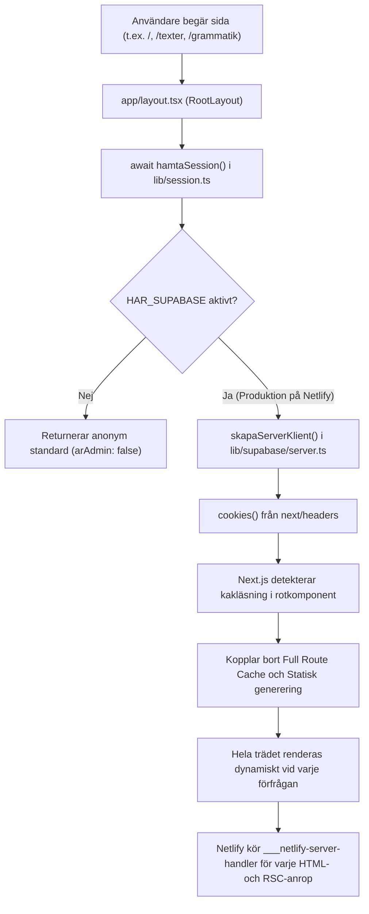

# E03 – Routematris och cachehinder

Datum: 2026-10-25  
Status: Slutförd och verifierad  
Referens: [`docs/drift/NETLIFY_OPTIMERINGSPLAN.md`](./NETLIFY_OPTIMERINGSPLAN.md)  
Föregående etapper: [`E01`](./E01-nulagesprotokoll.md), [`E02`](./E02-besokarresor-fore-andring.md)

---

## 1. Fullständig routematris

Matrisen omfattar samtliga sidor, layouter och API-rutter i applikationen:

| Rutt / Sökväg | Fil i `app/` | Datakälla | Nuläge (Byggtyp) | Dynamiska hinder | Målklassificering | Målpolicy för cache | Invalideringshändelse |
|---|---|---|---|---|---|---|---|
| **Rotlayout** | `app/layout.tsx` | Supabase auth | `Dynamic` | `cookies()` via `hamtaSession()` | Publik stabil ram | Sessionsoberoende | Aldrig (om inte global layout ändras) |
| **Startsida (`/`)** | `app/page.tsx` | `data/` el. `sidor` (DB) | `ƒ Dynamic` | `force-dynamic`, rotlayoutens session | **Publik föränderlig** | ISR / `s-maxage=86400` | `sparaStartinnehall` |
| **Texter (Katalog)** | `app/texter/[[...slug]]` | `data/texter.ts` (fil) | `ƒ Dynamic` | `force-dynamic`, rotlayoutens session | **Publik stabil** | SSG / `s-maxage=31536000` | Dokument skapas/ändras i träd |
| **Texter (Dokument)** | `app/texter/[[...slug]]` | `data/textdokument.ts` | `ƒ Dynamic` | `force-dynamic`, rotlayoutens session | **Publik föränderlig** | SSG / ISR `s-maxage=604800` | `sparaInnehall` (specifikt dokument) |
| **Grammatik (Katalog)** | `app/grammatik/[[...slug]]` | `data/grammatik.ts` | `ƒ Dynamic` | `force-dynamic`, rotlayoutens session | **Publik stabil** | SSG / `s-maxage=31536000` | Struktur ändras |
| **Grammatik (Artikel)** | `app/grammatik/[[...slug]]` | `data/dokument.ts` | `ƒ Dynamic` | `force-dynamic`, rotlayoutens session | **Publik föränderlig** | SSG / ISR `s-maxage=604800` | `sparaInnehall` (specifik artikel) |
| **Resursbibliotek (`/resurser`)** | `app/resurser/page.tsx` | `data/resurser.ts` / DB | `ƒ Dynamic` | `force-dynamic`, rotlayoutens session | **Publik föränderlig** | ISR `s-maxage=86400` | Resurs/hylla skapas el. ändras |
| **Västgötalagen PDF** | `app/resurser/vastgotalagen` | Statisk React | `○ Static` | *(inga, redan statisk)* | **Publik stabil** | `s-maxage=31536000` | Oförändrad |
| **Källor (`/kallor`)** | `app/kallor/page.tsx` | Redirect `/resurser` | `○ Static` | *(inga)* | **Publik stabil** | 308 Permanent Redirect | Oförändrad |
| **Ordbok (`/ordbok`)** | `app/ordbok/page.tsx` | `data/ordbok/poster.json` | `ƒ Dynamic` | `searchParams` (`q`, `letter`, etc.) | **Query-beroende** | Klientcache + CDN `s-maxage=3600` | Rättelse / modern definition sparas |
| **Ordbok Artikel (`/ordbok/[id]`)** | `app/ordbok/[id]/page.tsx` | `data/ordbok/poster.json` | `ƒ Dynamic` | Rotlayoutens session | **Publik föränderlig** | ISR `s-maxage=86400` + on-demand | `sparaOrdbokRattelseAction` |
| **Runsida (`/runor`)** | `app/runor/page.tsx` | `lib/runor/pilot-data.ts` | `○ Static` | *(inga)* | **Publik stabil** | `s-maxage=31536000` | Ny runversion publiceras |
| **Runpost (`/runor/[slug]`)** | `app/runor/[slug]/page.tsx` | `lib/runor/pilot-data.ts` | `● SSG` (20 st) | *(inga, generateStaticParams)* | **Publik stabil** | `s-maxage=31536000` | Ny runversion publiceras |
| **Admin (`/admin`)** | `app/admin/page.tsx` | Supabase auth | `ƒ Dynamic` | `force-dynamic`, inloggning | **Privat / Admin** | `private, no-store` | Skall förbli helt privat |
| **Admin Runor (`/admin/runor`)** | `app/admin/runor/page.tsx`| Supabase drafts/log | `ƒ Dynamic` | `force-dynamic`, inloggning | **Privat / Admin** | `private, no-store` | Skall förbli helt privat |
| **API Ordboksuppslag** | `app/api/ordbok/uppslag` | `lib/ordbok/ordbokServer` | `ƒ Dynamic` | `searchParams` (`ord`) | **Query-beroende** | `public, s-maxage=86400, stale=604800` | Rättelse sparas |
| **API Runor v1** | `app/api/runor/v1` | `lib/runor/contract.ts` | `ƒ Dynamic` | `searchParams` (filter) | **Query-beroende** | `public, s-maxage=3600, stale=86400` | Ny runversion |
| **API Runor v1 [slug]** | `app/api/runor/v1/[slug]` | `lib/runor/contract.ts` | `ƒ Dynamic` | `slug` param | **Publik stabil** | `public, s-maxage=86400` | Ny runversion |

---

## 2. Rotlayoutens beroendekedja (Rotorsak)

Beroendekedjan i [`app/layout.tsx`](file:///Users/oscarpagerup/Desktop/Git%20Repo/fornsvenska/app/layout.tsx) som orsakar global dynamisk rendering:

### Insikt för E04:
- Inga publika sidor (`/`, `/texter`, `/grammatik`, `/resurser`, `/ordbok`) behöver veta vem användaren är för att visa sin HTML.
- Klientkomponenterna ([`TextShell`](file:///Users/oscarpagerup/Desktop/Git%20Repo/fornsvenska/components/text/TextShell.tsx), [`DocShell`](file:///Users/oscarpagerup/Desktop/Git%20Repo/fornsvenska/components/dokument/DocShell.tsx), [`ResursBibliotek`](file:///Users/oscarpagerup/Desktop/Git%20Repo/fornsvenska/components/resurser/ResursBibliotek.tsx), [`Startsida`](file:///Users/oscarpagerup/Desktop/Git%20Repo/fornsvenska/components/start/Startsida.tsx)) anropar `useAdmin()` för att slå på redigeringsknappar.
- Genom att flytta sessionsinläsningen till klienten (en separat, lättvikts sessionsprovider som initialt antar anonym besökare och hämtar session asynkront i bakgrunden utan att blockera initial rendering), kan **rotlayouten bli 100 % statisk**.

---

## 3. Server Actions och cacheinvalideringsmatris

Kartläggning av samtliga Server Actions och deras påverkan på sidcachen:

| Fil | Server Action | Nuvarande invalidering | Problem i nuläget | Målinvalidering (E11) |
|---|---|---|---|---|
| `lib/actions.ts` | `sparaInnehall` | `revalidatePath('/', 'layout')` | Tömmer cachen för **hela sajten** vid sparning av en enskild text | `revalidatePath('/texter/' + slug)` och `revalidatePath('/grammatik/' + slug)` |
| `lib/actions.ts` | `skapaNod` | `revalidatePath('/', 'layout')` | Tömmer cachen för hela sajten | `revalidatePath('/' + root)` |
| `lib/actions.ts` | `bytTitel` | `revalidatePath('/', 'layout')` | Tömmer cachen för hela sajten | `revalidatePath('/' + root)` + berörd nod |
| `lib/actions.ts` | `flyttaNod` | `revalidatePath('/', 'layout')` | Tömmer cachen för hela sajten | `revalidatePath('/' + root)` |
| `lib/actions.ts` | `taBortNod` | `revalidatePath('/', 'layout')` | Tömmer cachen för hela sajten | `revalidatePath('/' + root)` |
| `lib/actions.ts` | `bytPosition` | `revalidatePath('/', 'layout')` | Tömmer cachen för hela sajten | `revalidatePath('/' + root)` |
| `lib/sidActions.ts`| `sparaStartinnehall` | `revalidatePath('/')` | Väl avgränsad | `revalidatePath('/')` (bevaras) |
| `lib/resursActions.ts` | Hyll- och resursåtgärder | `revalidatePath('/resurser')` | Väl avgränsad | `revalidatePath('/resurser')` (bevaras) |
| `lib/ordbok/rattelseActions.ts` | `sparaOrdbokRattelseAction` | `/ordbok`, `/ordbok/[id]`, `/admin` | Väl avgränsad | Bevaras |
| `lib/ordbok/moderniseringActions.ts` | `sparaModernDefinitionAction` | `/ordbok`, `/ordbok/[id]`, `/admin` | Väl avgränsad | Bevaras |

---

## 4. Middleware-analys ([`middleware.ts`](file:///Users/oscarpagerup/Desktop/Git%20Repo/fornsvenska/middleware.ts))

- **Plattform:** Körs som en Netlify Edge Function (inte i `___netlify-server-handler`).
- **Uppgift:** Förnyar Supabase-autentiseringstoken om sessionskaka finns.
- **Matcher:** Matchar alla URL:er utom statiska tillgångar (`_next/static`, bilder, etc.).
- **Slutsats:** Eftersom middleware körs på Edge och inte räknas av mot serverfunktionskvoten för `___netlify-server-handler` är middleware inte huvudorsaken till de 146 000 funktionsanropen. Däremot ska vi i E10 säkerställa att middleware inte sätter headers som förhindrar CDN-cache för anonyma anrop.

---

## 5. Prioriterad åtgärdsordning

Baserat på routematrisen ska optimeringarna genomföras i strikt ordning:

1. **E04: Separera session från publik layout (Högsta prioritet)**
   - Ta bort `hamtaSession()` från `app/layout.tsx`.
   - Låt rotlayouten vara sessionsoberoende och statisk.
   - Inför klientbaserad `AdminProvider` som läser sessionsstatus via ett dedikerat internt sessionsanrop eller Supabase browser client, så att redaktörer behåller sitt smidiga arbetsflöde medan anonyma besökare aldrig triggar sessionskod.
2. **E05: Säker offentlig dataläsning**
   - Skapa en anonym läsklient för Supabase utan `cookies()`.
3. **E06: Pilotoptimering av Startsidan (`/`)**
   - Ta bort `export const dynamic = "force-dynamic"` från `app/page.tsx`.
   - Konfigurera återvalidering / statisk generering.
4. **E07: Förgenerering och ISR för Texter och Grammatik**
   - Ta bort `force-dynamic` och inför `generateStaticParams()` för fasta noder.
5. **E08: Resursbibliotek och ordboksuppslag**
   - Cacheheaders på `/api/ordbok/uppslag` och avgränsad cache för `/resurser`.
