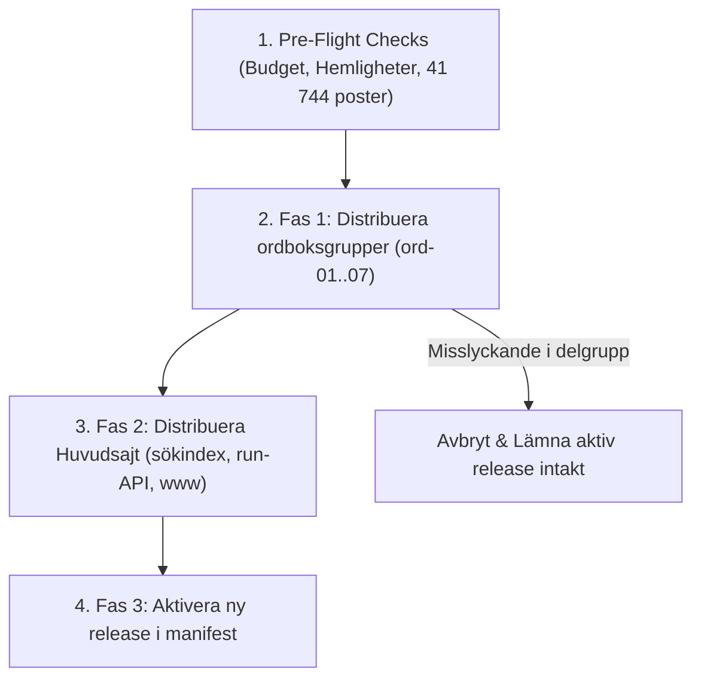

# CF11 – Byggkedja, samordnad release och återställning

## Sammanfattning
Denna rapport dokumenterar arkitekturen, genomförandet och verifieringen av den samordnade publiceringskedjan, versionshanteringen och återställningsprocessen (rollback) för Fornsvenska på Cloudflare Pages Free.

Eftersom Cloudflare Pages saknar inbyggd global flerprojektstransaktion (multi-project atomic deployment) har vi konstruerat en deterministisk, fasindelad orkestrering (`ReleaseOrchestrator`) med strikta förhandskontroller (pre-flight checks), fasindelad utrullning, idempotensskydd och en separat återställningsmotor.

---

## 1. Releasearkitektur och ID-schema

Varje release tilldelas ett unikt och reproducerbart versions-ID med formatet:
`cf-rel-YYYYMMDD-HHmmss-<shortId>` (t.ex. `cf-rel-20261101-163012-a1b2c3d4`).

### Beståndsdelar i en release:
1. **Ordboksgrupper (ord-01 till ord-07):**
   - 41 744 statiska HTML-artiklar fördelade på 7 tekniska Cloudflare Pages-projekt baserat på deterministisk routing (`scripts/cloudflare/routing.ts`).
   - Varje del innehåller `_headers` och `_redirects` för gruppen.
2. **Huvudsajt (huvudsajt / www):**
   - Textläsare, runinskrifter, resurser, startsida, bibliotek, bokvy.
   - Komprimerade sökindex (`data/search/headwords-compact.json`).
   - Run-API-exporter (`public/api/runor/v1/`).
   - Globala omdirigeringsregler i `_redirects` (HTTP 301 från `/ordbok/:id` till rätt `ord-XX.fornsvenska.se`).
3. **Release-manifest (`release-manifest.json`):**
   - Innehåller snapshot-ID, git commit-hash, aktör, tidsstämpel och status för alla delprojekt.

---

## 2. Automatiska förhandskontroller (Pre-flight checks)

Innan någon fil distribueras körs automatiska spärrar:
- **Fullständighetskontroll:** Verifierar att samtliga 41 744 artiklar finns genererade och är unika.
- **Filbudget per delprojekt:** Kontrollerar att ingen ordboksgrupp överskrider Cloudflare Pages Free-gränsen på 20 000 filer (vår interna säkerhetsgräns är satt till 16 000 filer; största gruppen har 13 803 filer).
- **Maximal filstorlek:** Ingen fil får överskrida 25 MB (största filen i ordboken är 66 KB, största sökindexet är ca 1.9 MB).
- **Hemlighetskontroll:** Skannar alla statiska distributionsfiler efter `SUPABASE_SERVICE_ROLE_KEY`, `RESEND_API_KEY` och `CLOUDFLARE_API_TOKEN`. 0 hemligheter i publika artefakter.
- **Indexintegritet:** Säkerställer att sökindex och runexportfiler är intakta och parses utan fel.

Om någon kontroll fallerar avbryts processen omedelbart utan att förändra det aktiva produktionstillståndet.

---

## 3. Fasindelad samordnad utrullning

Cloudflare Pages uppdateras per projekt. För att förhindra brutna referenser (dead links) sker publiceringen i följande strikta ordning:



### Varför denna ordning?
Genom att driftsätta `ord-01..07` **före** `huvudsajt` garanteras att när det nya sökindexet och de nya länkarna aktiveras på huvudsajten, finns alla motsvarande artiklar redan publicerade och tillgängliga på respektive underdomän.

---

## 4. Blandversionsfönster (Mixed-version window)

Eftersom DNS och CDN-cacher sprids asynkront och användare kan ha gamla flikar öppna i webbläsaren:
1. **Artikellänkar är stabila och oföränderliga:** Adressen till en artikel förblir `/ordbok/<id>` och routas deterministiskt till samma underdomän (`ord-XX.fornsvenska.se`).
2. **Klientkompatibilitet:** Ett äldre sökindex som refererar till en artikel leder till en artikel som fortsätter att existera.
3. **Korsdomänsresurser:** Web Worker och Storage Bridge använder versionsagnostiska meddelandeprotokoll (`window.postMessage`) med `origin`-validering mot `*.fornsvenska.se`.

---

## 5. Dokumenterade felinjektioner i testmiljö

I enlighet med godkännandekriterierna för CF11 har följande felscenarier testats och verifierats i `tests/cloudflare-cf11.test.mjs`:

### 1. Misslyckad delgruppsdeploy (Felinjektion 1)
- **Scenario:** Under utrullning av ordboksdelarna injiceras ett simulerat nätverksfel på `ord-04`.
- **Observerat utfall:** Orkestreraren detekterar omedelbart felet, avbryter utrullningen av efterföljande grupper och huvudsajten, samt sätter jobbstatusen till `FAILED`.
- **Verifiering:** Den tidigare aktiva releasen (`activeReleaseId`) förblir 100 % orörd. Inga brutna länkar skapas för användare.

### 2. Idempotens och dubbelklicksskydd (Felinjektion 2)
- **Scenario:** Administratören klickar två gånger snabbt på "Publicera", vilket skickar två samtidiga förfrågningar med samma `idempotencyKey`.
- **Observerat utfall:** Den andra förfrågan upptäcker det pågående jobbet och ansluter till samma jobb-ID i stället för att starta ett konkurrerande bygge.
- **Verifiering:** Exakt 1 releaseprocess exekveras; inga dubbelbyggen eller race conditions.

### 3. Reversibel rollback (Atomär återställning)
- **Scenario:** Efter en genomförd release begär en administratör en återställning till en föregående release (`executeRollback(targetReleaseId)`).
- **Observerat utfall:** Den aktiva releasen växlas direkt till den tidigare stabila versionen.
- **Verifiering:** Redaktionella utkast i redaktionslagret (autosparade revisioner skapade efter releasen) raderas **inte** och förblir orörda för vidare bearbetning.

### 4. Månatlig gratisbudget (Kvotkontroll)
- **Scenario:** Verifiering mot Cloudflare Pages Free-gränsen på 500 byggen per månad.
- **Budget:** Fornsvenska budgeterar för maximalt 28 samordnade byggen per månad (8 projekt × 28 = 224 byggoperationer), vilket ger en betryggande säkerhetsmarginal på över 55 % till gratistaket.

---

## 6. Operatörsinstruktion (CLI & API)

Publicerings- och återställningsoperationer kan styras via CLI-skriptet `scripts/cloudflare/release.ts`:

### Förhandskontroll (Pre-flight checks):
```bash
npx tsx scripts/cloudflare/release.ts --check
```

### Skapa och driftsätta en ny release:
```bash
npx tsx scripts/cloudflare/release.ts --release
```

### Återställ till tidigare release (Rollback):
```bash
npx tsx scripts/cloudflare/release.ts --rollback cf-rel-20261101-120000-xxxx
```

---

## 7. Status och godkännande

Etapp CF11 är härmed **lokalt verifierad**:
- Samtliga 7 enhets- och integrationstester i `tests/cloudflare-cf11.test.mjs` passerar utan fel.
- Full paritet och stabilitet med 0 TypeScript-fel (`npx tsc --noEmit`).
- Samtliga 48 Cloudflare-specifika tester (CF03–CF11) passerar.

Nästa steg är **CF12 (Samlad acceptans)** för komplett slutverifiering av hela plattformen.
